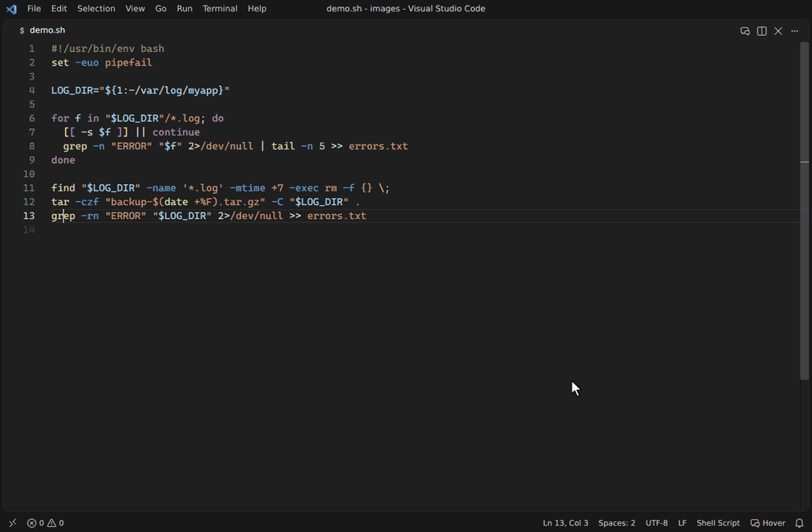
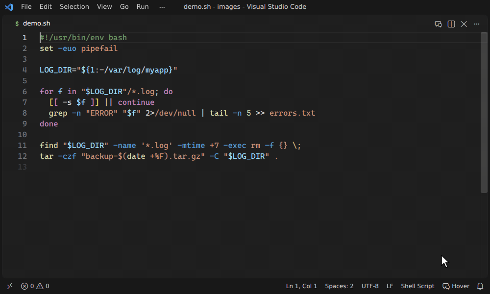
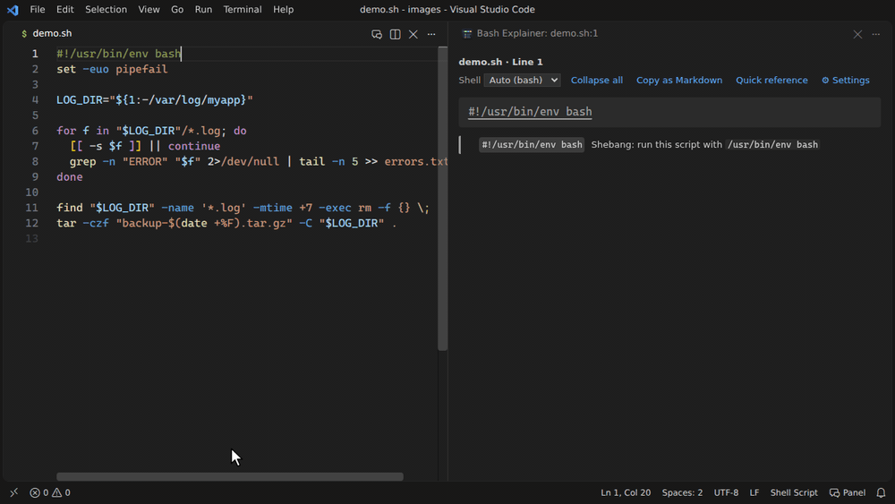
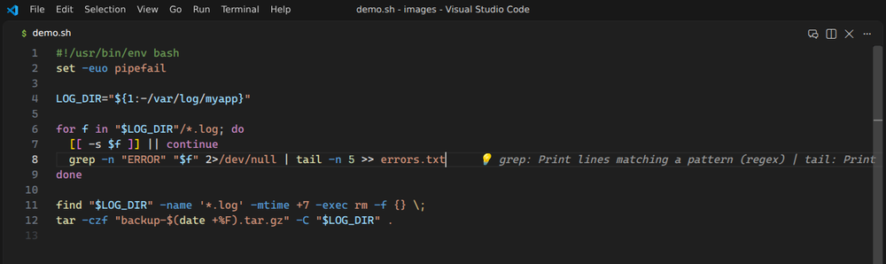

# Bash Explainer

[](https://marketplace.visualstudio.com/items?itemName=shun-fujioka.bash-explainer)
[](https://open-vsx.org/extension/shun-fujioka/bash-explainer)
[](https://github.com/sf624/bash-explainer/actions/workflows/test.yml)
[](https://github.com/sf624/bash-explainer/actions/workflows/test.yml)
[](#プライバシー)
[](LICENSE) [](./README.md)


シェルスクリプトを1行ずつ解説します。シェルスクリプト版の [regex101](https://regex101.com/) を目指しています。

行にマウスを乗せると、コマンド・オプション・リダイレクト・`${…}` がそれぞれ何をしているかを、書き換えて試せる具体例つきで解説します。知らないスクリプトを読むときにも、シェルを学ぶときにも、教えるときにも役立ちます。

**設定不要で、[設計上オフラインで動きます](#プライバシー)。** 通信も AI もテレメトリも使いません。日本語と英語に対応しています。



Bash Explainer は VS Code の拡張機能としてだけでなく、同じ解説と警告をほかの形でも使えます。インストールせずに試せるブラウザ版、コマンドラインツール、他のエディタ向けの Language Server、PR でスクリプトを検査する GitHub Action です。

## 使える場所

| 場所 | 使い方 |
| --- | --- |
| **VS Code** | Marketplace から **[Bash Explainer](https://marketplace.visualstudio.com/items?itemName=shun-fujioka.bash-explainer)** をインストールし、シェルスクリプトを開いて行にマウスを乗せます。詳しくは [VS Code で使う](#vs-code-で使う) を参照してください。 |
| VSCodium など Open VSX を使うエディタ | [open-vsx.org/extension/shun-fujioka/bash-explainer](https://open-vsx.org/extension/shun-fujioka/bash-explainer) |
| vscode.dev と github.dev | 同じ拡張が VS Code for the Web でも動きます（GitHub のリポジトリで `.` を押す）。 |
| **ブラウザ**（インストールなし） | [ブラウザ版](https://sf624.github.io/bash-explainer/) にスクリプトを貼り付けて、カーソルを動かします。 |
| **ターミナル** | `npx bash-explainer deploy.sh:12`、または `npm install --global bash-explainer`。詳しくは [cli/README.md](cli/README.md#installation) を参照してください。 |
| **Neovim、Helix、Emacs** など LSP に対応したエディタ | `bash-explainer --lsp` が Language Server として、同じホバー、警告、クイックフィックスを提供します。設定例は [In your editor](cli/README.md#in-your-editor-language-server) を参照してください。 |
| **CI** | GitHub Actions で `uses: sf624/bash-explainer@v0` とすると、警告が PR の差分に表示されます。他の CI では `npx bash-explainer --check` を使います。詳しくは [In CI](cli/README.md#in-ci-github-actions) を参照してください。 |

## こんなことがわかります

| 書いたもの | Bash Explainer の解説 |
| --- | --- |
| `tar -czf backup.tgz -C src .` | `-c`・`-z`・`-f`・`-C src` がそれぞれ何をするか |
| `cmd 2>&1 > out.log` | 標準出力と標準エラー出力の行き先。この書き方ではエラーがファイルに入らないこと |
| `echo "${file%.*}"` | `file=report.tar.gz` → `report.tar` |
| `sed -E 's/^([a-z]+)=(.*)$/\2=\1/'` | 正規表現の部品ごとの意味と、入力例 `a=x` → 出力 `x=a` |
| `#!/bin/sh` の中の `[[ -f $f ]]` | ⚠ dash では `[[ ]]` が動かないこと。`[ -f "$f" ]` へのクイックフィックス付き |
| Dockerfile の `RUN apt-get update && …` | Dockerfile・Makefile・CI の YAML・Jenkinsfile・`package.json`・Python の中のシェルも同じように解説 |

## 解説できるもの

| | 例 |
| --- | --- |
| コマンドとオプション | 約330のコマンド・組み込みコマンド（`grep`、`sed`、`awk`、`find`、`curl`、`tar`、`git`、`docker`、`apt-get`、`gpg`、`systemctl`、`kubectl`、`helm`、`terraform`、`aws`、`go` など）。まとめたオプション（`-rn`）、値付きのオプション（`-o pipefail`、`--include=*.sh`）、サブコマンド（`git commit`）、他のコマンドから実行されるコマンド（`sudo`、`xargs`、`find -exec`） |
| 演算子とリダイレクト | `\|`、`&&`、`\|\|`、`;`、`&`、`>`、`>>`、`2>&1`、`&>`、ヒアドキュメント、ヒアストリング。リダイレクトの順序の影響も |
| 展開 | `${var:-default}`、`${file%.sh}`、`${#array[@]}`、`$?`、`$@`、`$(…)`、`<(…)`、`$((…))` を部品に分けて解説 |
| 引数の中の言語 | 正規表現（オプションに応じて BRE・ERE・PCRE）、sed スクリプト、awk プログラム、jq・yq のフィルタ、perl のワンライナー、`printf`・`date` の書式、`find` の条件式、`chmod` のモード、`sort -k`・`cut -f`・`tr` の指定、`getopts`・`getopt` のオプション文字列、`git log --pretty`・`--date` |
| 制御構文 | `if`、`for`、`while`、`case`、関数。ブロック内の行では「for ループ › if 文」のように位置も表示 |
| 定番の書き方と落とし穴 | `IFS= read -r`、スクリプトのディレクトリを得る書き方、strict mode、`trap … EXIT`、`command -v … >/dev/null 2>&1` など。`x = 1`、空の `DIR` での `rm -rf $DIR/…`、クォートしていない変数、`for f in $(ls)`、`-r` のない `read`、`local x=$(cmd)`、`sudo cmd > /etc/…` で何が起きるか |

## 具体例

多くの書き方に、入力例とその出力を表示します。計算は組み込みの実行器で行い、テストで実物（GNU sed・coreutils、gawk、jq、perl、bash、git、yq）と照合しています。

| 対象 | 表示される内容 |
| --- | --- |
| `grep` のパターン、`[[ =~ ]]`、グロブ、`case` のパターン | 一致する文字列と一致しない文字列 |
| `sed`・`awk`・`jq`・`yq`・`perl`・`sort`・`uniq`・`cut`・`tr`・`head`・`tail` | 入力例 → 出力 |
| パイプライン全体 | 段ごとの途中経過 |
| `${…}` の展開、`printf`、ブレース展開 | 展開・出力される値 |
| `[ ]`・`[[ ]]`・`(( ))` | 真になる値と偽になる値 |
| `xargs`・`read`・`getopt` | 実行されるコマンド、変数に入る値、引数の並び替え結果 |
| `git log --pretty`・`--date` | 例のコミットでの表示 |
| `date +書式` | 決まった2つの日時での出力（パネルで日時を書き換えられる） |

具体例は、対応する部分の解説の真下に表示します（`bashExplainer.examples.placement` で変更可）。

## bash 以外のシェル向けのスクリプト

解説は bash に基づきますが、スクリプトが別のシェル向けのときは、そのシェルにない書き方や、意味が変わる書き方も指摘します。

```sh
#!/bin/sh
[[ -n $name ]] && echo -e "hi\t$name"
# ⚠ `[[ ]]`は POSIX sh にない書き方です（dash では動きません）。代わりに `[ ]` を使う。
# ⚠ `echo -e`は POSIX sh にない書き方です（dash では動きません）。代わりに `printf` を使う…
```

- **対応シェル:** POSIX `sh`（dash と busybox ash で動かないものを明記）、`dash`、`ash`、`yash`、`ksh`、`mksh`、`zsh`。どのシェルで何が動くかは、各シェルで実測しています。
- **シェルの判定:** shebang（`#!/bin/sh`、`#!/usr/bin/env dash` など）、`# shellcheck shell=` の行、ファイル名から判定します。`bashExplainer.shell` で指定もできます。

## 他のファイルの中のシェル

| ファイル | 解説する部分 |
| --- | --- |
| Dockerfile | `RUN`・`CMD`・`ENTRYPOINT`（シェル形式、`RUN <<EOF`、exec 形式、`["sh", "-c", "…"]`）と `SHELL [...]`。`pipefail` なしの `RUN` のパイプで失敗が見逃される場合は警告 |
| Makefile | レシピ。make の `$(VAR)`・`$@`・`$$` も説明 |
| CI の YAML | GitHub Actions の `run:`（ワークフローと `action.yml`。`shell:` や `defaults` に従う）、GitLab CI の `script:`、CircleCI の `run:`・`command:`、Azure Pipelines の `script:`・`bash:`（`$(変数)` のマクロも）。`${{ github.event.pull_request.title }}` のような外部からの入力をスクリプトに埋め込むと警告 |
| `package.json` | `scripts` |
| Markdown | `sh`・`bash`・`console` などのコードブロック |
| Python | `subprocess.run(…)`・`os.system(…)` など。`shell=True` なしの文字列や、シェルに値を埋め込む書き方を指摘 |
| Jenkinsfile | `sh '…'`・`sh "…"`・`sh '''…'''`・`sh(script: …)`。シェルより先に Groovy が埋め込む `$名前` や `${…}` を指摘 |

それぞれ、実際に実行するシェル向けの書き方になっているかも確認します（Dockerfile と Makefile は `SHELL` の指定がなければ `/bin/sh`）。対象にするファイルの種類は `bashExplainer.embedded.files` で選べます。

## yq

`yq` という名前のツールは3種類あり、記法がそれぞれ違います。**mikefarah/yq v4**、**kislyuk/yq**（jq のラッパー）、古い **mikefarah/yq v3** です。Bash Explainer は、オプション・サブコマンド・関数や、同じファイル内のインストール方法からどれ向けかを判定し、その結果を行ごとに表示します。

> yq: mikefarah/yq v4（v4.22.1 以降）として解説。根拠: `-o json` は mikefarah/yq v4 のオプション、`pick` は mikefarah/yq の関数（jq にはない）
> 互換性: mikefarah/yq v4（v4.22.1 以降） ✓ ／ kislyuk/yq ✗（`-o json`・`pick` が使えない） ／ mikefarah/yq v3 ✗（jq 形式の式・`-o json` が使えない）

各機能がどのリリースで入ったかは、4.x の全マイナーリリースで実際に動かして調べています。判定できないときは mikefarah/yq v4 として扱います。`bashExplainer.yq.flavor` で種類を固定することもできます。

## 警告とクイックフィックス

警告は VS Code の「問題」パネルにも表示されるので、マウスを乗せなくても気づけます。コマンドラインツール（`--check`）、Language Server、GitHub Action からも同じ警告が出ます。意味を変えずに書き換えられる場合は、クイックフィックスも出します。

| 修正前 | 修正後 |
| --- | --- |
| `[[ -f $f && -n $x ]]` | `[ -f "$f" ] && [ -n "$x" ]` |
| `[ "$a" == b ]` | `[ "$a" = b ]` |
| `source ./lib.sh` | `. ./lib.sh` |
| `function f {` | `f() {` |
| `cmd &> log` | `cmd > log 2>&1` |
| `cmd \|& tee log` | `cmd 2>&1 \| tee log` |

クイックフィックスは、スクリプトのシェルがその書き方に対応していない場合で、かつ意味が変わらない場合だけ出します。例えば `[[ $f == *.txt ]]` はパターン一致なので出しません。書き換え結果は、元の書き方を bash で実行した場合と dash で同じ結果になることをテストで確認しています。警告を消すには、その前の行（または同じ行のコードの後ろ）に `# bash-explainer disable=<コード>`、ファイル全体なら `# bash-explainer disable-file=<コード>` を書くか、`bashExplainer.diagnostics.ignore` にコードを指定します（`all` ですべて）。「問題」パネルへの表示自体は `bashExplainer.diagnostics.enabled` でオフにできます。

## VS Code で使う

### クイックスタート

1. Visual Studio Marketplace から **[Bash Explainer](https://marketplace.visualstudio.com/items?itemName=shun-fujioka.bash-explainer)** をインストールします。
2. シェルスクリプト（`.sh`、`.bash` など）を開きます。
3. 知りたい行にマウスを乗せます。キーボードなら、カーソルを置いて `Ctrl+K Ctrl+E`（macOS は `Cmd+K Cmd+E`）です。

カーソルに追従するサイドペインで見たいときは、ホバーの下の **パネルで詳しく見る** をクリックします。

### インストール

- **Marketplace:** [shun-fujioka.bash-explainer](https://marketplace.visualstudio.com/items?itemName=shun-fujioka.bash-explainer)
- **VS Code の中から:** 拡張機能ビュー（`Ctrl+Shift+X` / `Cmd+Shift+X`）で *Bash Explainer* を検索します。またはクイックオープン（`Ctrl+P` / `Cmd+P`）で `ext install shun-fujioka.bash-explainer` を実行します。
- **コマンドライン:** `code --install-extension shun-fujioka.bash-explainer`
- **VSCodium など Open VSX を使うエディタ:** [open-vsx.org/extension/shun-fujioka/bash-explainer](https://open-vsx.org/extension/shun-fujioka/bash-explainer)
- **VS Code for the Web:** [vscode.dev](https://vscode.dev) や [github.dev](https://github.dev)（GitHub のリポジトリで `.` を押す）でも動きます。

VS Code 1.85 以降が必要です。ネイティブの依存はなく（構文解析は WebAssembly）、VS Code が動く環境ならどこでも動きます。

### 表示方法

| | 使い方 | 既定 |
| --- | --- | --- |
| **ホバー** | 行にマウスを乗せる。またはカーソル行で `Ctrl+K Ctrl+E` | オン |
| **パネル** | カーソルに追従するサイドペイン。regex101 のように色分けし、具体例の入力を書き換えて結果を確かめられる | ホバーやエディタのタイトルバーから開く |
| **インライン** | カーソル行の行末に1行の要約を薄く表示 | オフ |

ステータスバーの **Bash Explainer** をクリックすると、それぞれオン/オフできます。

#### ホバー

行にマウスを乗せると、その場で分解した解説が出ます。



#### パネル

パネルはカーソル行に追従します。ツリーの項目を指すと、エディタ側の該当箇所がハイライトされます。



#### インライン

カーソル行の行末に、1行の要約が出ます。



### パネル

パネルは regex101 と同じように使えます。

- **具体例を書き換える:** grep や `[[ =~ ]]` のテスト文字列、sed・awk・jq・perl・`sort`・`cut`・`xargs`・パイプライン全体の入力を書き換えると、出力がその場で更新されます。
- **一致した部分を見る:** 入力の中の一致部分を色付けし、キャプチャグループごとに、解説ツリーのグループと同じ色で示します。`\1`・`\2`… に入る文字列も一覧にします。
- **シェルや yq を切り替える:** ヘッダーで、そのファイルの対象シェルや yq の種類を切り替えると、解説と警告がすぐ変わります。
- **折りたたみ・コピー・早見表:** 解説ツリーを折りたたんだり、Markdown としてコピーしてレビューやドキュメントに貼ったりできます。展開・リダイレクト・条件式・変数・コマンドを検索できる早見表もあります。

### コマンド

| コマンド | ショートカット・呼び出し場所 |
| --- | --- |
| Bash Explainer: カーソル行の bash を解説 | `Ctrl+K Ctrl+E` / `Cmd+K Cmd+E` |
| Bash Explainer: bash の解説パネルを開く | エディタのタイトルバー、ホバー |
| Bash Explainer: ホバー・インライン・パネルの表示を切り替え | ステータスバー |
| Bash Explainer: 設定を開く | ホバー、パネル |

### 設定

| 設定 | 既定値 | 説明 |
| --- | --- | --- |
| **表示** | | |
| `bashExplainer.hover.enabled` | `true` | マウスを乗せた行の解説をホバーで表示（`Ctrl+K Ctrl+E` はオフでも使える） |
| `bashExplainer.hover.followCursor` | `false` | カーソルが移動するたびにホバーを表示 |
| `bashExplainer.hover.followDelay` | `400` | その表示までの遅延（ミリ秒） |
| `bashExplainer.hover.maxDepth` | `0` | ホバーに表示する解説ツリーの階層数（`0` はすべて） |
| `bashExplainer.panel.autoOpen` | `false` | シェルスクリプトを開いたらパネルを自動で開く |
| `bashExplainer.inline.enabled` | `false` | カーソル行の行末に1行の要約を表示 |
| `bashExplainer.inline.maxLength` | `120` | その要約の最大文字数 |
| `bashExplainer.examples.enabled` | `true` | 具体例を表示する |
| `bashExplainer.examples.disabled` | `[]` | 表示しない具体例の種類: `regex`・`sed`・`awk`・`jq`・`yq`・`perl`・`textFilters`・`pipeline`・`expansion`・`printf`・`glob`・`test`・`xargs`・`read`・`getopt`・`gitLog`・`date` |
| `bashExplainer.examples.inHover` | `true` | ホバーにも具体例を表示する（オフならパネルだけ） |
| `bashExplainer.examples.placement` | `first` | 具体例を対応する部分の下の、各要素の解説より先（`first`）・後（`last`）、またはすべての解説の後（`bottom`）に表示 |
| `bashExplainer.language` | `auto` | `auto`（VS Code の表示言語に合わせる）・`ja`・`en` |
| `bashExplainer.notes.idioms` | `true` | 定番の書き方（strict mode、`IFS= read -r` など）の補足を表示する |
| `bashExplainer.notes.pitfalls` | `true` | よくある間違いと避け方を注記する（`x = 1`、クォートしていない変数、`for f in $(ls)` など） |
| **確認** | | |
| `bashExplainer.shell` | `auto` | スクリプトの対象シェル: `auto`・`bash`・`sh`・`dash`・`ash`・`yash`・`ksh`・`mksh`・`zsh` |
| `bashExplainer.diagnostics.enabled` | `true` | 警告を「問題」パネルにも表示（クイックフィックス付き） |
| `bashExplainer.diagnostics.ignore` | `[]` | 出さない警告のコード（「問題」パネルに表示されるコード。`dbracket`・`echoE`・`dockerPipefail` など） |
| `bashExplainer.diagnostics.embedded` | `true` | 他のファイルの中のシェルの警告も出す |
| `bashExplainer.yq.flavor` | `auto` | `auto`・`mikefarah4`・`kislyuk`・`mikefarah3` |
| **ファイル** | | |
| `bashExplainer.embedded.files` | すべて | 中のシェルを解説するファイル: `dockerfile`・`makefile`・`yaml`・`packageJson`・`markdown`・`python`・`jenkinsfile` |
| `bashExplainer.languages` | `["shellscript"]` | シェルスクリプトとして解説する言語 ID |
| **辞書** | | |
| `bashExplainer.customCommands` | `{}` | 辞書にないコマンドの説明を追加する（下記） |

#### 自分のコマンドを追加する

社内ツールなどは、説明を書くまで「外部コマンド」として表示されます:

```json
"bashExplainer.customCommands": {
  "deploy": {
    "summary": "サービスを本番にデプロイする",
    "options": {
      "-n|--dry-run": "実行せずに内容だけ表示",
      "-e": { "description": "デプロイ先の環境", "takesValue": true }
    },
    "arguments": ["サービス名"]
  }
}
```

## コマンドライン、他のエディタ、CI

コマンドラインツール、Language Server、GitHub Action は、1つの npm パッケージ [`bash-explainer`](cli/README.md) にまとまっています。オプション、出力形式（テキスト、Markdown、JSON、SARIF、GitHub のアノテーション）、Neovim・Helix・Emacs の設定、Action の入力は、そちらの README を参照してください（英語）。

## 制限事項

- 解説はルールベースです。辞書に無いコマンドは「外部コマンド」として表示され、オプションの詳細は出ません。
- 構文解析に使っている文法の都合で、正しく解析できない書き方があります（例: `*(.)` のような zsh 独自の書き方や、bash ではテスト全体を否定する `[[ ! $x =~ re ]]`。後者は `(! $x) =~ re` と読まれます）。文法に当てているパッチが直すのは、`&&` や `||` と並んだ `[[ ]]` 内の `=`・`==`・`=~` と、`${s:$i+1}` のオフセットに入る変数だけです。

## プライバシー

Bash Explainer は、設計上すべてオフラインで動きます。

- **通信しません。** 拡張にはネットワーク接続を開くコードが含まれていません。パネルも Content Security Policy で外部へのリクエストを禁止しています。
- **AI を使いません。** [tree-sitter-bash](https://github.com/tree-sitter/tree-sitter-bash) で構文解析し、組み込みの辞書で解説します。同じ行には毎回同じ解説が出ます。
- **テレメトリはありません。** 拡張は何も収集しません。
- **外部プロセスを起動しません。** 具体例の結果は組み込みのコードで計算します。手元のツールを実行することはありません。

配布する拡張に通信やプロセス起動の API が入ると、[CI のチェック](test/offline.test.ts)でビルドが失敗します（[実行履歴](https://github.com/sf624/bash-explainer/actions/workflows/test.yml)）。さらに[結合テスト](integration/extension.itest.ts)で、配布するのと同じ拡張を実際の VS Code で動かし、接続を開いたりプロセスを起動したりすれば失敗するようにしています。Linux ではネットワークのまったくない環境で動かしています。ご自身で確かめることもできます。`.vsix` は zip ファイルなので中身を確認でき、ネットワークを切った環境でもそのまま動きます。

[ブラウザ版](https://sf624.github.io/bash-explainer/) も同じです。ページは GitHub Pages から配信されますが、スクリプトの構文解析と解説はブラウザの中で行い、どこにも送りません。ページの Content Security Policy は他のサイトへのリクエストを一切許可していません。スクリプトを共有するリンクでは、スクリプトを `#` より後ろに入れます。ブラウザはこの部分をサーバーに送りません。ページも同じ CI のチェックの対象です。さらに、ページを Chromium で開いて他のサイトへのリクエストをすべて遮断し、オフラインにしたまま使い続けるテストも行っています。

VS Code for the Web では、拡張はお使いのブラウザの中で動きます。VS Code は拡張のファイル（構文解析器を含む）を Marketplace から読み込みますが、スクリプトの解説はブラウザの中で行い、どこにも送りません。

[コマンドラインツール](cli/README.md)（Language Server を兼ねます）も同じです。ネットワーク接続を開いたりプロセスを起動したりするコードを含まず、同じ CI のチェックで確かめています。さらに、通信やプロセス起動のモジュールを塞いだ状態で動かすテストも行っています。ネットワークを使うのは入手するときだけです。`npx` と GitHub Action は npm からダウンロードしますが、インストール後はオフラインで動きます。

ここで述べているのはこの拡張、ブラウザ版、コマンドラインツールの性質で、VS Code 本体、他の拡張、お使いのブラウザ、npm、GitHub Actions は含みません。本拡張は無保証で提供されます（[LICENSE](LICENSE) を参照）。機密性の高いデータに使う場合は、ご自身の要件に照らして評価してください。

## リリースノート

[CHANGELOG.md](CHANGELOG.md) を参照してください。

## 開発

不具合報告やプルリクエストは [github.com/sf624/bash-explainer](https://github.com/sf624/bash-explainer) へどうぞ。

```sh
npm install
npm run build      # dist/ にバンドル（wasm もコピー）
npm test           # 型チェック + 単体テスト
npm run coverage   # カバレッジ付きの単体テスト（レポートは coverage/index.html）
npm run package    # .vsix を作成
node scripts/build-grammar.mjs   # grammar/tree-sitter-bash.wasm を作り直す（tree-sitter-bash に patches/tree-sitter-bash/grammar.patch を当てる。初回はネットワークが必要で、npx が tree-sitter-cli を、CLI が wasi-sdk をダウンロードする）
npm run test:integration   # 拡張を VS Code で動かしてテスト（VS Code は .vscode-test/ にダウンロード）
npm run test:integration:web   # VS Code for the Web でも同様に（`npx playwright install chromium` が必要）
```

- VS Code でこのフォルダを開いて `F5` を押すと、`test/fixtures/sample.sh` を開いた拡張機能開発ホストが起動します。
- `npm run build:web` でブラウザ版を `site/` にビルドします。`python3 -m http.server -d site` で <http://localhost:8000/> から確認できます。
- `npx tsx test/dump.ts <file> [ja|en] [line]` で、ファイルの各行の解説をテキストで確認できます。
- このリポジトリの中でコマンドラインツールを試すには、`npm run build:cli` のあと `node cli/dist/cli.js <file>`（または `npx --package=./cli bash-explainer <file>`）を使います。単に `npx bash-explainer` と打っても、ここでは動きません。拡張自身の `package.json` も名前が `bash-explainer` なので、npx がこのプロジェクトをパッケージだと解釈するためです。
- 実物と照合するテストは、`PATH` または `$BASH_EXPLAINER_SHELLS` にあるシェルと、`$BASH_EXPLAINER_YQ` にある yq を使います。無いものはスキップされます。ブラウザ版のテストには Chromium が必要です（`npx playwright-core install --with-deps chromium-headless-shell`）。
- CI では、ツールをすべて入れた状態で単体テストのカバレッジを計測します（Node.js 24 のジョブ）。実行結果のページにカバーされていない部分の多いファイルが並び、成果物 `coverage` に HTML のレポートが入ります。ローカルで計測すると、ツールがない分のテストが飛ばされるので低めに出ます。また、CI と同じ Node.js 24 を使ってください。古い版では、一度も実行されなかったメソッドが実行済みとして数えられます。時刻帯によって通る分岐が変わるので、`npm run coverage` は CI と同じく UTC で実行します。レポートでは、テストのために tsx がソースを変換するときに足すコード（補助関数や export の getter）を数えません。これらはどのテストでも実行できない位置に対応づけられるためです（[scripts/coverage-report.mjs](scripts/coverage-report.mjs)）。
- `src/` のすべての行は単体テストで実行され、すべての分岐を通る必要があります。そうでなければ CI が失敗します（`npm run coverage:check`）。まだ届いていないファイルは [coverage-floors.json](coverage-floors.json) に今の割合とともに載っていて、それを下回ってはいけません。テストを足したら `node scripts/coverage-check.mjs --update` で下限を引き上げ、100% に届いたファイルを一覧から外します。どのテストも通れない分岐は削除します。ほかの部分の不具合に備える分岐の場合は、理由をコメントに書いて `/* c8 ignore next */` を付けます。VS Code 側（`extension.ts`、`service.ts`、描画以外の `ui/`）は結合テストに任せます。先頭のカバレッジのバッジは固定の表示ですが、100% を下回ると CI が失敗するので、常に正しい状態が保たれます。
- 依存パッケージを変えたら `npm run notices` を実行して、ビルドに実際に含まれるものから [THIRD_PARTY_NOTICES.md](THIRD_PARTY_NOTICES.md) を作り直してください。古いままのときや、まだ確認していないライセンスのものが入ったときは、テストが失敗します。
- 日本語の解説は [docs/japanese-style.md](docs/japanese-style.md) の決まりに合わせてください（テストで確かめます）。
- コマンドを追加するには [`src/dict/commands.ts`](src/dict/commands.ts) に `cmd(日本語の説明, 英語の説明, [オプション…], { positional: […] })` を追加します。
- リリースするには、`package.json` と `cli/package.json` の `version` を上げて `CHANGELOG.md` に節を追加し、`v<version>` のタグを push します。[Release ワークフロー](.github/workflows/release.yml) がテストとパッケージ作成を行い、`release` 環境での承認を待ってから、VS Code Marketplace、Open VSX、npm に公開し、GitHub Release の作成、GitHub Action が使う `v0` タグの付け替え、ブラウザ版の更新を行います。手順と、最初に一度だけ必要な設定は [docs/publishing.md](docs/publishing.md) を参照してください。

## ライセンス

[MIT](LICENSE)。同梱しているサードパーティのソフトウェアは [THIRD_PARTY_NOTICES.md](THIRD_PARTY_NOTICES.md) を参照してください。
