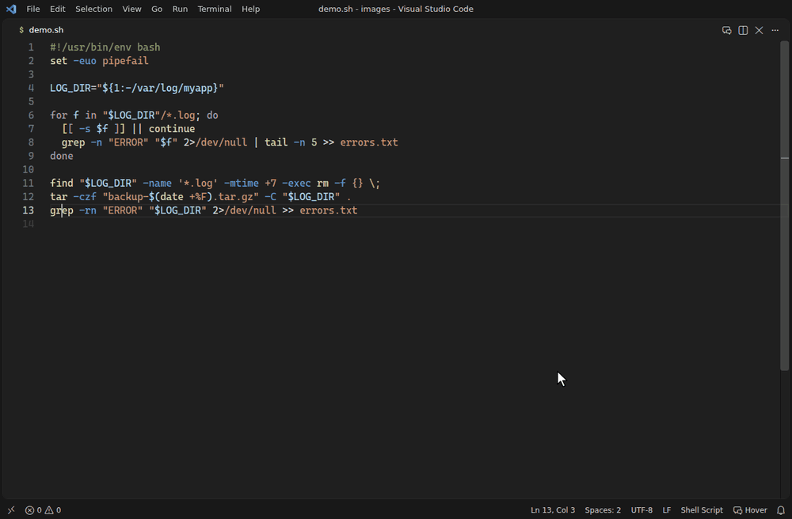

# <picture><source media="(prefers-color-scheme: dark)" srcset="images/readme/logo-dark.png"></picture>

 

<!-- development-note -->
> この README は `main` ブランチの開発版について書いています。公開済みの版より先の機能を含むことがあります。公開済みの版は [Marketplace](https://marketplace.visualstudio.com/items?itemName=shun-fujioka.bash-explainer) と [Open VSX](https://open-vsx.org/extension/shun-fujioka/bash-explainer) のページで見られます。README を含むソースは、[最新リリース](https://github.com/sf624/bash-explainer/releases/latest)のタグにあります。
<!-- /development-note -->

シェルスクリプトを1行ずつ解説します。シェルスクリプト版の [regex101](https://regex101.com/) を目指しています。

行のどこにでもマウスを乗せると、その部分（コマンド・オプション・リダイレクト・`${…}`）が何をしているかを、書き換えて試せる具体例つきで解説します。知らないスクリプトを読むときにも、シェルを学ぶときにも、教えるときにも役立ちます。

**設定不要で、[設計上オフラインで動きます](#プライバシー)。** 通信も AI もテレメトリも使いません。日本語と英語に対応しています。

**[クイックスタート](#クイックスタート)** · [ブラウザで試す](https://sf624.github.io/bash-explainer/) · [ユーザーガイド](docs/guide/ja/README.md) · [コマンドライン](cli/README.md)（英語） · [変更履歴](CHANGELOG.md)（英語） · [English](README.md)

Bash Explainer は VS Code の拡張機能としてだけでなく、同じ解説と警告をほかの形でも使えます。インストールせずに試せるブラウザ版、コマンドラインツール、他のエディタ向けの Language Server、PR でスクリプトを検査する GitHub Action です。

## 使える場所

| 場所 | 使い方 |
| --- | --- |
| **VS Code** | Marketplace から **[Bash Explainer](https://marketplace.visualstudio.com/items?itemName=shun-fujioka.bash-explainer)** をインストールし、シェルスクリプトを開いて単語にマウスを乗せます。詳しくは [クイックスタート](#クイックスタート) と [VS Code で使う](docs/guide/ja/vscode.md) を参照してください。 |
| VSCodium など Open VSX を使うエディタ | [open-vsx.org/extension/shun-fujioka/bash-explainer](https://open-vsx.org/extension/shun-fujioka/bash-explainer) |
| vscode.dev と github.dev | 同じ拡張が VS Code for the Web でも動きます（GitHub のリポジトリで `.` を押す）。 |
| **ブラウザ**（インストールなし） | [ブラウザ版](https://sf624.github.io/bash-explainer/) にスクリプトを貼り付けるかファイルを開いて（`Ctrl+O`、またはエディタにドロップ）、カーソルを動かします。単語にマウスを乗せると、VS Code と同じカードを表示します。詳しくは [Web 版](docs/guide/ja/web.md) を参照してください。`main` からビルドした [開発版](https://sf624.github.io/bash-explainer/next/) もあります（リリース版と異なる場合があります）。 |
| **ターミナル** | `npx bash-explainer deploy.sh:12`、または `npm install --global bash-explainer`。詳しくは [cli/README.md](cli/README.md#installation) を参照してください。 |
| **Neovim、Helix、Emacs** など LSP に対応したエディタ | `bash-explainer --lsp` が Language Server として、同じホバー、警告、クイックフィックスを提供します。設定例は [In your editor](cli/README.md#in-your-editor-language-server) を参照してください。 |
| **CI** | GitHub Actions で `uses: sf624/bash-explainer@v0` とすると、警告が PR の差分に表示されます。他の CI では `npx bash-explainer --check` を使います。詳しくは [In CI](cli/README.md#in-ci-github-actions) を参照してください。 |

## こんなことがわかります

| 書いたもの | Bash Explainer の解説 |
| --- | --- |
| `tar -czf backup.tgz -C src .` | `-c`・`-z`・`-f`・`-C src` がそれぞれ何をするか |
| `cmd 2>&1 > out.log` | 標準出力と標準エラー出力の行き先。この書き方ではエラーがファイルに入らないこと |
| `echo "${file%.*}"` | `file=report.tar.gz` → `report.tar` |
| `sed -E 's/^([a-z]+)=(.*)$/\2=\1/'` | 正規表現の部品ごとの意味と、入力例 `a=x` → 出力 `x=a` |
| `#!/bin/sh` の中の `[[ -f $f ]]` | ⓧ dash では `[[ ]]` が動かないこと。`[ -f "$f" ]` へのクイックフィックス付き |
| Dockerfile の `RUN apt-get update && …` | Dockerfile・Makefile・CI の YAML・Jenkinsfile・`package.json`・Python・bats のテストの中のシェルも同じように解説 |

## 解説できるもの

| | 例 |
| --- | --- |
| コマンドとオプション | 約330のコマンド・組み込みコマンド（`grep`、`sed`、`awk`、`find`、`curl`、`tar`、`git`、`docker`、`apt-get`、`gpg`、`systemctl`、`kubectl`、`helm`、`terraform`、`aws`、`go` など）。まとめたオプション（`-rn`）、値付きのオプション（`-o pipefail`、`--include=*.sh`）、サブコマンド（`git commit`）、他のコマンドから実行されるコマンド（`sudo`、`xargs`、`find -exec`） |
| 演算子とリダイレクト | `\|`、`&&`、`\|\|`、`;`、`&`、`>`、`>>`、`2>&1`、`&>`、ヒアドキュメント、ヒアストリング。リダイレクトの順序の影響も |
| 展開 | `${var:-default}`、`${file%.sh}`、`${#array[@]}`、`$?`、`$@`、`$(…)`、`<(…)`、`$((…))` を部品に分けて解説 |
| 引数の中の言語 | 正規表現（オプションに応じて BRE・ERE・PCRE）、sed スクリプト、awk プログラム、jq・yq のフィルタ、perl のワンライナー、`printf`・`date` の書式、`find` の条件式、`chmod` のモード、`sort -k`・`cut -f`・`tr` の指定、`getopts`・`getopt` のオプション文字列、`git log --pretty`・`--date` |
| 制御構文 | `if`、`for`、`while`、`case`、関数。ブロック内の行では「for ループ › if 文」のように位置も表示 |
| 定番の書き方と落とし穴 | `IFS= read -r`、スクリプトのディレクトリを得る書き方、strict mode、`trap … EXIT`、`command -v … >/dev/null 2>&1` など。`x = 1`、空の `DIR` での `rm -rf $DIR/…`、クォートしていない変数、`for f in $(ls)`、`-r` のない `read`、`local x=$(cmd)`、`sudo cmd > /etc/…` で何が起きるか |

具体例、他のファイル（Dockerfile・Makefile・CI の YAML・`package.json`・Markdown・Python・Jenkinsfile・bats のテスト）の中のシェル、`yq` という名前の3つのツールは、[ユーザーガイド](docs/guide/ja/explained.md) で説明しています。`sh`・`dash`・`zsh` などについては [bash 以外のシェル向けのスクリプト](docs/guide/ja/other-shells.md) を参照してください。

## クイックスタート

1. Visual Studio Marketplace から **[Bash Explainer](https://marketplace.visualstudio.com/items?itemName=shun-fujioka.bash-explainer)** をインストールします。
2. シェルスクリプト（`.sh`、`.bash` など）を開きます。
3. 知りたい単語にマウスを乗せます。行全体の解説は、カーソルを置いて `Ctrl+K Ctrl+E`（macOS は `Cmd+K Cmd+E`）を押すか、ホバーの **行全体** をクリックします。

カーソルに追従するサイドペインで見たいときは、ホバーの下の **パネルで詳しく見る** をクリックします。

ほかのインストール方法（拡張機能ビュー、`code --install-extension`、Open VSX、vscode.dev）、パネル、コマンド名のヒント、コマンドは [VS Code で使う](docs/guide/ja/vscode.md)、すべての設定は [設定](docs/guide/ja/settings.md) を参照してください。

## 警告とクイックフィックス

警告は VS Code の「問題」パネルにも表示されるので、マウスを乗せなくても気づけます。コマンドラインツール（`--check`）、Language Server、GitHub Action からも同じ警告が出ます。意味を変えずに書き換えられる場合は、クイックフィックスも出します（`sh` のスクリプトの `[[ -f $f ]]` は `[ -f "$f" ]` に、`read line` は `read -r line` に）。問題には、VS Code と同じく **ⓧ エラー**・**⚠ 警告**・**ⓘ 情報** の3つのレベルがあります。各レベルの意味、警告を出さない方法、`--check` と GitHub Action が失敗する場合は [警告とクイックフィックス](docs/guide/ja/warnings.md) を参照してください。

## プライバシー

Bash Explainer は、設計上すべてオフラインで動きます。通信も、AI も、テレメトリも、外部プロセスも使いません。スクリプトは組み込みのコードで解説するので、同じ行には毎回同じ解説が出ます。Web 版も、スクリプトをブラウザの中で解説し、どこにも送りません。変更のたびにテストで確かめています。詳しくは [プライバシー](docs/guide/ja/privacy.md) を参照してください。

## ドキュメント

- [ユーザーガイド](docs/guide/ja/README.md): [VS Code で使う](docs/guide/ja/vscode.md)、[設定](docs/guide/ja/settings.md)、[解説できるもの](docs/guide/ja/explained.md)、[bash 以外のシェル向けのスクリプト](docs/guide/ja/other-shells.md)、[警告とクイックフィックス](docs/guide/ja/warnings.md)、[Web 版](docs/guide/ja/web.md)、[制限事項](docs/guide/ja/limitations.md)、[プライバシー](docs/guide/ja/privacy.md)。
- [コマンドラインツール、Language Server、GitHub Action](cli/README.md)（英語）。
- リリースノート: [CHANGELOG.md](CHANGELOG.md)（英語）。
- 開発: [CONTRIBUTING.md](CONTRIBUTING.md)（英語）。不具合報告やプルリクエストは [github.com/sf624/bash-explainer](https://github.com/sf624/bash-explainer) へどうぞ。

## ライセンス

[MIT](LICENSE)。同梱しているサードパーティのソフトウェアは [THIRD_PARTY_NOTICES.md](THIRD_PARTY_NOTICES.md) を参照してください。
