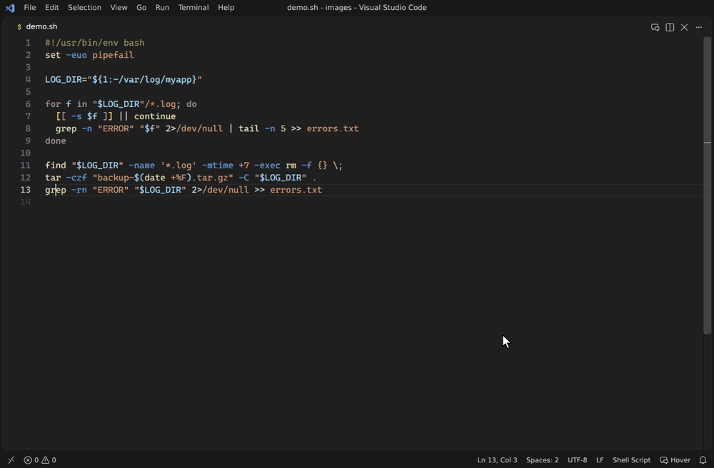
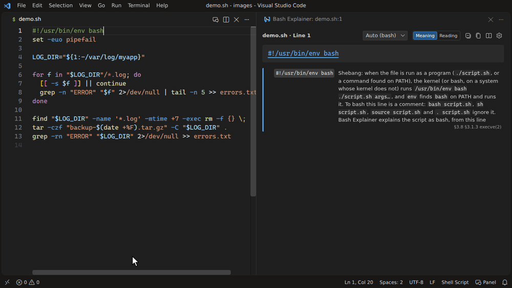
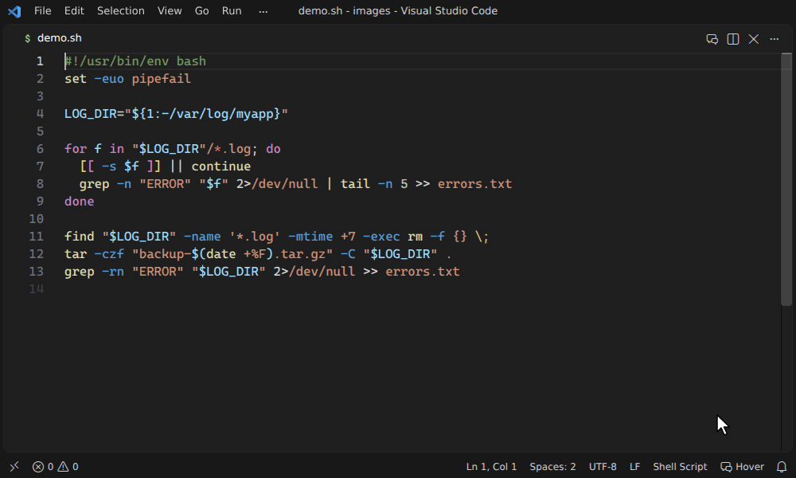
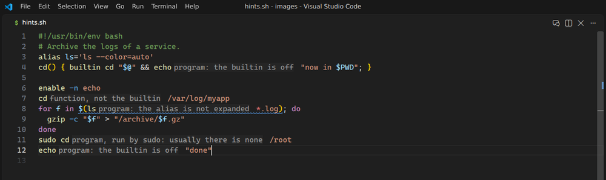

# <picture><source media="(prefers-color-scheme: dark)" srcset="images/readme/logo-dark.png"></picture>

[](https://marketplace.visualstudio.com/items?itemName=shun-fujioka.bash-explainer)
[](https://open-vsx.org/extension/shun-fujioka/bash-explainer)
[](https://www.npmjs.com/package/bash-explainer)
[](https://github.com/sf624/bash-explainer/actions/workflows/test.yml?query=branch%3Amain+event%3Apush)
[](https://github.com/sf624/bash-explainer/actions/workflows/test.yml)
[](#privacy)
[](LICENSE) 
[](./README.ja.md)

<!-- development-note -->
> This README describes the development version on `main`, which can be ahead of the release. The released version is on the [Marketplace](https://marketplace.visualstudio.com/items?itemName=shun-fujioka.bash-explainer) and [Open VSX](https://open-vsx.org/extension/shun-fujioka/bash-explainer) pages, and its source, README included, is at the tag of the [latest release](https://github.com/sf624/bash-explainer/releases/latest).
<!-- /development-note -->

Explains shell scripts line by line — like [regex101](https://regex101.com/), but for bash.

Hover any part of a line and see what it does — every command, option, redirection and `${…}` — with worked examples you can edit. Useful for reading unfamiliar scripts, learning the shell, and teaching it.

**No setup, and [offline by design](#privacy):** no network, no AI, no telemetry. In English and Japanese.



Bash Explainer is a VS Code extension, and more: the same explanations and warnings also come as a web page you can try without installing anything, a command-line tool, a Language Server for other editors, and a GitHub Action that checks scripts in pull requests.

## Where to use it

| Where | How |
| --- | --- |
| **VS Code** | Install **[Bash Explainer](https://marketplace.visualstudio.com/items?itemName=shun-fujioka.bash-explainer)** from the Marketplace, open a shell script and hover a word. See [In VS Code](#in-vs-code). |
| VSCodium and other editors using Open VSX | [open-vsx.org/extension/shun-fujioka/bash-explainer](https://open-vsx.org/extension/shun-fujioka/bash-explainer) |
| vscode.dev and github.dev | The same extension works in VS Code for the Web (press `.` in a GitHub repository). |
| **Browser**, no installation | The [web version](https://sf624.github.io/bash-explainer/): paste a script or open a file (`Ctrl+O`, or drop it on the editor) and move the cursor, or hover a word for its card, as in VS Code; `Ctrl+S` saves it, and `F6` goes between the editor and the explanation. The [development version](https://sf624.github.io/bash-explainer/next/) is built from `main` and may differ from the release. |
| **Terminal** | `npx bash-explainer deploy.sh:12`, or `npm install --global bash-explainer`. See [cli/README.md](cli/README.md#installation). |
| **Neovim, Helix, Emacs** and other LSP editors | `bash-explainer --lsp`, a Language Server with the same hovers, warnings and quick fixes. See [In your editor](cli/README.md#in-your-editor-language-server). |
| **CI** | `uses: sf624/bash-explainer@v0` in GitHub Actions puts the warnings on the pull request's diff; elsewhere, `npx bash-explainer --check`. See [In CI](cli/README.md#in-ci-github-actions). |

## What it shows

| You write | Bash Explainer tells you |
| --- | --- |
| `tar -czf backup.tgz -C src .` | what `-c`, `-z`, `-f` and `-C src` each do |
| `cmd 2>&1 > out.log` | where stdout and stderr end up — and that errors do *not* go to the file here |
| `echo "${file%.*}"` | `file=report.tar.gz` → `report.tar` |
| `sed -E 's/^([a-z]+)=(.*)$/\2=\1/'` | the regex piece by piece, and a sample: `a=x` → `x=a` |
| `#!/bin/sh` … `[[ -f $f ]]` | ⚠ `[[ ]]` fails in dash — with a quick fix to `[ -f "$f" ]` |
| `RUN apt-get update && …` in a Dockerfile | the same explanations inside Dockerfiles, Makefiles, CI YAML, Jenkinsfiles, `package.json`, Python and bats tests |

## What is explained

| | Examples |
| --- | --- |
| Commands and options | about 330 commands and builtins (`grep`, `sed`, `awk`, `find`, `curl`, `tar`, `git`, `docker`, `apt-get`, `gpg`, `systemctl`, `kubectl`, `helm`, `terraform`, `aws`, `go`, …); combined flags (`-rn`), values (`-o pipefail`, `--include=*.sh`), subcommands (`git commit`), commands run by others (`sudo`, `xargs`, `find -exec`) |
| Operators and redirections | `\|`, `&&`, `\|\|`, `;`, `&`, `>`, `>>`, `2>&1`, `&>`, here-documents, here-strings — including what the order of redirections does |
| Expansions | `${var:-default}`, `${file%.sh}`, `${#array[@]}`, `$?`, `$@`, `$(…)`, `<(…)`, `$((…))`, broken into their parts |
| Languages inside arguments | regular expressions (BRE, ERE or PCRE, as the options say), sed scripts, awk programs, jq and yq filters, perl one-liners, `printf` and `date` formats, `find` expressions, `chmod` modes, `sort -k` / `cut -f` / `tr` sets, `getopts` / `getopt` option strings, `git log --pretty` / `--date` |
| Control flow | `if`, `for`, `while`, `case`, functions; lines inside a block show where they are (*for loop › if statement*) |
| Idioms and pitfalls | `IFS= read -r`, the script-directory idiom, strict mode, `trap … EXIT`, `command -v … >/dev/null 2>&1`, …; and what goes wrong in `x = 1`, `rm -rf $DIR/…` with an empty `DIR`, unquoted variables, `for f in $(ls)`, `read` without `-r`, `local x=$(cmd)`, `sudo cmd > /etc/…` |

## Worked examples

Many constructs come with a made-up input and the output it produces. The built-in runners are checked against the real tools (GNU sed and coreutils, gawk, jq, perl, bash, git, yq) in the tests.

| For | You see |
| --- | --- |
| `grep` patterns, `[[ =~ ]]`, globs, `case` patterns | strings that match and strings that do not |
| `sed`, `awk`, `jq`, `yq`, `perl`, `sort`, `uniq`, `cut`, `tr`, `head`, `tail` | sample input → output |
| whole pipelines | the output after each stage |
| `${…}` expansions, `printf`, brace expansion | the resulting value |
| `[ ]`, `[[ ]]`, `(( ))` | values that make the test true and false |
| `xargs`, `read`, `getopt` | the commands that run, the variables that get set, how arguments are rearranged |
| `git log --pretty` / `--date` | the output for sample commits |
| `date +FORMAT` | the output at two fixed moments; edit them in the panel |

Examples appear right under the part they illustrate (see `bashExplainer.examples.placement`).

## Scripts for other shells

Explanations follow bash. When a script is written for another shell, Bash Explainer also points out what that shell does not have, and what behaves differently there:

```sh
#!/bin/sh
[[ -n $name ]] && echo -e "hi\t$name"
# ⚠ `[[ ]]` is not POSIX sh (it fails in dash). Instead, use `[ ]`.
# ⚠ `echo -e` is not POSIX sh (it fails in dash). Instead, use `printf` …
```

- **Shells:** POSIX `sh` (naming what fails in dash and busybox ash), `dash`, `ash`, `yash`, `ksh`, `mksh`, `zsh`. What works where was measured with each shell.
- **Which shell:** from the shebang (`#!/bin/sh`, `#!/usr/bin/env dash`, …), a `# shellcheck shell=` line or the file name — or set `bashExplainer.shell`. In a Markdown code block, a shebang wins over the fence's tag; a block tagged `sh` without one is read as bash (write `#!/bin/sh` in it to check it as POSIX sh), and `bash`, `zsh`, `dash`, `ksh` keep their shell.

## Shell code in other files

| File | What is explained |
| --- | --- |
| Dockerfile | `RUN` / `CMD` / `ENTRYPOINT` (shell form, `RUN <<EOF`, exec form, `["sh", "-c", "…"]`) and `SHELL [...]`; warns when a `RUN` pipe hides failures without `pipefail` |
| Makefile | recipes, with make's `$(VAR)`, `$@` and `$$` explained |
| CI YAML | GitHub Actions `run:` (workflows and `action.yml`, following `shell:` and `defaults`), GitLab CI `script:`, CircleCI `run:` / `command:`, and Azure Pipelines `script:` / `bash:` with its `$(variable)` macros; warns when untrusted input like `${{ github.event.pull_request.title }}` is pasted into a script |
| `package.json` | `scripts` |
| Markdown | code blocks marked `sh`, `bash`, `console`, …; the shell is the block's shebang, else the one the tag names (`sh` counts as bash) |
| Python | `subprocess.run(…)`, `os.system(…)`, …; flags strings passed without `shell=True` and values pasted into a shell command |
| Jenkinsfile | `sh '…'`, `sh "…"`, `sh '''…'''`, `sh(script: …)`; points out the `$name` and `${…}` that Groovy fills in before the shell runs |
| bats (`.bats`, or a `bats` shebang) | the whole file as bash: `@test "…" {` as the test bats runs with `set -e`, and `run` (with `!`, `-N`, `--separate-stderr`), `load`, `skip`, `bats_pipe`; warns about `! cmd` that cannot fail a test and `run` in a pipeline |

Each snippet is checked for the shell that runs it (`/bin/sh` for Dockerfiles and Makefiles unless `SHELL` says otherwise). Choose which kinds of files with `bashExplainer.embedded.files`.

## yq

Three different tools are called `yq`, each with its own syntax: **mikefarah/yq v4**, **kislyuk/yq** (a jq wrapper) and the older **mikefarah/yq v3**. Bash Explainer tells which one a command is for — from its options, subcommands and functions, and from how yq is installed in the same file — and says so on the line:

> yq: explained as mikefarah/yq v4 (v4.22.1 or later). Because: `-o json` is a mikefarah/yq v4 option; `pick` is a mikefarah/yq function (jq has none)
> Works with: mikefarah/yq v4 (v4.22.1 or later) ✓ / kislyuk/yq ✗ (no `-o json`, `pick`) / mikefarah/yq v3 ✗ (no jq-style expressions, `-o json`)

The first release with each feature was measured on every 4.x minor release. When nothing tells, mikefarah/yq v4 is assumed; set `bashExplainer.yq.flavor` to fix the choice.

## Warnings and quick fixes

Warnings appear in VS Code's Problems panel, so you see them without hovering, and the same warnings come from the command-line tool (`--check`), the Language Server and the GitHub Action. Where a rewrite keeps the meaning, a quick fix is offered:

| Before | After |
| --- | --- |
| `[[ -f $f && -n $x ]]` | `[ -f "$f" ] && [ -n "$x" ]` |
| `[ "$a" == b ]` | `[ "$a" = b ]` |
| `source ./lib.sh` | `. ./lib.sh` |
| `function f {` | `f() {` |
| `cmd &> log` | `cmd > log 2>&1` |
| `cmd \|& tee log` | `cmd 2>&1 \| tee log` |

Fixes are offered only when the script's shell lacks the construct, and only when the meaning is kept: `[[ $f == *.txt ]]` is a pattern match, so it gets no fix. Each rewrite is checked to behave in dash as the original does in bash. To silence a warning, add `# bash-explainer disable=<code>` on the line before it (or after the code on the same line), `# bash-explainer disable-file=<code>` anywhere for the whole file, or list the code in `bashExplainer.diagnostics.ignore`; `all` matches every warning. Turn the Problems panel entries off with `bashExplainer.diagnostics.enabled`.

Every warning and caveat the explanations point out is a problem too, each with its code: a warning for what breaks the script as written or does damage that cannot be undone (`x = 1` is no assignment, `rm -rf $DIR/*` with an empty `DIR`, `rm $f`, `[-f x]`, `[` without `]`), information for what goes wrong only with some values or goes unnoticed (`for f in $(ls)`, `cat $f`, `read` without `-r`, `local x=$(cmd)`). A plain fact is not a problem. Leave them out with `bashExplainer.diagnostics.pitfalls`. `--check` prints them, but fails on them only with `--strict`.

## In VS Code

### Quick start

1. Install **[Bash Explainer](https://marketplace.visualstudio.com/items?itemName=shun-fujioka.bash-explainer)** from the Visual Studio Marketplace.
2. Open a shell script (`.sh`, `.bash`, …).
3. Hover a word to see what it is. For the whole line, put the cursor on it and press `Ctrl+K Ctrl+E` (`Cmd+K Cmd+E` on macOS), or click **Whole line** in the hover.

For a side pane that follows the cursor, click **Open in panel** at the bottom of the hover.

### Installation

- **Marketplace:** [shun-fujioka.bash-explainer](https://marketplace.visualstudio.com/items?itemName=shun-fujioka.bash-explainer)
- **In VS Code:** open the Extensions view (`Ctrl+Shift+X` / `Cmd+Shift+X`) and search for *Bash Explainer*, or run `ext install shun-fujioka.bash-explainer` from Quick Open (`Ctrl+P` / `Cmd+P`).
- **Command line:** `code --install-extension shun-fujioka.bash-explainer`
- **VSCodium and other editors using Open VSX:** [open-vsx.org/extension/shun-fujioka/bash-explainer](https://open-vsx.org/extension/shun-fujioka/bash-explainer)
- **VS Code for the Web:** the extension also works on [vscode.dev](https://vscode.dev) and [github.dev](https://github.dev) (press `.` in a GitHub repository).

Requires VS Code 1.85 or later. There are no native dependencies (the parser is plain JavaScript), so it runs wherever VS Code runs.

### Ways to show explanations

| | How | Default |
| --- | --- | --- |
| **Panel** | A side pane that follows the cursor, colour-coded like regex101, where you can edit the example input and watch the result change | open it from the editor title bar or the hover |
| **Hover** | Hover a word for what it is; press `Ctrl+K Ctrl+E` for the whole cursor line | on |
| **Name hints** | A hint after a command name that does not run what it suggests (`cd` that is a function, `sudo cd`) | on |

Turn the hover and the panel on or off by clicking **Bash Explainer** in the status bar; the name hints with `bashExplainer.hints.names`.

#### Panel

The panel follows the cursor line by line. Point at a part of the tree to highlight it in the editor.



#### Hover

Hover a word, an option or an operator to see what it is, right where you are reading: its meaning, what kind of command a name is (a badge: keyword, builtin, special builtin, function, alias, program) and who runs it, and the command it belongs to. Moving to the next word explains that one. In the indentation, the hover shows the line's structure in one line.

For the whole line, press `Ctrl+K Ctrl+E`, choose **Explain Bash on Current Line** from the context menu, or click **Whole line** in the hover: one block per command, with its arguments.

The web page's editor shows the same cards (not on a touch screen); there, `Ctrl+K Ctrl+E` and **Whole line** explain the line in the panel.



#### Name hints

A command name gets a faint hint after it where it does not run what a reader would guess: a function or an alias that hides a builtin or a program, a builtin turned off by `enable -n`, an alias that bash does not expand in a script, `sudo cd` (there is no `cd` program), a name that runs nothing. Hover the hint for what runs and what else the name is; click it to open the line in the panel. The web page shows the same hints in its editor. VS Code's `editor.inlayHints.enabled` turns all inlay hints on or off (or on while `Ctrl+Alt` is held).



The inline summary at the end of the cursor line was removed: `bashExplainer.inline.*` no longer has an effect.

### The panel

The panel works like regex101:

- **Edit the examples.** Change the input of a worked example — grep and `[[ =~ ]]` test strings, sed, awk, jq, perl, `sort`, `cut`, `xargs`, whole pipelines — and the output updates as you type.
- **See what matched.** Matches are highlighted in the input, each capture group in its own colour, the same colour as the group in the explanation; a table shows what `\1`, `\2`, … captured.
- **See what each command name is.** In both views a badge after the name says keyword, builtin, special builtin, function, alias or program, and who runs it (`sudo echo`: the program, run by `sudo`). A name that is also something else gets a line saying what, and the code that runs it (`time` is also the program `/usr/bin/time`: `command time`).
- **See who reads each part** in the **Reading** view (**Meaning** goes back). bash splits the line into commands, and a simple command into assignments, the command name, its arguments and redirections; an alias is shown with the text bash puts in its place. A subshell parses the text of each `$( )` again, and the string of `bash -c`, `eval` or a trap is read as a script again. Each command reads its own arguments (options, operands, subcommands), and some words hold a language of their own (a regex, a sed script): the command reads it, or bash itself for `[[ =~ ]]`. Eight steps above the tree (◁ and ▷, or a button each) build it up: the line, its lists and pipelines, commands, words, inside the words, the scripts inside, how each command reads its arguments, and the languages; each reader has its own colour. Fold it with the arrow keys or a click; the panel remembers the view and the step.
- **Switch the shell or yq** for the current file from the header, and see the explanation and warnings change.
- **Fold** the explanation tree, **copy** it as Markdown for a review or a document, and open the searchable **quick reference** of expansions, redirections, tests, variables and commands. On the web page, these three are buttons in the top bar (on a phone, the copy is in the menu). The quick reference does not move the focus to its search field on a touch screen, so the on-screen keyboard stays down.

### Commands

| Command | Shortcut / where |
| --- | --- |
| Bash Explainer: Explain Bash on Current Line | `Ctrl+K Ctrl+E` / `Cmd+K Cmd+E` |
| Bash Explainer: Open Bash Explanation Panel | the editor title bar, the hover |
| Bash Explainer: Turn Hover and Panel On or Off | the status bar item |
| Bash Explainer: Open Settings | the hover and the panel |

### Settings

| Setting | Default | Description |
| --- | --- | --- |
| **Display** | | |
| `bashExplainer.hover.enabled` | `true` | Hover for the part under the mouse (`Ctrl+K Ctrl+E`, the whole line, works either way) |
| `bashExplainer.hover.followCursor` | `false` | Show the hover whenever the cursor moves |
| `bashExplainer.hover.followDelay` | `400` | Delay (ms) before it does |
| `bashExplainer.hover.maxDepth` | `0` | Levels of the explanation tree the hover shows (`0`: all) |
| `bashExplainer.panel.autoOpen` | `false` | Open the panel when a shell script is opened |
| `bashExplainer.panel.animations` | `true` | Rows of the panel grow and shrink when they are unfolded and folded, and when a step of the Reading view changes (off: they appear at once; reduced motion turns it off too) |
| `bashExplainer.panel.colors` | `"classic"` | Colours of the parts of a line in the panel: `classic` (its own six), `theme` (the editor theme's, where readable), `themeLike` (the theme's, with new colours where the theme gives two kinds of part one colour). In a remote window, every theme when the extension is installed on the local side (where VS Code installs it); VS Code's default themes only when it runs on the remote side. VS Code only |
| `bashExplainer.highlight.enabled` | `true` | Colour shell code as the explanations read it (semantic tokens over the editor's colours): what each command name runs, options, readonly variables. Can be set per language (below); the web page always does it |
| `bashExplainer.hints.names` | `true` | A hint after a command name that does not run what it suggests |
| `bashExplainer.hints.deadCode` | `true` | Fade code that never runs (a branch whose condition the script has decided, the skipped side of `&&` or `||`, what follows `exit`, `return`, `break` or `continue`): a hint, not a warning |
| `bashExplainer.inline.enabled`, `bashExplainer.inline.maxLength` | | Removed: no longer have an effect |
| `bashExplainer.examples.enabled` | `true` | Show worked examples at all |
| `bashExplainer.examples.disabled` | `[]` | Kinds of examples not to show: `regex`, `sed`, `awk`, `jq`, `yq`, `perl`, `textFilters`, `pipeline`, `expansion`, `printf`, `glob`, `test`, `xargs`, `read`, `getopt`, `gitLog`, `date` |
| `bashExplainer.examples.inHover` | `true` | Show examples in the hover too (off: only in the panel) |
| `bashExplainer.examples.placement` | `first` | Worked examples under the part they illustrate, before (`first`) or after (`last`) its pieces, or all at the end (`bottom`) |
| `bashExplainer.language` | `auto` | `auto` (follow VS Code), `en` or `ja` |
| `bashExplainer.notes.idioms` | `true` | Notes about well-known idioms (strict mode, `IFS= read -r`…) |
| `bashExplainer.notes.pitfalls` | `true` | Point out common mistakes and how to avoid them (`x = 1`, unquoted variables, `for f in $(ls)`…) |
| `bashExplainer.notes.basis` | `true` | Mark a note, or the explanation of a part, that rests on bash's behaviour rather than the manual ("Not in the manual · checked with bash 5.2"), with a command to try it in your terminal |
| **Checks** | | |
| `bashExplainer.shell` | `auto` | The shell scripts are written for: `auto`, `bash`, `sh`, `dash`, `ash`, `yash`, `ksh`, `mksh`, `zsh` |
| `bashExplainer.bashVersion` | `5.2` | The bash release to explain for: `5.2` or `5.3`. A construct of bash 5.3 (`${ cmd; }`) is explained as 5.3 runs it, and is a warning with `5.2` |
| `bashExplainer.diagnostics.enabled` | `true` | Warnings in the Problems panel, with quick fixes |
| `bashExplainer.diagnostics.ignore` | `[]` | Warning codes to leave out (the code shown in the Problems panel, e.g. `dbracket`, `echoE`, `dockerPipefail`) |
| `bashExplainer.diagnostics.embedded` | `true` | Also warn about shell code inside other files |
| `bashExplainer.diagnostics.pitfalls` | `true` | Also list the warnings and caveats of the explanations in the Problems panel (`x = 1`, `rm -rf $DIR/*`, `rm $f`: warnings; `cat $f`, `read line`: information) |
| `bashExplainer.yq.flavor` | `auto` | `auto`, `mikefarah4`, `kislyuk` or `mikefarah3` |
| **Files** | | |
| `bashExplainer.embedded.files` | all | Files whose shell code is explained: `dockerfile`, `makefile`, `yaml`, `packageJson`, `markdown`, `python`, `jenkinsfile`, `bats` |
| `bashExplainer.languages` | `["shellscript"]` | Language IDs explained as shell scripts |
| **Dictionary** | | |
| `bashExplainer.customCommands` | `{}` | Describe commands the dictionary does not know (see below) |

#### Colours per kind of file

The colours are on for shell scripts and the shell code of other files (not Python files and Dockerfiles, which their own language servers colour). To turn them off for one kind of file, set the setting for its language in `settings.json`:

```json
"[makefile]": { "bashExplainer.highlight.enabled": false },
"[yaml]": { "bashExplainer.highlight.enabled": false }
```

The languages are those VS Code shows in the status bar: `shellscript`, `bats`, `makefile`, `yaml` (GitLab CI, and GitHub workflows without the GitHub Actions extension), `github-actions-workflow`, `json` (package.json), `markdown`, `groovy` and `jenkinsfile`. `"bashExplainer.highlight.enabled": false` alone turns them off everywhere.

#### Your own commands

In-house tools are shown as *external commands* until you describe them:

```json
"bashExplainer.customCommands": {
  "deploy": {
    "summary": "Deploy a service to production",
    "options": [
      { "names": ["-n", "--dry-run"], "description": "only show what would happen" },
      { "names": ["-e"], "description": "target environment", "takesValue": true }
    ],
    "operands": [{ "description": "service name", "repeat": "+" }],
    "subcommands": {
      "status": { "summary": "Show what is deployed", "operands": [{ "description": "service name", "repeat": "*" }] }
    }
  }
}
```

- `options`: each option's names, its description, and `takesValue` when it takes a value (`-e prod`, `-eprod`, `--env=prod`).
- `operands`: the words that are not options, in order. `repeat` is `?` (optional), `*` (any number) or `+` (one or more); without it, the operand is there exactly once. When the words do not fit, they are shown as plain words.
- `style`: `gnu` (the default: options may come after operands), `posix` (the first operand ends the options) or `single-dash` (long options with one dash, `-name value`).
- `subcommands`: the same fields, for each subcommand.

The shape before 0.7 (`options` as an object, `"-n|--dry-run": "…"`, and `arguments`, a list of texts of which the last repeats) is still read, and a later release drops it.

## Settings outside VS Code

The same settings work on the web page, in the command-line tool and in the Language Server, wherever they have a meaning:

| Settings (`bashExplainer.`…) | Web page | Command line | Language Server |
| --- | --- | --- | --- |
| `language`, `notes.idioms`, `notes.pitfalls`, `notes.basis`, `shell`, `bashVersion`, `yq.flavor`, `diagnostics.ignore`, `diagnostics.embedded`, `diagnostics.pitfalls`, `examples.enabled`, `examples.disabled`, `customCommands` | ✓ | ✓ | ✓ |
| `diagnostics.enabled` | ✓ | (`--check` asks for the warnings) | ✓ |
| `hover.enabled`, `hints.names`, `hints.deadCode` | ✓ | | ✓ |
| `examples.placement`, `panel.animations` | ✓ | | |
| `editor.wrap` (the web page only: it is not in VS Code's settings, which has `editor.wordWrap`) | ✓ | | |
| `examples.inHover`, `hover.maxDepth`, `highlight.enabled`, `languages`, `embedded.files` | | | ✓ |
| `hover.followCursor`, `hover.followDelay`, `panel.autoOpen`, `panel.colors` | | | |

The empty cells are about what only VS Code has (the hover's depth and examples, a hover that follows the cursor, a panel to open, files to choose); the web page and the command line explain the file they are given, as the kind you choose.

- **Web page:** click the ⚙ button in the top bar. The shell and yq menus are in the menu (☰), and on a wide window in the top bar too. Changes apply at once, and are kept in your browser (localStorage); **Reset to defaults** puts the settings back, and **Clear stored data** (after a confirmation) removes everything the page keeps in the browser (the settings, the theme, the size of the panes, read mode and the first-run tip) and shows the defaults at once. The language and the shell and yq menus of the page are the same settings. **Export to a file** (or **Copy**) gives the settings you changed as a settings file in the format below, for the command-line tool or VS Code's `settings.json`; **Import a file…** (or dropping a file on the dialog, or pasting JSON) replaces the page's settings with those of such a file, and lists the keys it left out.
- **Command line and Language Server:** a JSON file with the keys of VS Code's `settings.json`, with or without `bashExplainer.` (comments are allowed). It is the file given with `--config`, else `$BASH_EXPLAINER_CONFIG`, else `$XDG_CONFIG_HOME/bash-explainer/settings.json` (by default `~/.config/bash-explainer/settings.json`). `--set key=value` sets one setting. See [Settings](cli/README.md#settings) in the tool's README.

```json
{
  "bashExplainer.language": "ja",
  "bashExplainer.shell": "sh",
  "bashExplainer.diagnostics.ignore": ["crlf"],
  "bashExplainer.examples.disabled": ["date"],
  "bashExplainer.customCommands": {
    "deploy": { "summary": "Deploy a service to production" }
  }
}
```

## Command line, other editors and CI

The command-line tool, the Language Server and the GitHub Action are one npm package, [`bash-explainer`](https://www.npmjs.com/package/bash-explainer) (`npx bash-explainer`, or `npm install --global bash-explainer`). [Its README](cli/README.md) covers the options, the output formats (text, Markdown, JSON, SARIF, GitHub annotations), the set-up for Neovim, Helix and Emacs, and the action's inputs.

## Limitations

- Explanations are rule-based. Commands that are not in the dictionary are shown as an *external command* without option details.
- A few constructs are not read as bash reads them: zsh-only syntax such as `*(.)` and `${(f)var}` (with the shell set to zsh, such a line is marked as not parsed), `echo (` (bash: syntax error; it is accepted without an error), an alias that stands for a declaration builtin (after `alias d=declare`, bash reads `d a=(1 2)` as `declare` would, and `d a=$v` does not split `$v`; here the first is a syntax error and the second an argument that is split), a declaration after `command` in POSIX mode (`set -o posix`, sh: bash and dash do not split `$v` in `command declare a=$v` or `command export a=$v`, and dash not in `\export a=$v` either; here it is split, as in bash's default mode), and the base-64 digit `@` in arithmetic next to other terms (`$((64#@))` alone is read as 62, but in `$((64#@ + 1))` the whole expression becomes one word). In a `[ ]`, the arguments are grouped by bash's own rules for `test` (`-o` below `-a` below `!`; `-a` and `-o` as unary operators where an operand is expected), whatever the parser says.
- A script with Windows line endings (CRLF) is explained as if it had LF, and a warning (`crlf`, on the last word of the first such line) says that bash reads the CR as part of the last word of each line. To keep the file as it is, write `# bash-explainer disable-file=crlf` on a line of its own (the first line is the shebang, so `disable=` before it is not possible). A here-document in such a script has no closing line, as in bash.
- A string that a command runs as a script (`bash -c '…'`, `eval`, a trap's action, `ssh host '…'`) is explained as a script only when its text is written out: one with an expansion in it (`eval "$cmd"`, `bash -c "cd $dir"`) is known only when it runs. A file run with `bash file` or `source file` is not read.
- An alias named like a reserved word (`alias {=echo`, `alias [[=echo`) is not followed: where aliases are expanded, bash replaces `{` or `[[` with its text (`{ x; }` becomes a syntax error, `[[ x ]]` runs `echo`), but the line is still explained as a group or a `[[ ]]`.
- In POSIX mode, an assignment to an array element before a special builtin (`set -o posix; n[0]=5 :`) ends the script in bash, with "not a valid identifier"; the explanation goes on as if the line had run.
- The values of expansions, the conditions said to be decided and the code said never to run assume that the script starts in a default environment: no variables of bash in the environment, and the options bash starts with. The explainer reads what the script itself does to bash's behaviour (`set -k`, `shopt -s compat42`, `BASH_COMPAT=42`, `POSIXLY_CORRECT=1`, `FUNCNEST=1`, `BASH_ALIASES`, a locale other than `C`, `POSIX` or `C.UTF-8`) and what its first line starts bash with (`#!/bin/bash -k`, `#!/usr/bin/env -S BASH_COMPAT=42 bash`, `bash -O compat31 -c '…'`). When it finds such a change, or a construct it does not know, it decides nothing in that script: no value, no decided condition, no code marked as never running. Setting the locale to `C`, `POSIX`, `C.UTF-8` or empty changes nothing.
- It cannot see what is outside the script. A variable of the environment (`BASH_COMPAT`, `POSIXLY_CORRECT`, `FUNCNEST`, `SHELLOPTS`, `BASHOPTS`, `LANG` or `LC_ALL` with another locale, a `PS4` under `bash -x`, `BASH_ENV`, exported functions named like commands) can change a value or a decision, and the explanation does not take it into account. Nor does it see the options given when the script is run: `bash -k script` or `sh script` (the shell is read from the shebang or the setting, and the options on the command line are not known). If you run a script so, treat its values and decided conditions with care.
- When a later redirection of the same descriptor replaces one that opens a file (`echo hi >a >b`), links are not followed: two different paths are taken for two files, unless one has a `..` part or one is absolute and the other relative (`>a >b/../a`), which gets "unless … names the same file". A symbolic or hard link to the same file (`ln -s a b; echo hi >a >b` writes to `a`) is not seen.

## Privacy

Bash Explainer works entirely offline by design:

- **No network access.** The extension contains no code that opens network connections, and the panel's Content Security Policy blocks external requests. The links to the Bash manual (gnu.org) are plain links: a page opens only when you click one.
- **No AI.** Scripts are parsed with [unbash](https://github.com/webpro-nl/unbash), a JavaScript parser bundled into the extension, and explained from built-in dictionaries, so the same line always gets the same explanation.
- **No telemetry.** The extension collects nothing.
- **No external processes.** Examples are computed by built-in code; your tools are never run.

A [CI check](test/offline.test.ts) fails the build if network or process APIs appear in the packaged extension ([latest runs](https://github.com/sf624/bash-explainer/actions/workflows/test.yml)). [Integration tests](integration/extension.itest.ts) also run the packaged extension in VS Code — on Linux with no network at all — and fail if it opens a connection or starts a process. You can also verify this yourself: the `.vsix` is a zip archive, and the extension works with networking disabled.

The [web version](https://sf624.github.io/bash-explainer/) works the same way. GitHub Pages serves the page, but your script is parsed and explained in the browser and sent nowhere; the page's Content Security Policy allows no requests to other sites, and a link to a script carries it after `#`, which browsers do not send. A file you open is read in the browser too, and a save writes to your own disk. The same CI check covers the page, and a test opens it in Chromium, blocking every request to other sites, and keeps using it offline.

In VS Code for the Web, the extension runs in your browser; VS Code loads its files (including the parser) from the Marketplace, but your scripts are explained there and sent nowhere.

The [command-line tool](cli/README.md), which is also the Language Server, works the same way: it contains no code that opens a network connection or starts a process, which the same CI check covers, and a test runs it with network and process modules blocked. Only getting it uses the network: `npx` and the GitHub Action download it from npm; installed, it runs offline.

This describes the extension, its web version and the command-line tool, not VS Code, other extensions, your browser, npm or GitHub Actions. It is provided as is, without warranty (see [LICENSE](LICENSE)); please evaluate it against your own requirements before using it with sensitive data.

## Release notes

See [CHANGELOG.md](CHANGELOG.md).

## Contributing

Issues and pull requests are welcome at [github.com/sf624/bash-explainer](https://github.com/sf624/bash-explainer).

```sh
npm install
npm run build      # bundle into dist/
npm test           # type check + unit tests
npm run coverage   # unit tests with coverage (report in coverage/index.html)
npm run package    # build a .vsix
npx tsx scripts/extract-snippets.ts   # after changing the scripts in the tests: rewrite test/fixtures/snippets.json, the inputs of the syntax tests and the fuzz (CI runs it with --check)
npx tsx scripts/argv-corpus.ts   # before a release, or after changing the word model: the argv check of test/argv.test.ts over every snippet and 200 fuzz inputs (CI runs a sample)
npx tsx scripts/normal-forms-sweep.ts --count 1000   # after changing a normalizer (quoting, command names, options): the generated forms of test/normal-forms-gen.test.ts, many more of them (CI runs a sample); --seed N for other forms, --missed to list the missed matches
npm run test:integration   # run the extension in VS Code (downloaded into .vscode-test/)
npm run test:integration:web   # …and in VS Code for the Web (needs `npx playwright install chromium`)
```

- Press `F5` in VS Code to launch an Extension Development Host with `test/fixtures/playground.sh` open (a gitignored copy of `sample.sh`, the tour of every feature, made when it is missing; edit it freely), with the panel beside it (`.vscode/playground.code-workspace` turns on `bashExplainer.panel.autoOpen`). F5 first runs `npm install`, so `node_modules` follows `package-lock.json` after a pull.
- `npm run build:web` builds the web version into `site/` (`-- --channel=next` builds the development version shown at `/next/`, with its banner); `python3 -m http.server -d site` serves it at <http://localhost:8000/>.
- `npx tsx test/dump.ts <file> [en|ja] [line]` prints the explanation of every line of a file.
- `npx tsx test/snapshot.ts <output file>` writes the full explanation of every line of the test corpus (fixtures, host fixtures, snippets), in Japanese and English, as JSON lines, with a fixed clock and time zone. For refactoring: run it on main and on the branch, and compare with `git diff --no-index --stat` (see [docs/design/analyzer.md](docs/design/analyzer.md)). `test/file-length.test.ts` keeps files of `src/` under 1,000 lines (the listed exceptions have ceilings that may only go down, in `test/fixtures/file-length.json`), and `test/explain-imports.test.ts` keeps `src/explain/` free of import cycles and of comparisons with command names.
- To try the command-line tool from this repository, `npm run build:cli`, then `node cli/dist/cli.js <file>` (or `npx --package=./cli bash-explainer <file>`). A bare `npx bash-explainer` does not work here: the extension's own `package.json` is also named `bash-explainer`, so npx takes this project for the package.
- Tests that compare with real tools use the shells on `PATH` or in `$BASH_EXPLAINER_SHELLS`, and the yq releases in `$BASH_EXPLAINER_YQ`; the yq examples use mikefarah/yq from `$BASH_EXPLAINER_YQ4` (a path to the program), or a mikefarah `yq` on `PATH` (CI installs v4.54.1, MIT, checked by its SHA-256); missing ones are skipped. `test/bash-ast.test.ts` compares the syntax tree with bash's own parser through [bash-ast](https://github.com/cv/bash-ast) (GPL: used only as an external program, never a dependency or part of a bundle), found at `$BASH_AST` or on `PATH`; without it the test is skipped. CI runs it with the pinned release v0.3.3 (`bash-ast-v0.3.3-x86_64-unknown-linux-gnu.tar.gz` from <https://github.com/cv/bash-ast/releases/tag/v0.3.3>; the known differences are those of this version), downloaded on each run, checked by its SHA-256 and never stored or redistributed; set `BASH_EXPLAINER_BASH_AST=1` to fail instead of skipping when it cannot be run. `test/host-shells.test.ts` compares the scripts we read in YAML block scalars with those PyYAML loads (`python3 -c 'import yaml'`); without PyYAML it is skipped, and `BASH_EXPLAINER_PYYAML=1` (set in CI) makes that fail. To run only this test: `npx mocha --no-config --node-option import=tsx test/bash-ast.test.ts` (`--spec` would add to the whole suite). Its known differences are listed, with reasons, in `test/fixtures/bash-ast-known.json`; the test fails on a new difference and on an entry that no longer applies. `test/command-tokens.test.ts` uses it the same way: each token of the explanations lies in exactly one innermost command of our tree, crosses no command's boundary, and that command is one of bash-ast's, in the script or in the text of a substitution (see docs/design/syntax-tree.md); its known findings and the counts it pins are in `test/fixtures/command-tokens-known.json`. `test/bash53.test.ts` checks what we say of bash 5.3's constructs (`${ cmd; }`, `${| cmd; }`) with a real bash 5.3, found at `$BASH_EXPLAINER_BASH53` (a path; skipped without it, and `BASH_EXPLAINER_BASH53_REQUIRED=1` makes that fail), and with the bash 5.2 on `PATH`. CI builds bash 5.3 from the release tarball, checked by its SHA-256 (`./configure --without-bash-malloc && make`), in a job of its own; bash is GPL, so it is only run as a separate program and never stored or redistributed. The web page test needs Chromium (`npx playwright-core install --with-deps chromium-headless-shell`). Mocha runs the test files in parallel (`.mocharc.cjs`: three workers, on Node.js 20 or later; each file in one worker, a worker runs its files one after another); parallel mode ignores `.only` and a `this.timeout()` outside a `describe`, so for one file, or to debug, use `npx mocha --no-parallel --spec test/x.test.ts` (or `--no-config` as above). Every web test file builds and serves its own copy of the page, and closes it after the file.
- CI runs the unit tests in four shards per Node.js version, each on a runner of its own: [scripts/test-shards.cjs](scripts/test-shards.cjs) splits the files by the times measured in `scripts/test-timings.json` (a new file counts as the median), and `test/shards.test.ts` checks that each file is in exactly one shard. `MOCHA_SHARD=2/4 npx mocha` runs one shard; `node scripts/test-shards.cjs --measure` measures the times again (with the tools of CI installed) when the shards' jobs drift apart. The job `Test (Node.js …)` passes when the type checks, the package build and every shard passed; on Node.js 24 it also merges the shards' coverage.
- CI measures the coverage of the unit tests with every tool installed (the Node.js 24 job): the run's summary lists the least covered files, and the `coverage` artifact holds the HTML report. Measured locally, it is lower when tools are missing, as their tests are skipped; use Node.js 24 as CI does, since older versions count methods that never ran as covered. `npm run coverage` runs in UTC, as CI does, since some branches depend on the time zone. The reports leave out the code that tsx adds when it compiles the sources for the tests (its helpers, the getters of exports), which maps to places no test can run ([scripts/coverage-report.mjs](scripts/coverage-report.mjs)).
- Every line of `src/` must run in a unit test, and every branch must be taken, or CI fails (`npm run coverage:check`). Every file is at 100%, so [coverage-floors.json](coverage-floors.json) is empty. A file listed there would keep a floor, its share then, which must not go down; after adding tests, `node scripts/coverage-check.mjs --update` raises the floors and drops the files that reach 100%. A branch no test can take is removed, or, when it guards against a bug elsewhere, marked with `/* c8 ignore next */` and a comment saying why. The VS Code side (`extension.ts`, `service.ts`, `ui/` except the renderers) is left to the integration tests. The coverage badge at the top is static; it stays true because CI fails below 100%.
- After changing dependencies, run `npm run notices` to regenerate [THIRD_PARTY_NOTICES.md](THIRD_PARTY_NOTICES.md) from what the builds include; a test fails while it is out of date, or if something under a license not yet reviewed gets in.
- A weekly workflow ([unbash-release.yml](.github/workflows/unbash-release.yml)) opens an issue when a newer unbash (the parser, pinned exactly in `package.json`) is on npm, with the upgrade checklist; Dependabot's monthly npm run proposes the same bump as a PR.
- Japanese text follows [docs/japanese-style.md](docs/japanese-style.md) (in Japanese); a test checks it.
- To add a command, add an entry to [`src/dict/commands.ts`](src/dict/commands.ts): `cmd(japanese, english, [options…], { positional: […] })`. Write the descriptions in your own words: do not copy them from man pages, `--help` output or other documentation, whose licenses (often the GPL or the GFDL) differ from this project's.
- `CHANGELOG.md` is for users: it is the GitHub Release's notes and the Marketplace's Changelog tab. Add entries under `## Unreleased`, in `### New`, `### Changed` or `### Fixed`: one bullet per change users can see, in one or two short sentences that say what they see now. Write "Before, …" only when the behaviour changes in a way users will notice, not for every fix. Leave out tests, CI, refactors and internal design. Each version ends with an `[All changes]` link to GitHub's compare view of the previous and this tag (`compare/vPREV...vX.Y.Z`).
- Fine-grained examples and the earlier behaviour go into `docs/changes/<version>.md`, linked from the version's section in `CHANGELOG.md` (for unreleased work, `docs/changes/unreleased.md`, linked from `## Unreleased`). When a change is a fix of a kind already listed, add a few words or an example to the details file; do not grow the bullet.
- To release, bump `version` in `package.json` and `cli/package.json`, rename `## Unreleased` in `CHANGELOG.md` to the version, rename `docs/changes/unreleased.md` to `docs/changes/<version>.md` (and fix its link in the section to `https://github.com/sf624/bash-explainer/blob/v<version>/docs/changes/<version>.md`), and push a tag `v<version>`. The [Release workflow](.github/workflows/release.yml) takes the version's section of `CHANGELOG.md` as the release notes, so keep the section short and the details link in it. It checks that the Test workflow passed on the tagged commit, packages it, waits for approval in the `release` environment, then publishes to the VS Code Marketplace, Open VSX and npm, creates a GitHub Release, moves the `v0` tag the GitHub Action is used by, and updates the web version; see [docs/publishing.md](docs/publishing.md) for the steps and the one-time setup. The package pages show the README of their version: the packages are pinned to the tag (`npm run package`, `scripts/build-cli.ts --tag`), and the release checks it. Run by hand (Actions, Release, Run workflow), the Release workflow is a dry run: it does the checks and packages the extension, and publishes nothing.

## License

[MIT](LICENSE). Third-party components are listed in [THIRD_PARTY_NOTICES.md](THIRD_PARTY_NOTICES.md).
