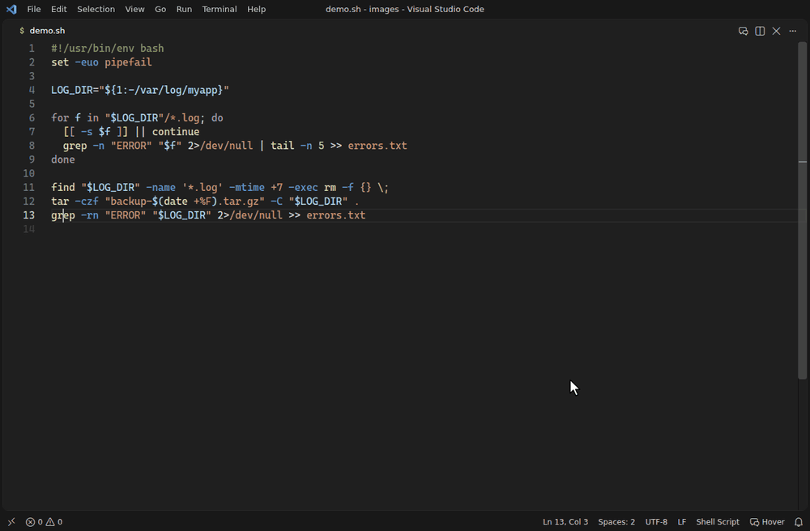

# <picture><source media="(prefers-color-scheme: dark)" srcset="images/readme/logo-dark.png"></picture>

 

<!-- development-note -->
> This README describes the development version on `main`, which can be ahead of the release. The released version is on the [Marketplace](https://marketplace.visualstudio.com/items?itemName=shun-fujioka.bash-explainer) and [Open VSX](https://open-vsx.org/extension/shun-fujioka/bash-explainer) pages, and its source, README included, is at the tag of the [latest release](https://github.com/sf624/bash-explainer/releases/latest).
<!-- /development-note -->

Explains shell scripts line by line — like [regex101](https://regex101.com/), but for bash.

Hover any part of a line and see what it does — every command, option, redirection and `${…}` — with worked examples you can edit. Useful for reading unfamiliar scripts, learning the shell, and teaching it.

**No setup, and [offline by design](#privacy):** no network, no AI, no telemetry. In English and Japanese.

**[Quick start](#quick-start)** · [Try it in the browser](https://sf624.github.io/bash-explainer/) · [User guide](docs/guide/README.md) · [Command line](cli/README.md) · [Changelog](CHANGELOG.md) · [日本語](README.ja.md)

Bash Explainer is a VS Code extension, and more: the same explanations and warnings also come as a web page you can try without installing anything, a command-line tool, a Language Server for other editors, and a GitHub Action that checks scripts in pull requests.

## Where to use it

| Where | How |
| --- | --- |
| **VS Code** | Install **[Bash Explainer](https://marketplace.visualstudio.com/items?itemName=shun-fujioka.bash-explainer)** from the Marketplace, open a shell script and hover a word. See [Quick start](#quick-start) and [In VS Code](docs/guide/vscode.md). |
| VSCodium and other editors using Open VSX | [open-vsx.org/extension/shun-fujioka/bash-explainer](https://open-vsx.org/extension/shun-fujioka/bash-explainer) |
| vscode.dev and github.dev | The same extension works in VS Code for the Web (press `.` in a GitHub repository). |
| **Browser**, no installation | The [web version](https://sf624.github.io/bash-explainer/): paste a script or open a file (`Ctrl+O`, or drop it on the editor), move the cursor, or hover a word for its card, as in VS Code. See [The web page](docs/guide/web.md). The [development version](https://sf624.github.io/bash-explainer/next/) is built from `main` and may differ from the release. |
| **Terminal** | `npx bash-explainer deploy.sh:12`, or `npm install --global bash-explainer`. See [cli/README.md](cli/README.md#installation). |
| **Neovim, Helix, Emacs** and other LSP editors | `bash-explainer --lsp`, a Language Server with the same hovers, warnings and quick fixes. See [In your editor](cli/README.md#in-your-editor-language-server). |
| **CI** | `uses: sf624/bash-explainer@v0` in GitHub Actions puts the warnings on the pull request's diff; elsewhere, `npx bash-explainer --check`. See [In CI](cli/README.md#in-ci-github-actions). |

## What it shows

| You write | Bash Explainer tells you |
| --- | --- |
| `tar -czf backup.tgz -C src .` | what `-c`, `-z`, `-f` and `-C src` each do |
| `cmd 2>&1 > out.log` | where stdout and stderr end up — and that errors do *not* go to the file here |
| `echo "${file%.*}"` | `file=report.tar.gz` → `report.tar` |
| `sed -E 's/^([a-z]+)=(.*)$/\2=\1/'` | the regex piece by piece, and a sample: `a=x` → `x=a` |
| `#!/bin/sh` … `[[ -f $f ]]` | ⓧ `[[ ]]` fails in dash — with a quick fix to `[ -f "$f" ]` |
| `RUN apt-get update && …` in a Dockerfile | the same explanations inside Dockerfiles, Makefiles, CI YAML, Jenkinsfiles, `package.json`, Python and bats tests |

## What is explained

| | Examples |
| --- | --- |
| Commands and options | about 330 commands and builtins (`grep`, `sed`, `awk`, `find`, `curl`, `tar`, `git`, `docker`, `apt-get`, `gpg`, `systemctl`, `kubectl`, `helm`, `terraform`, `aws`, `go`, …); combined flags (`-rn`), values (`-o pipefail`, `--include=*.sh`), subcommands (`git commit`), commands run by others (`sudo`, `xargs`, `find -exec`) |
| Operators and redirections | `\|`, `&&`, `\|\|`, `;`, `&`, `>`, `>>`, `2>&1`, `&>`, here-documents, here-strings — including what the order of redirections does |
| Expansions | `${var:-default}`, `${file%.sh}`, `${#array[@]}`, `$?`, `$@`, `$(…)`, `<(…)`, `$((…))`, broken into their parts |
| Languages inside arguments | regular expressions (BRE, ERE or PCRE, as the options say), sed scripts, awk programs, jq and yq filters, perl one-liners, `printf` and `date` formats, `find` expressions, `chmod` modes, `sort -k` / `cut -f` / `tr` sets, `getopts` / `getopt` option strings, `git log --pretty` / `--date` |
| Control flow | `if`, `for`, `while`, `case`, functions; lines inside a block show where they are (*for loop › if statement*) |
| Idioms and pitfalls | `IFS= read -r`, the script-directory idiom, strict mode, `trap … EXIT`, `command -v … >/dev/null 2>&1`, …; and what goes wrong in `x = 1`, `rm -rf $DIR/…` with an empty `DIR`, unquoted variables, `for f in $(ls)`, `read` without `-r`, `local x=$(cmd)`, `sudo cmd > /etc/…` |

The [user guide](docs/guide/explained.md) has the worked examples, the shell code in other files (Dockerfiles, Makefiles, CI YAML, `package.json`, Markdown, Python, Jenkinsfiles, bats tests) and the three tools called `yq`; [Scripts for other shells](docs/guide/other-shells.md) covers `sh`, `dash`, `zsh` and the others.

## Quick start

1. Install **[Bash Explainer](https://marketplace.visualstudio.com/items?itemName=shun-fujioka.bash-explainer)** from the Visual Studio Marketplace.
2. Open a shell script (`.sh`, `.bash`, …).
3. Hover a word to see what it is. For the whole line, put the cursor on it and press `Ctrl+K Ctrl+E` (`Cmd+K Cmd+E` on macOS), or click **Whole line** in the hover.

For a side pane that follows the cursor, click **Open in panel** at the bottom of the hover.

Other ways to install (the Extensions view, `code --install-extension`, Open VSX, vscode.dev), the panel, the name hints and the commands: [In VS Code](docs/guide/vscode.md). Every setting: [Settings](docs/guide/settings.md).

## Warnings and quick fixes

Warnings appear in VS Code's Problems panel, so you see them without hovering, and the same warnings come from the command-line tool (`--check`), the Language Server and the GitHub Action. Where a rewrite keeps the meaning, a quick fix is offered (`[[ -f $f ]]` becomes `[ -f "$f" ]` in a `sh` script, `read line` becomes `read -r line`). Problems have three levels, as VS Code's own: **ⓧ Error**, **⚠ Warning** and **ⓘ Information**. [Warnings and quick fixes](docs/guide/warnings.md) says what each level means, how to silence a warning, and what `--check` and the GitHub Action fail on.

## Privacy

Bash Explainer works entirely offline by design: no network access, no AI, no telemetry, and no external processes. Scripts are explained by built-in code, so the same line always gets the same explanation; the web page explains your script in the browser and sends it nowhere. Tests check this on every change: see [Privacy](docs/guide/privacy.md).

## Documentation

- [User guide](docs/guide/README.md): [In VS Code](docs/guide/vscode.md), [Settings](docs/guide/settings.md), [What is explained](docs/guide/explained.md), [Scripts for other shells](docs/guide/other-shells.md), [Warnings and quick fixes](docs/guide/warnings.md), [The web page](docs/guide/web.md), [Limitations](docs/guide/limitations.md), [Privacy](docs/guide/privacy.md).
- [The command-line tool, the Language Server and the GitHub Action](cli/README.md).
- Release notes: [CHANGELOG.md](CHANGELOG.md).
- Contributing: [CONTRIBUTING.md](CONTRIBUTING.md). Issues and pull requests are welcome at [github.com/sf624/bash-explainer](https://github.com/sf624/bash-explainer).

## License

[MIT](LICENSE). Third-party components are listed in [THIRD_PARTY_NOTICES.md](THIRD_PARTY_NOTICES.md).
