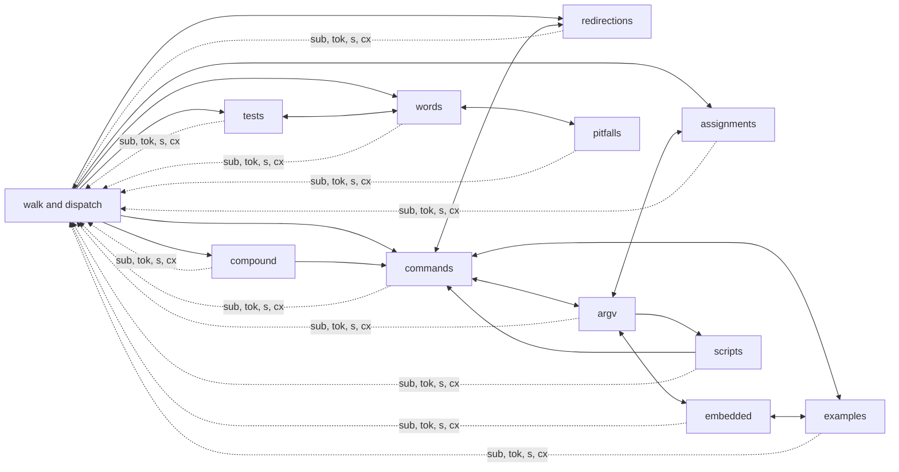
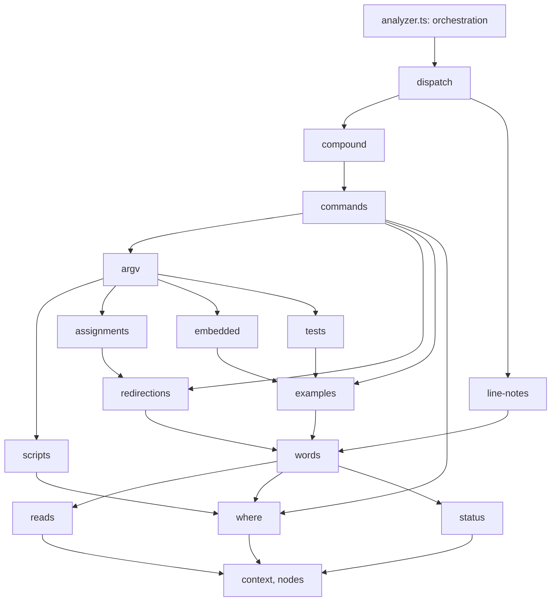

# A thin analyzer

src/analyzer.ts is 4,202 lines (at d265509). One class, `Analyzer`, holds about 200 members. The facts are no longer decided there: [semantics.md](semantics.md) and [refactor.md](refactor.md) moved them into the specs (src/argv/), the semantic model (src/semantics/) and the example sources (src/examples/source.ts). What is left is mostly the assembly of an explanation: tokens, notes, pitfalls and examples.

An outside review noted the size, and the pace (683 commits in 9 days). For one maintainer over the long term, a thin core matters more than a wider scope. The maintainer agreed: the next big work is to thin analyzer.ts, not to add features. This page plans it. Each step is a PR. The [traceability table](#traceability) records the findings and the steps.

Status: step 0 (the guards and the snapshot) is done (#275), step 1 (the facts the models own) is done (#308), step 2 (the context) is done (#324), step 3 (the readers) is done (#325), step 4 (words and expansions) is done (#327), step 5 (tests, redirections) is done (#329, #330), step 6 (examples, embedded languages) is done (#333, #334), step 7 (arguments, assignments, scripts) is done (#338, #339, #340), and step 8 (commands, compound commands, line notes) is done (#348, #349). Step 9 is not started: src/explain/ has the context, the node helpers, the readers, the words, the tests, the redirections, the examples (those of jq and yq apart), the embedded languages, the scripts, the assignments, the arguments, the commands, the compound commands and the line notes, and src/analyzer.ts is 270 lines (the dispatch and the orchestration).

The goal is not new behaviour. Every explanation stays byte-identical, except where a step fixes a contradiction with bash (and then says so).

## 1. What analyzer.ts holds (at d265509)

### 1.1 The parts

The file has three parts:

- **Imports and module helpers** (lines 1–170): about 60 lines of imports, the node-type sets (`BLOCKS`, `LAST_STAGES`, `BLOCK_OWNERS`, `WRAPPERS`), span and line helpers, `braceExpansion`, and the `LineContext` interface.
- **The class `Analyzer`** (lines 171–4042, 3,872 lines).
- **Module helpers after the class** (lines 4044–4202): `CommandHead`, `SHOPT_NAMES`, `sedPattern`, `jobSpec`, `dropLabelEcho`, `skeletal`, `summaryOf`, `sortTokens`, `lineStarts`, `posOf`, and the re-export of `lookupCommand`.

### 1.2 The class, by responsibility

The members fall into fourteen groups. Lines are those of the member bodies, without their doc comments. With the comments, add about 15%.

| Group | Members | Lines | Main members | Writes to the line's context |
|---|---:|---:|---|---|
| Walk and dispatch | 22 | 285 | `explainLine`, `explainNode`, `explain`, `sub`, `subs`, `full`, `flatten`, `ordered`, `anon`, `contextLabel`, `notes` (here-document and continuation notes), `say`, `s`, `t`, `tok`, `lineRef` | `line`, `context`, `facts` |
| Where code runs | 6 | 71 | `shoptAt`, `groupSubshell`, `subshellWhy`, `inSubshell`, `shellEffectNote`, `pidNote` | none |
| Compound commands | 13 | 224 | `forStatement`, `whileStatement`, `caseStatement`, `caseItem`, `casePattern`, `functionDef`, `coprocStatement`, `pipeline`, `list`, `block`, `missingKeyword`, `comment`, `shebangEnv` | notes, examples |
| Redirections | 13 | 194 | `redirected`, `redirectedWhole`, `redirectLayout`, `splitCommand`, `redirectInfo`, `fileRedirect`, `redirectTargetNote`, `wholeRedirect`, `fdExpansion`, `heredoc`, `herestring` | notes |
| Assignments and declarations | 9 | 209 | `assignment`, `assignments`, `assignmentList`, `markedAssignment`, `declaredOperand`, `unsetOperand`, `nameGlob`, `declarationOption`, `endOfOptions` | notes |
| Status notes | 4 | 44 | `postfixStatusNote`, `statusRangeNote`, `statusNotes`, `substitutionStatus` | notes |
| Commands | 17 | 356 | `command`, `commandParts`, `commandToken`, `commandTail`, `commandHead`, `commandHeadFor` (123 lines), `functionCall`, `missedNote`, `resolve`, `specFor`, `hostCommand`, `timed`, `tagExamples`, `anchorExamples` | notes, examples |
| Arguments by the spec (argv rendering) | 19 | 408 | `args`, `render` (100 lines), `optionToken`, `equalsToken`, `letterParts`, `valueToken`, `operandToken`, `splicedNote`, `wrapped`, `positional`, `testArgs` | `argCtx`, notes |
| Embedded languages | 12 | 206 | `embedded`, `embeddedText`, `embeddedTextInner`, `embeddedExample`, `fromEmbedded`, `findExpression`, `trContext`, `given`, `optionValues`, `regexFlavor` | examples |
| Examples | 27 | 424 | `titledExamples`, `wantsExample`, `jqExamples`, `yqExample`, `yqStreams`, `pipelineExample`, `pipelineStages`, `commandExampleFor`, `inputSource`, `stdinOf`, `unreadStdin`, `readExample`, `wordExample`, `regexExample`, the pattern and test examples | examples, notes |
| Pitfalls from the models | 7 | 147 | `pipeSubshellPitfalls`, `unmatchedGlobPitfalls`, `extglobPitfalls`, `globOptionNote`, `starStarNote`, `globNotes`, `extglobNote` | notes |
| Scripts run by commands | 8 | 187 | `scriptTokens` (a nested `Analyzer` per string), `withScript`, `joinedScript`, `fromScript`, `scriptSpan`, `trapNote`, `slotNotes` (80 lines), `unpassedVariables` | notes, facts, examples |
| Tests and arithmetic | 10 | 207 | `test`, `testTokens`, `unary`, `binary`, `regexNode`, `numericTestNote`, `quotedPatternNote`, `inArithmetic`, `isAssoc` | notes, examples |
| Words and expansions | 37 | 362 | `word`, `string`, `variable`, `simpleExpansion`, `expansion`, `subscript`, `tilde`, `braceWord`, `splitNote`, `variableNote`, `valueNote`, `wordAt`, `globOff`, the arithmetic literals, `commandSubstitution`, `processSubstitution` | none (reads `argCtx`) |

Two areas named in the brief need little work here:

- **Host files.** Their remapping is already outside, in src/hosts/remap.ts. The analyzer only reads `opts.host` (for yq) and `hostCommand` (bats functions).
- **The `reading` origin** came with PR #269 (tree view): `Token.origin`, set where `render`, `testArgs`, the embedded explainers and `scriptTokens` make their tokens, with the helpers of src/tokenmarks.ts (`claim`, `readByCommand`, `readAsScript`). Its marks follow the groups above: argv rendering is `argv`, embedded languages are `embedded`, scripts are `script`, the rest is `shell`. In the target, the module that makes a token sets its origin.

There are 393 inline `this.s(ja, en)` texts. They move with their functions, unchanged.

### 1.3 Shared mutable state

Every group reaches the per-line state through `this.cx` (a `LineContext`, made new by each `explainLine`):

- `extraNotes`: pushed in 40 places, from ten groups. Any function can add a note to the line.
- `examples`: pushed or sliced in 27 places. `tagExamples` and `anchorExamples` mark, after the fact, which command the new ones belong to.
- `facts`: written by `say` and by `scriptTokens`.
- `line`: the line filter. `full` sets it to null and restores it, so it must stay one shared object.
- `argCtx`: the command whose words are explained. `render` sets it; embedded languages, examples and words read it. It is an implicit parameter.
- `state`, `status`, `shell`, `opts`, `source`, `rootNode`, `slotEnvs`: read only.

Two adapters already copy parts of the class for other modules: `ExpansionHost` (src/expansion-tokens.ts, 12 members) and `EmbeddedContext` (src/embedded/registry.ts).

### 1.4 Dependencies between groups

Every group calls the walk (`sub`, `subs`, `full`, `tok`, `s`), and the walk dispatches to every group. Beyond that, the calls between groups form cycles:



Most cycles come from a few shared readers, not from real recursion:

- `resolve`, `specFor` (called from argv, examples, scripts, embedded, compound);
- `shoptAt`, `wordAt`, `globOff`, `unquotedWord` (from pitfalls, examples, redirections, assignments);
- `isAssoc`, `inArithmetic` (from words and assignments into tests);
- `given`, `optionValues` (from examples into embedded);
- `tagExamples`, `anchorExamples` (from tests, embedded, compound into commands);
- `globNotes`, `extglobNote` (word notes, grouped with the pitfalls).

Three are real recursion:

- the dispatch: a part's explanation explains its children;
- `splitCommand` (a command with redirections before its words) calls `commandToken`;
- `scriptTokens` explains a string with a new `Analyzer`; `findExpression` (find's `-exec`) calls `render`.

### 1.5 Decisions that belong to the models

CLAUDE.md "Design" says the analyzer does not check names, and does not decide what the models own. A few such places are left:

- **Name checks.** `commandTail` picks the yq flavour when the name is `yq` (1356). It says `local` fails outside a function by looking for a `function_definition` ancestor (1364). `regexFlavor` tests `cmd === 'sed'` (3157). The pipeline example labels the `xargs` stage by name (2741).
- **Where code runs, from node types.** `groupSubshell` climbs a hand-written list of parent types (377). `inSubshell` tests the reason with a regex (`/substitution/`, 417). `pipeSubshellPitfalls` decides the last stage and the scope of a variable with `LAST_STAGES` and `BLOCK_OWNERS` (2964, 2982).
- **Options per shell.** `shoptAt` says that `globstar` is on in zsh and is `set -o globstar` in ksh (361–362).
- **Words read by text.** `unpassedVariables` finds the variables a string reads with a regex over expansion texts (3185), beside the string's own model. `slotNotes` decides which words are risky with `hasExpansionNode` (3239).

These are small. They are fixed first (step 1), so that the split moves code that only renders.

## 2. The target

### 2.1 Principles

1. **analyzer.ts orchestrates.** It builds the line's context, explains the items of the line, gathers the notes and the examples, and returns the `LineExplanation`. Nothing else.
2. **One module per part of the explanation.** Each part of bash the reader learns (words, commands, redirections, compound commands, tests) has its module, in src/explain/.
3. **Functions, not a class.** A module exports functions `(cx: Explainer, n: SyntaxNode, …) => Token`. The context is the only state.
4. **The context is small and explicit.** What a line collects goes through three sinks (`note`, `say`, `example`). The current command is a scoped value (`withCommand`), not a field anyone may set.
5. **Facts come from the models.** A module renders what a model says. It does not compare command names, and it does not decide semantics from node types (see 2.4).
6. **No cycles.** Modules import only modules below them (2.3). The few real recursions go through the context.
7. **No change of behaviour.** A move keeps every explanation byte-identical (section 5).

### 2.2 The context

One object per line, made by analyzer.ts. It replaces `LineContext`, `ExpansionHost` and the analyzer's half of `EmbeddedContext`.

```ts
// src/explain/context.ts (sketch)
export interface Explainer {
  readonly lang: Lang;
  s(ja: string, en: string): string;
  t(text: Text): string;
  tok(n: SyntaxNode, kind: Kind, explanation: string, children?: Token[], label?: string): Token;

  /** The models of the script, read only. */
  readonly state: StateModel;
  readonly status: StatusModel;
  readonly shell: Shell | undefined;
  readonly opts: ExplainOptions;
  readonly source: string;
  readonly nested: NestedScript['kind'] | undefined;

  /** The walk: the line filter and the dispatch (src/explain/dispatch.ts). */
  explain(n: SyntaxNode): Token;
  sub(n: SyntaxNode | null | undefined): Token[];
  subs(nodes: readonly (SyntaxNode | null | undefined)[]): Token[];
  full(n: SyntaxNode): Token;
  onLine(n: SyntaxNode): boolean;

  /** What the line collects; nothing else writes it. */
  note(text: string): void;
  say(f: Fact): string[];
  example(e: Example): void;
  /** The examples added inside `f`, tagged with the command they belong to (today `tagExamples`). */
  examplesOf<T>(n: SyntaxNode, f: () => T, words?: Layout): T;

  /** The command whose words are explained (today `argCtx`), set only for the time of `f`. */
  readonly command: CommandContext | undefined;
  withCommand<T>(c: CommandContext, f: () => T): T;

  /** Re-entry points, for the real recursions (1.4). */
  commandToken(n: SyntaxNode, redirsOut?: boolean): Token;
  nestedLine(tree: SyntaxTree, line: number, shell: Shell | undefined): LineExplanation;
}
```

The line filter (`line`) and the collected lists are private to the implementation. `full` saves and restores the filter on the one object. A module never copies the context (`{ ...cx }` would break `full`).

### 2.3 The modules

Sizes are estimates, with doc comments.

| Module | From the groups | Lines | Reads (models) |
|---|---|---:|---|
| src/explain/context.ts | `LineContext`, `say`, `s`, `t`, `tok`, `lineRef`, example tagging; replaces `ExpansionHost` | 200 | the message catalog (`said`) |
| src/explain/nodes.ts | span and line helpers, `shorten`, `sortTokens`, `skeletal`, `dropLabelEcho`, `lineStarts`, `posOf`, `fromEmbedded` | 150 | the syntax tree |
| src/explain/reads.ts | `resolve`, `specFor`, `hostCommand`, `shoptAt`, `wordAt`, `globOff`, `globState`, `unquotedWord`, `isAssoc`, `inArithmetic`, `given`, `optionValues`, `regexFlavor`, `trContext` | 250 | names, state, words, argv query |
| src/explain/where.ts | where code runs: `groupSubshell`, `subshellWhy`, `inSubshell`, `shellEffectNote`, `pidNote` | 90 | env |
| src/explain/status.ts | `postfixStatusNote`, `statusRangeNote`, `substitutionStatus` | 60 | status, statusfacts |
| src/explain/words.ts | words and expansions, with `globNotes`, `extglobNote`, `globToken`, `globChildren` | 450 | words, state |
| src/explain/examples.ts | example builders that read the line (pipeline, regex, read, glob, case, test), which examples the line keeps and their titles | 500 | spec (`example`, `io`, `eachFile`), examples/source.ts |
| src/explain/examples-jq.ts | the examples of jq and yq (`jqExamples`, `yqExample`, `yqStreams`), split off examples.ts to keep it near 500 lines | 240 | spec (`example`), examples/source.ts |
| src/explain/embedded.ts | `embedded`, `embeddedText`, `embeddedTextInner`, `embeddedExample`, `ansiCChildren` | 200 | embedded registry, argv query |
| src/explain/tests.ts | `test`, `testTokens`, `unary`, `binary`, `regexNode`, `numericTestNote`, `quotedPatternNote` | 230 | testexpr (`testSpecOf`, which finds the spec of `test` or `[`, stays in analyzer.ts with `testArgs` until step 7) |
| src/explain/redirections.ts | redirections, without `splitCommand` and `redirectLayout` | 190 | idioms (`simulateRedirects`), state |
| src/explain/scripts.ts | `scriptTokens`, `withScript`, `joinedScript`, `fromScript`, `scriptSpan`, `trapNote`, `slotNotes`, `unpassedVariables` | 220 | `state.script`, env |
| src/explain/assignments.ts | `assignment`, `assignments`, `assignmentList` | 150 | state, vars |
| src/explain/argv.ts | `args`, `render`, options, values, operands (with `declaredOperand`, `unsetOperand`, `markedAssignment`, `nameGlob`, `findExpression`), `wrapped`, `positional`, `testArgs`; may split into options.ts and operands.ts | 600 | ArgvParse, argv query, effects |
| src/explain/commands.ts | `command`, `commandParts`, `commandTail`, `commandHead`, `commandHeadFor`, `functionCall`, `missedNote`, `timed`, `splitCommand`, `redirectLayout` | 450 | names (`resolveName`, `assignmentsOf`), spec |
| src/explain/compound.ts | loops, `if`, `case`, functions, coproc, pipelines and lists, groups, comments and the shebang | 270 | env, state |
| src/explain/line-notes.ts | notes on the line as a whole: here-document and continuation notes, `statusNotes`, the pitfalls from the models (`pipeSubshellPitfalls`, `unmatchedGlobPitfalls`, `extglobPitfalls`), `globOptionNote`, `starStarNote` | 320 | state, env, status |
| src/explain/dispatch.ts | `explainNode`, `explain`, `sub`, `flatten`, `ordered`, `anon`, `contextLabel` | 260 | the syntax tree, refs |
| src/analyzer.ts | `Analyzer` (constructor, `explainLine`), `isBlockLike`, the re-exports | 150 | — |

The public API does not change. Tests and products keep `new Analyzer(lang).explainLine(tree, line, shell, opts)`, `isBlockLike`, `lookupCommand` and the type re-exports. 62 test files import them.

**Pitfalls.** There are three kinds, and each keeps one place:

- *Style checks on the text*, with no model: src/pitfalls.ts, src/dialect.ts, src/idioms.ts, as today (CLAUDE.md: "Style checks stay in src/pitfalls.ts").
- *Notes on the line that follow from the models* (a variable lost after a pipeline, a glob that matches nothing, status and errexit): src/explain/line-notes.ts. Each is a catalog entry, said through `cx.say(fact(…))`.
- *Notes on one token* (`splitNote`, `variableNote`): in the module of the token.

The `notes.pitfalls` setting stays applied in one place, `said` (src/messages.ts). No module tests it.

### 2.4 Facts only from the models

Each module renders what a model says. The rule per kind of fact:

| Fact | Source | Not |
|---|---|---|
| What a name runs | `resolveName` (through `reads.resolve`) | `name === 'local'` |
| What a command's words are | the `ArgvParse` and src/argv/query.ts | regexes over words |
| What a command does with input, its example | the spec (`CommandSpec.example`, `io`, `eachFile`) | `cmd === 'sed'` |
| Where code runs | `processOf`, `ownSubshells`, `whereOf`, `reachOf` (env) | climbing parent types |
| What a word does | `wordMeaning`, `partMeaning`, `wordFields` | `n.parent.type !== 'string'` |
| Options and variables in effect | `shellState(…).at(n)` | per-shell tables in the analyzer |
| Status and errexit | `statusModel`, src/statusfacts.ts | node types |
| A string read as a script | `state.script(words, env)` | regexes over its text |

Switching on node types to *render* them is fine: the syntax tree is the model of the syntax. Deciding *semantics* from node types is not. Step 1 removes the places listed in 1.5. A guard keeps new ones out (3.3).

### 2.5 Layers

Imports point down only:



The real recursions go up through the context: `cx.explain` and `cx.sub` (the dispatch), `cx.commandToken` (a command with redirections first, from commands.ts back into itself through redirections), and `cx.nestedLine` (a string read as a script; analyzer.ts provides it). `findExpression` moves beside `render`, so embedded.ts does not call argv.ts.

## 3. Guards

### 3.1 File length

test/file-length.test.ts: no file in src/ is over 1,000 lines, except those listed in test/fixtures/file-length.json, each with a ceiling.

- The test fails when a listed file is over its ceiling, or when it now fits under 1,000 lines (a stale entry, as in bash-ast-known.json).
- A step that shrinks a listed file lowers its ceiling to the new count. The test prints it.
- The list starts with today's files over 1,000 lines:

| File | Lines |
|---|---:|
| src/analyzer.ts | 4,202 |
| src/dict/commands.ts | 2,102 |
| src/examples/jq.ts | 1,847 |
| src/semantics/walk/walker.ts | 1,511 |
| src/syntax/adapters/unbash.ts | 1,421 |
| src/examples/awk.ts | 1,388 |
| src/semantics/words.ts | 1,165 |

The others are outside this plan. They stay listed, and may only shrink. src/dict/commands.ts is a table; it may later be split by kind of command, like src/dict/*.ts already is.

### 3.2 No import cycles in src/explain

test/explain-imports.test.ts reads the imports of src/explain/*.ts (as test/syntax-boundary.test.ts reads them) and fails on a cycle. It also checks that no file in src/explain/ imports src/analyzer.ts.

### 3.3 No command names in src/explain

The same test looks for comparisons with a command name of the dictionary (`commands`, `builtins`): `=== 'sed'`, `'declare' !== x`, `case 'awk':`, `.has('sed')`, `.includes('declare')`. The known ones are listed with a reason and may only shrink. After step 1 the list should be empty.

The rule is by type, not by field name. The test builds one TypeScript program over src/explain/*.ts and what they import, with the repo's tsconfig (about a second; cached for the test), and asks the checker for the type of the other side of each comparison. A comparison is accepted only when that type is a closed union of string literals that contains the literal: the literal is then a value of a model (`'alias'` of a name's resolution, `'sed'` of `EmbeddedLang`), not a command name read from a script. A `string`, an `any`, an `unknown`, a type parameter or a union with `string` in it is open, and the comparison is found; so is a closed union that lacks the literal. `null` and `undefined` in the union are ignored.

- **Case labels.** `switch (x) { case 'sed': … }` is checked like `x === 'sed'`, against the type of `x`: the labels on `EmbeddedLang` pass, a `case 'grep':` on a `string` is found.
- **Membership tests.** `set.has('sed')` and `list.includes('sed')` are checked against the parameter type of the method the call resolves to, which is the element type of the container: a `Set<'sed' | 'awk'>` passes, a `Set<string>` or an array of `string` is found.
- **The one exception.** `SyntaxNode.type`, the node type of the syntax tree, is an open `string` whose values (`command`, `test`, `declare`) are spelled like command names. A property access that the checker resolves to the `type` of `SyntaxNode` is not checked; another `type` field is.

A field name decides nothing: an open `why: string` compared with `'builtin'` is found, a closed `kind: 'alias' | 'file'` compared with `'alias'` passes. To make a comparison pass, make its type a closed union (the model owns the values), not a name in the guard. A lookup of a command by its name in a record of the dictionary (`builtins.local`, `builtins['return']`, `commands.sed`; the records `builtins`, `commands` and `core` of src/dict/, imported under any name) is found too: a spec picked by name and compared by identity decides by name. A lookup with a name read from the script (`builtins[name]`) is what the records are for. Not covered: a list of names tested with a variable (`['sed', 'awk'].includes(x)`), and regular expressions or `startsWith` over a name. The finder's own tests run on snippets that are files of src/explain/ in memory only, in the same program.

## 4. Steps

Each step is a PR. Each keeps every test passing and coverage at 100% (Node.js 24, `npm run coverage`, `npm run coverage:check`). Sizes are in changed lines with tests, as in refactor.md: S under 300, M 300–1,000, L over 1,000. A move counts twice (removed and added).

**How a move is done.** A move is mechanical: `private f(a)` becomes `export function f(cx: Explainer, a)`, `this.cx.x` becomes `cx.x`, `this.g(…)` becomes `g(cx, …)`. It is done by a script (with the TypeScript compiler API), kept with the PR. After a conflict, the move is redone on the new main by running the script again, instead of merging by hand. While a step is in progress, the class keeps one-line delegates for moved functions that unmoved code still calls; the step that moves the last caller removes them.

**Avoiding long conflicts.** The maintainer chose thinning over features, so feature PRs that touch src/analyzer.ts wait while a move PR is open. Each move PR is short-lived: opened, checked and merged in one sitting. PR #269 (tree view, `Token.origin`) should be merged, or rebased, before step 2: it touches `render`, `testArgs`, `scriptTokens` and the embedded explainers, and step 2 changes how tokens are made.

### Step 0: the guards and the snapshot (S). Done (#275)

- test/file-length.test.ts and test/fixtures/file-length.json (3.1).
- test/explain-imports.test.ts (3.2, 3.3). It passes at once: src/explain/ does not exist yet. A unit test of its cycle finder covers it.
- test/snapshot.ts, a debug helper like test/dump.ts: the full `LineExplanation` of every line of the corpus (test/support/corpus.ts: the fixtures, the host fixtures and snippets.json), in Japanese and English, as JSON lines. It fixes the clock first, so the `git log` samples do not change from run to run. Every later step diffs its output against main's. Run it on main and on the branch, then compare: `npx tsx test/snapshot.ts /tmp/main.jsonl` (about 6 s, 7.5 MB, 4,054 lines), and `git diff --no-index --stat /tmp/main.jsonl /tmp/branch.jsonl` (empty for a pure move).

### Step 1: the facts the models own (S). Done (#308)

These fix the places of 1.5 before anything moves. Each is small and independent. A behaviour change is a fix: it gets a test against bash or the tool, and a CHANGELOG line.

- **1.1 Names.** The yq flavour from the spec or the resolution, not the name (1356). `local` outside a function from the env model: whether the command runs in a function (a `call` link), not whether a `function_definition` is around it (1364). The regex flavour of sed from its spec (a spec field for the flavour each option selects) (3157). The `xargs` stage's label from the spec of a command that runs commands (`CommandRole`) (2741).
- **1.2 Where code runs.** `groupSubshell` and `inSubshell` ask src/semantics/env.ts (a query for "the subshell link of this group, through the lists that hold it", and the link's kind instead of a regex on `why`). `pipeSubshellPitfalls` asks the model which variables a pipeline's last stage sets in its own shell and which of them are read after it, in place of `LAST_STAGES`, `BLOCK_OWNERS` and the walk over `everyNode`.
- **1.3 Options per shell.** `shoptAt`'s `globstar` of zsh and ksh comes from the state model, which knows the shell.
- **1.4 Words of a string.** `unpassedVariables` reads the variables from the string's own model (`script.model`), not from a regex over expansion texts. `slotNotes` asks `wordMeaning` whether a word is expanded.

**As done (#308).** The four parts were small enough for one PR. The snapshot of the corpus is byte-identical before and after. What moved where:

- 1.1. yq is not in the dictionary: three tools share the name, and an entry would change what its name badge says (`isProgram`). So the dictionary answers for the name, as `lookupCommand` does for the others: `yqSpecsOf(name)` (src/dict/yq.ts) gives the three specs, and the analyzer no longer compares the name. `local` outside a function is `inFunction(env)` (src/semantics/env.ts): a call link, with no slot after it that starts another shell or a program; a `${ …; }` of bash 5.3 still counts as a function, by its syntax (`scopeOf`). sed's `-E` (`-r`) selects the mode `ere` of its spec, as grep's options already did, and `regexFlavor` reads the modes the given options select, and those of the words its name implies (`egrep`). The pipeline example labels the step of a stage whose spec has a command among its operands (xargs), not the stage named `xargs`.
- 1.2. `groupSubshellLink(env, n)` (src/semantics/env.ts) climbs the statements that hold a `{ }` group. `inSubshell` compares the link's reason with `command-substitution` and `process-substitution`. `lostVariable(model, p)` (the new src/semantics/pipeline.ts) says which variable the last stage of a pipeline sets in its subshell and the script reads after it, with `LAST_STAGES`, `BLOCK_OWNERS` and the walk over the nodes moved there; `readsVariable` moved from src/pitfalls.ts to src/syntax/tree.ts, so that the semantics do not import the pitfalls.
- 1.3. `shoptIn(st, name, shell)` (src/semantics/shellstate.ts, exported by src/semantics/state.ts) gives a shopt option in the model's shell (`StateModel.shell`): zsh's `**`, ksh's `set -o globstar`.
- 1.4. `plainReads(script)` (src/semantics/nested.ts) lists the plain `$v` and `${v}` of a string read as a script, from the expansion's parse (`parseExpansion`). `slotNotes` takes a word as expanded here when `wordMeaning` has a tilde, parameter, command, arithmetic, process or glob step that applies.

Two of them change what is said outside the corpus, as bash does (tests against bash in test/audit-shell.test.ts and test/env.test.ts; details in docs/changes/unreleased.md, under a kind of fix the changelog already lists): `f() { eval 'local x'; }` no longer gets the `local` pitfall, and the ssh pitfall now names `'a'*`, `a=~/x` and `<(…)`, which bash expands here, and not a `*` after `set -f`. The other parts gave the same output on a set of edge cases (groups in pipelines, `&` and coprocs, lastpipe, zsh and ksh globstar, yq, grep and sed flavours, `egrep -F`, xargs stages, variables a `bash -c` string reads).

The analyzer still compares command names elsewhere (`head.name === 'local'` to find `local` at all, `return`, and others). They are not in 1.5's list; the guard of 3.3 checks them when their code moves to src/explain/.

### Step 2: the context (M)

- src/explain/context.ts with `Explainer` (2.2), and src/explain/nodes.ts with the module helpers.
- The class makes one `Explainer` per line and keeps its methods; they call `cx.note`, `cx.say`, `cx.example`, `cx.examplesOf`, `cx.withCommand` instead of pushing to `this.cx` lists. That is about 70 call sites.
- `ExpansionHost` becomes the `Explainer` (src/expansion-tokens.ts takes it as it is). `EmbeddedContext` is built from it.
- Moves about 200 lines. Risk: low (one file, mechanical), but the line filter must stay shared (`full`).

**As done (#324).** The snapshot of the corpus is byte-identical before and after (and so is a snapshot of the corpus with options: the reading tree, pitfalls and idioms off, examples disabled, a Markdown host with bash 5.3). src/analyzer.ts went from 4,092 to 3,905 lines; src/explain/context.ts is 306 lines and src/explain/nodes.ts 90. What moved where:

- src/explain/nodes.ts: the module helpers on nodes, tokens and positions (`isBlockLike` and the block sets, `intersects`, `effEndRow`, `same`, `onLine`, `sibling`, `has`, `skeletal`, `summaryOf`, `sortTokens`, `lineStarts`, `posOf`, `sameSpan`). analyzer.ts re-exports `isBlockLike` and `summaryOf`. The helpers of one group stay in the class's file and move with it (`braceExpansion`, `CommandHead`, `SHOPT_NAMES`, `jobSpec`, `Layout`, `stageText`, `redirectParts`…).
- src/explain/context.ts: the `Explainer` interface, and `LineExplainer`, which implements it with what analyzer.ts reads back (`LineOutput`: the notes, facts, anchors, examples and context entries, `anchored`, `end`). `LineContext` is gone. `say`, `s`, `t`, `tok`, `lineRef`, `sub`, `subs` and `full` are the context's; the class keeps one-line delegates for them. The dispatch stays in the class and is handed to the context as a `Walk` (`explain`, `flatten`), which `sub` and `full` call back.
- The writes: the 38 places that added a note call `cx.note`, the 9 that added an example `cx.example`; the example marks (`before = examples.length`, then `tagExamples` or `anchorExamples`) are `cx.examplesOf` and `cx.examplesAt`, scoped around the code that adds them; `argCtx` is `cx.command`, set by `render` with `cx.withCommand`. No `this.cx.extraNotes`, `examples`, `facts`, `anchors` or `context` is left in the class.
- `ExpansionHost` and `SubstitutionHost` are gone: src/substitution-tokens.ts and src/expansion-tokens.ts take the `Explainer` as it is. `EmbeddedContext` takes its language from the context.

Where the sketch of 2.2 did not fit main, it was adapted, and 2.2 is read with these changes:

- `say(f, at)` takes the node the fact is about (notes carry ranges since #323), and `note(what, at)` takes a fact or a text and the node or nodes it is about; `anchored` (for the dialect, idiom and pitfall findings) is the orchestration's, on `LineOutput`.
- Besides `examplesOf`, `examplesAt` attaches the examples to a node without naming a command (the old `anchorExamples`), and `examplesReplaced` lets one example replace those of the stages (a pipeline's).
- `enclosing(entry)` records a construct around the line (`LineExplanation.context`, pushed by `flatten`), and `adopt(ex, span)` joins the notes, facts and examples of a line of a string read as a script (`scriptTokens`), until `nestedLine` replaces the nested `Analyzer` (step 7).
- `line` is readable (two places compare it: the header of a redirected block, and whether a `case` branch's patterns are on the line); only `full` and `end` change it. `onLine(n)` replaces the `line === null || intersects(n, line)` tests.
- `slotEnvs` is on the context (`args` fills it, the slots read it). The stages of pipelines are a memo of the line (`cx.memo(key)`, the key made by the code that reads it), so the context does not know the types of the examples.
- `explain`, `commandToken` and `nestedLine` are not on the `Explainer` yet: nothing outside the class calls them, and an unused member would be uncovered. They come with the steps that move their callers.
- What `${…}` asks of the analyzer's words (`varDesc`, `variableNote`, `orderNote`, `isAssoc`, `globChildren`) stays a small interface of src/expansion-tokens.ts (`ExpansionWords`), passed beside the context, until step 4 moves the words.

### Step 3: the readers (M)

src/explain/reads.ts, where.ts and status.ts (2.3). These are the leaves that most groups call. Moves about 400 lines.

**As done (#325).** The snapshot of the corpus is byte-identical before and after (and so are the snapshots with options of step 2: the reading tree, pitfalls and idioms off, examples disabled, a Markdown host with bash 5.3; one analyzer for every line, in reverse; and errors thrown in the middle of a line). src/analyzer.ts went from 3,905 to 3,697 lines; src/explain/reads.ts is 132 lines, where.ts 83 and status.ts 54. The move was done by a script (TypeScript compiler API), as section 4 says; it is in the PR. What moved where:

- src/explain/reads.ts: `resolve`, `specFor`, `hostCommand`, `shoptAt` (with `SHOPT_NAMES` and the types `ShoptName`, `ShoptState`, `ShoptStates`, which analyzer.ts re-exports), `wordAt`, `globOff`, `globState`, `unquotedWord`, `isAssoc`, `inArithmetic`, `given`, `optionValues`, `regexFlavor`, `trContext`. `globState`, `unquotedWord` and `inArithmetic` read nothing of the context and take no `cx`.
- src/explain/where.ts: `groupSubshell`, `subshellWhy`, `inSubshell`, `shellEffectNote`, `pidNote`.
- src/explain/status.ts: `postfixStatusNote`, `statusRangeNote`, and `substitutionStatus`, from src/substitution-tokens.ts (which now imports it).
- `ExpansionWords` loses `isAssoc`: src/expansion-tokens.ts calls `reads.isAssoc` itself.
- In the class, four locals that would hide a moved function were renamed first (`resolve` in `explainLine`, three `given` in the yq and jq examples).

Where the plan did not fit main:

- It moved about 200 lines, not 400: the readers are shorter than estimated. `unwrapScalar` (yq's `-r`) stays with the examples (step 6), and `statusNotes` with the line notes (step 8), as 2.3 places them.
- The names guard (3.3) allows comparisons on `.kind`, `.stops` and `.shell`, besides `.type`, with the values of their closed unions only: the moved status and where code compares them with `command`, `test`, `script` and `bash`, which are values of the models, not names. A bare identifier, or another command name on these fields, is still found. (Replaced by the type-aware rule of 3.3: the checker's type decides, not the field name.)
- `Explainer.note` is two overloads, a fact about one node or a text about one or more, so that a fact with several nodes (which `spanOf` cannot place) does not type-check.

### Step 4: words and expansions (M)

src/explain/words.ts. Moves about 450 lines.

**As done (#327).** The snapshot of the corpus is byte-identical before and after, and so are the snapshots of step 3 with options (the reading tree, pitfalls and idioms off, examples disabled, a Markdown host with bash 5.3), with one analyzer for every line in reverse, and with errors thrown in the middle of a line; to the inputs of step 3 it adds scripts of words and expansions (every `${…}` operator and transformation, the quoting kinds, brace, tilde and glob expansion with the glob options, `IFS`, `$'…'`, arrays and namerefs, arithmetic literals, nested substitutions), each also read as sh, zsh, ksh and dash. src/analyzer.ts went from 3,697 to 3,180 lines; src/explain/words.ts is 503 lines. The move was done by a script (TypeScript compiler API), kept in the PR. What moved where:

- src/explain/words.ts: words and quotes (`word`, `string`, `concatenationNote`, `valueNote`, `shown`), brace and tilde expansion (`braceExpansion`, from the module helpers, `braceWords`, `braceWord`, `braceWordToken`, `braceVarNote`, `tildeTarget`, `tilde`, `tildeNote`), globs (`globToken`, `globChildren`, `globNotes`, `globOptionNote`, `starStarNote`, `extglobNote`, `notGlobbedHere`), variables (`varDesc`, `variable`, `simpleExpansion`, `splitNote`, `matchNote`, `orderNote`, `variableNote`, `pastedValue`), arrays and arithmetic (`arrayElement`, `subscript`, `arithChildren`, `arithNumber`, `arithLiteralText`, `commaNote`, `wrapNote`). Those only words.ts calls are not exported; `shown` and `braceWords` read nothing of the context and take no `cx`.
- src/explain/nodes.ts: `fromEmbedded` (a token of an embedded explainer placed in the source), which the globs and the embedded explainers share; it takes no `cx`.
- `ExpansionWords` is gone: src/expansion-tokens.ts reads `varDesc`, `variableNote`, `orderNote` and `globChildren` from words.ts. The dispatch calls `explainExpansion` itself, as it calls the substitutions; the class's `expansion` is gone.

Where the plan did not fit main:

- `globOptionNote` and `starStarNote` moved here, not to line-notes.ts (2.3): `globNotes`, a note on one word, calls them, and line-notes.ts is above words.ts (2.5). They are notes on one token (2.3, "Pitfalls").
- `concatenationNote` (listed nowhere) is the note of a word: it moved here. `wordExample`, `globExample` and `globOpts` stay with the examples (step 6), `ansiCChildren` with the embedded languages (step 6), and the inline cases of the dispatch (`raw_string`, `ansi_c_string`, `array`, `arithmetic_expansion`, `number`) with the dispatch (step 9).
- src/expansion-tokens.ts and src/substitution-tokens.ts stay where they are: words.ts does not import them (the dispatch does), so they sit above words.ts and no cycle forms.
- The names guard (3.3) took `ignore !== 'unset'` in `globOptionNote` for a check of the builtin `unset`: it is a value of the model's `globignore` (`{ value } | 'unset' | 'unknown'`). The test now names the two other cases (`typeof ignore === 'object' || ignore === 'unknown'`), which is the same test; the guard is unchanged.

### Step 5: tests, redirections (two M PRs)

src/explain/tests.ts (about 230 lines), then src/explain/redirections.ts (about 190). `splitCommand` and `redirectLayout` stay in the class until step 8.

**Tests, as done (#329).** The snapshot of the corpus is byte-identical before and after, and so are the snapshots of step 4 with options (the reading tree, pitfalls and idioms off, examples disabled, a Markdown host with bash 5.3), with one analyzer for every line in reverse, and with errors thrown in the middle of a line; to the inputs of step 4 it adds scripts of tests (`[ ]` and `test` with every unary and binary operator, `!`, `-a`, `-o` and parentheses, malformed and unclosed forms, `test` run through `command`, `builtin`, a path, an alias and a function; `[[ ]]` with every operator, patterns, `=~` with quoted and unquoted parts, `-v` with subscripts, `-o`, `nocasematch`, a test over several lines; `(( ))`), each also read as sh, zsh, ksh and dash. src/analyzer.ts went from 3,174 to 2,906 lines; src/explain/tests.ts is 233 lines and src/explain/examples.ts 71. The move was done by a script (TypeScript compiler API), kept in the PR. What moved where:

- src/explain/tests.ts: `test` (`[[ ]]` and `(( ))`), `testTokens` (the expression of `[ ]` and `test`; `testArgs`, which explains the words of the command, stays with argv and calls it), `unary`, `binary` and `regexNode`; and, not exported, `arithTestExplanation`, `numericTestNote` and `quotedPatternNote`.
- src/explain/examples.ts: the example builders the tests call (`regexExample`, `patternExample`, `testExample`), with those they call (`globOpts`, `pushExample`, `interactive`). The builders still in the class call them there.

Where the plan did not fit main:

- The tests add examples, and tests.ts sits above examples.ts (2.5), so steps 5 and 6 are not independent, as the summary said. The six builders the tests call moved to src/explain/examples.ts now; step 6 moves the others there. They read only the context and reads.ts.
- The names guard (3.3) took `use === 'file'` in `globOpts` for the command `file`: `use` is a kind of glob match (`'file' | 'pattern' | 'none'`), not a name. As in step 4, the test now names the two other cases (`use !== 'pattern' && use !== 'none'`), which is the same test; the guard is unchanged.
- The builders of src/examples/ that have the names of the moved ones (`patternExample`, `testExample`, `interactive`) are read through their modules (`patterns.testExample`, `commandExamples.interactive`).

**Redirections, as done (#330).** The snapshots are byte-identical before and after, on the inputs of the tests above and scripts of redirections (every operator, with and without a descriptor; `>&-`, `n>&m-`, `{fd}>` and `{fd}>&-`, `>&$fd`; special files such as `/dev/null`, `/dev/stderr`, `/dev/tcp`; globs and braces in a target, also in POSIX mode; noclobber and `>|`; the order of `2>&1 >f`; `exec` with redirections only; redirections before the words, between them and on assignments; on groups, subshells, loops, `if`, `case`, functions, `time`, `[[ ]]`, `(( ))` and `coproc`, also over several lines; here-documents of every kind, several on a line, with a descriptor, unfinished; here-strings; process substitution as a target and as an argument), each also read as sh, zsh, ksh and dash. src/analyzer.ts went from 2,906 to 2,719 lines; src/explain/redirections.ts is 201 lines. The move was done by the same script. What moved where:

- src/explain/redirections.ts: `redirected` (a compound command or `time` with redirections), `redirectedWhole` (which the assignments, step 7, still call from the class), `fileRedirect`, `heredoc`, `herestring`, `redirectInfo` (which `splitCommand` and `command` still call), and the module helper `redirectParts`; and, not exported, `redirectTargetNote`, `wholeRedirect`, `constructName` and `fdExpansion`. `redirectInfo` and `constructName` read nothing of the context and take no `cx`.
- The class's delegate of `full` is gone: `wholeRedirect` was its last caller.

### Step 6: examples, embedded languages (two M PRs)

src/explain/examples.ts (about 500 lines; split off examples-jq.ts if it is near 600), then src/explain/embedded.ts (about 200).

**Examples, as done (#333).** The snapshot of the corpus is byte-identical before and after, and so are the snapshots of step 5 with options (the reading tree, pitfalls and idioms off, examples disabled, a Markdown host with bash 5.3; and a new set with every other kind of example disabled), with one analyzer for every line in reverse, and with errors thrown in the middle of a line (in methods that stay in the class and call the moved code, and in the context's sinks `example`, `examplesAt`, `examplesOf`, `memo` and `note`); to the inputs of step 5 it adds scripts of commands with examples (grep, sed, awk, jq, yq, find, sort, cut, tr, head, tail, wc, xargs, printf, date, read, getopt; reading files, globs, variables, stdin, pipes, here-strings and here-documents; `-i`, `-s`, `-n`, `-z`), of pipelines with examples, and of embedded languages (regexes of every flavour, globs, awk, sed, jq, yq, printf, date and git formats, perl and python one-liners, `$'…'`), each also read as sh, zsh, ksh and dash. src/analyzer.ts went from 2,719 to 2,239 lines; src/explain/examples.ts is 339 lines and src/explain/examples-jq.ts 243. The move was done by a script (TypeScript compiler API), kept in the PR. What moved where:

- src/explain/examples.ts: which examples the line keeps (`wantsExample`, the settings) and how they are titled (`titledExamples`, the command named in each title when the line has several); what a command reads (`inputSource`, with `stdinOf` and `pipedLines`); the example of a run from the spec (`commandExampleFor`, with `readExample`); the note on a standard input not read (`unreadStdin`); the pipeline example (`pipelineExample`, with `pipelineStages`, `pipelineStage`, and the module helpers `stageText`, `PipelineStage` and the memo key `PIPELINE_STAGES`); the words of a brace expansion or a glob (`wordExample`, `globExample`); `case` branches (`caseExample`); the input and output of sed, awk and perl (`ioExample`); and the options the embedded examples read (`sedScripts`, `awkOptions`). Those only the module calls are not exported.
- src/explain/examples-jq.ts: the examples of jq and yq (`jqExamples`, `yqExample`, with `yqStreams` and `unwrapScalar`), and the options they read (`jqVars`, `jqFormat`). examples.ts would have been about 580 lines; jq and yq are 240 of them. It imports examples.ts (`inputSource`, `interactive`).
- src/explain/reads.ts: `NO_SPEC` (the spec of a command with none), from the module helpers, beside `specFor`: the pipeline stages and the class read it.
- The builders of src/examples/ that have the names of the moved ones (`inputSource`, `stdinOf`, `pipelineExample`, `readExample`, `ioExample`, `globExample`) are read through their modules (`sources.inputSource`, `pipelines.pipelineExample`, `commandExamples.readExample`, `patterns.globExample`).
- `embeddedExample`, still in the class, calls the moved builders from there until the next PR.

Where the plan did not fit main:

- The names guard (3.3) took values of closed unions for command names: `st.kind === 'file'` (a `Stream` is a file or stdin), `mode === 'file'` (a `GlobMode` is `file` or `value`), `u.from === 'file'` (a `Stdin`) and `kind === 'read'` (the spec's example kind, `CommandSpec.example`, whose values are command names). As in steps 4 and 5, the same tests name the other case (`st.kind !== 'stdin'`, `mode !== 'value'`), or the field only that variant has (`'name' in u`); the example kind is compared on its property, `spec.example === 'read'`, which the guard allows for `read` only (`.example` joined the closed fields in the review of #333). (The type-aware rule of 3.3 now checks the `case` labels too; see 5.3.)
- `wantsExample` and `titledExamples` filter and title the line's examples in `explainLine`. They are in the examples' group (1.2), so they moved here, not to the orchestration.

**Embedded languages, as done (#334).** The snapshots are byte-identical before and after, on the inputs and option sets of the examples above (main, #333 and this PR give the same bytes). src/analyzer.ts went from 2,239 to 2,106 lines (2,719 to 2,106 over step 6); src/explain/embedded.ts is 147 lines. The move was done by the same script. What moved where:

- src/explain/embedded.ts: `embedded` and `embeddedText` (a word, or a part of one, read by the explainer of its language: the arguments, step 7, call them from the class), `ansiCChildren` (the escapes of `$'…'`: the dispatch, step 9, calls it), and, not exported, `embeddedTextInner`, `embeddedExample` (the worked example of each language, from examples.ts and examples-jq.ts) and `previousNamed` (the test before find's pattern; it reads nothing of the context and takes no `cx`).
- `findExpression` stays with `render` (step 7), as 2.5 says, so embedded.ts does not call argv.ts. Layers: embedded.ts imports context, nodes, reads, examples and examples-jq.

Where the plan did not fit main:

- The explainers' context in `embeddedTextInner` was a local `cx`, which would have hidden the line's: it is `ecx`.
- As in the examples, the names guard took `st.kind === 'file'` (the awk example's `FILENAME`) for the command `file`: it reads `st.kind !== 'stdin'`. The guard is unchanged.

### Step 7: arguments, assignments, scripts (L, in three PRs)

src/explain/scripts.ts (about 220 lines; `nestedLine` from the context replaces the nested `Analyzer`), src/explain/assignments.ts (about 150), then src/explain/argv.ts (about 600, or options.ts and operands.ts). argv rendering is where new commands and options most often land: do this PR in a quiet window.

**Scripts, as done (#338).** The snapshots are byte-identical before and after: the snapshot of the corpus, and the harness of step 6 (the six option sets, every example kind alone and left out, one analyzer for every line in reverse, errors thrown in the methods that stay in the class and call the moved code or that it calls back, and in the context's sinks alone), on the inputs of step 6 and scripts of arguments, assignments and strings run as scripts (`bash -c`, `sh -c`, `eval`, `trap`, `source`, ssh, `su -c`, `watch`, `xargs sh -c`, `find -exec sh -c`, nested strings), each also read as sh, zsh, ksh and dash. src/analyzer.ts went from 2,106 to 1,894 lines; src/explain/scripts.ts is 243 lines. The move was done by a script (TypeScript compiler API), kept in the PR. What moved where:

- src/explain/scripts.ts: `scriptTokens` (a string read as a script: the tokens of its lines, placed in the source), `withScript` and `joinedScript` (the tokens of the word, or of the words joined, with the script's), `trapNote` and `slotNotes` (the notes on a command another one runs, from where its slot runs it); and, not exported, `fromScript`, `scriptSpan`, `unpassedVariables` and the set `LOCAL_EXPANSIONS`. `withScript` reads nothing of the context and takes no `cx`. The arguments (the next PRs) call them from the class.
- src/explain/context.ts: `Explainer.nestedLine(script, line)`, which explains a line of a string read as a script with its tree, shell and kind, and the line's options without the reading tree. It calls the walk's `nestedLine`, which src/analyzer.ts gives: a new `Analyzer` with `nested` set, as `scriptTokens` made before (one per line now, not one per string: an `Analyzer` keeps nothing between lines).

Where the plan did not fit main:

- The names guard (3.3) took three comparisons with values of closed unions for command names: `slot.run === 'exec'` (twice: `CommandSlot.run` is `exec`, `shell-string`, `current-shell` or `subshell`) and `res.kind !== 'alias'` (a `NameResolution`). As reviewed edits, `.run` joined the closed fields with `exec` only, and `.kind` allows `alias`; the guard's own tests have both, and a command name on `.run` other than `exec` is still found.

**Assignments, as done (#339).** The snapshots are byte-identical before and after, on the inputs and option sets of the scripts above (main, #338 and this PR give the same bytes). src/analyzer.ts went from 1,894 to 1,791 lines; src/explain/assignments.ts is 121 lines. The move was done by the same script. What moved where:

- src/explain/assignments.ts: `assignments` (a command of assignments only, with the redirections around them: the dispatch, step 9, calls it) and `assignment` (one assignment: what it does with the variable's attributes here, and `IFS`; the dispatch and the operands of the declaration builtins, the next PR, call it); and, not exported, `assignmentList`. Layers: assignments.ts imports context, nodes, reads, words and redirections, as 2.5 has it (assignments → redirections).
- The rest of the group "Assignments and declarations" (1.2) reads the words of a declaration builtin by its spec: `declaredOperand`, `unsetOperand`, `markedAssignment`, `nameGlob`, `declarationOption` and `endOfOptions` go with the arguments (2.3), in the next PR. The assignments before a command name stay with the commands (`commandParts`, step 8).

**Arguments, as done (#340).** The snapshots are byte-identical before and after, on the inputs and option sets of the scripts above (main, #338, #339 and this PR give the same bytes). src/analyzer.ts went from 1,791 to 1,100 lines (2,106 to 1,100 over step 7); src/explain/argv.ts is 725 lines. The move was done by the same script. What moved where:

- src/explain/argv.ts: `readArgs` (the words of a command read by its spec, and where the commands its slots run run: the commands, step 8, call it), `testArgs` and `bashTest` (the words of `test` and `[`, which the commands also call); and, not exported, `render` (a token for each role of a parse), the options (`declarationOption`, `endOfOptions`, `optionToken`, `equalsToken`, `letterParts`, `part`, `span`, `unknownOption`, `turnedOff`, `wordParts`), the values (`valueToken`, `splicedNote`), the operands (`operandToken`, `markedAssignment`, `declaredOperand`, `unsetOperand`, `nameGlob`, `uncertainText`, `eachText`, `positional`), the command a wrapper runs (`wrapped`), find's expression (`findExpression`), and the module helpers `jobSpec`, `DECLARATION_SPECS` and `dash`. `part` and `span` read nothing of the context and take no `cx`.
- src/explain/context.ts: `Explainer.explain`, the dispatch (the walk's `explain`), which `declaredOperand` calls for a word that is not a plain name.
- Layers: argv.ts imports context, nodes, reads, words, tests, examples, embedded, scripts and assignments, as 2.5 has it (argv → scripts, assignments, embedded, tests). `findExpression` is beside `render`, so embedded.ts does not import argv.ts.

Where the plan did not fit main:

- `args` is `readArgs`: `commandTail`, its caller, has a parameter `args`, which would hide it.
- One module, not options.ts and operands.ts: `render` reads the options and the operands, an operand of a wrapper (`wrapped`) calls `render` again, and the values of options and the operands share `positional`; split in two, the modules would import each other. At 725 lines it is under the limit of 3.1.
- The names guard (3.3) took four comparisons with values of closed unions for command names: `role.role === 'command'` (an `ArgRole`: the words of a command another one runs), `res.kind === 'file'` (a `NameResolution`), and `missed.why === 'command'` and `'builtin'` (a `Missed`: a function that `command` or `builtin` skips). As reviewed edits, `.kind` allows `file`, and `.role` (`command`) and `.why` (`command`, `builtin`) joined the closed fields; the guard's own tests have them.
- 2.2 said that `explain` and `nestedLine` would come on the `Explainer` with the steps that move their callers: they did (this PR and #338). `commandToken` comes with step 8.

### Step 8: commands, compound commands, line notes (two M PRs)

src/explain/commands.ts (about 450 lines, with `splitCommand` and `redirectLayout`), then src/explain/compound.ts (about 270) and src/explain/line-notes.ts (about 320).

**Commands, as done (#348).** The snapshots are byte-identical before and after: the snapshot of the corpus, and the harness of step 7 (the six option sets, every example kind alone and left out, one analyzer for every line in reverse, errors thrown in the methods that stay in the class through step 8 and call the moved code or that it calls back, `flatten` and `explain`, also with `caseItem` and `pipeline`, and in the context's sinks, alone and with `tok` and `sub`, which the moved code calls), on the inputs of step 7 and scripts of commands (assignments before the name, in POSIX mode too; redirections before, after and among the words; names spelled with quotes, escapes, braces and expansions; paths; aliases of every kind, functions defined later, in a subshell, in a branch, removed, after `enable -n` and `hash -p`; `source`; the distribution aliases; `[`, `test` and their paths; subcommands; yq; `local` and `return` in and out of functions and `${ …; }`; `time` in every form), of compound commands (`if`, `elif`, `else`; `for`, `select`, `while` and `until` in every form, with a missing `do` or `then`; `case` with every terminator and patterns over lines; `{ }` and `( )`; functions in every form; `time`, `!`, `coproc`, `[[ ]]` and `(( ))` as commands; pipelines with `|&`; lists with `&&`, `||`, `;` and `&`; here-documents inside them) and of line notes (statements over several lines, here-documents of every kind, status and errexit, lost variables, globs that match nothing, extended globs), each also read as sh, zsh, ksh and dash. src/analyzer.ts went from 1,100 to 657 lines; src/explain/commands.ts is 468 lines. The move was done by a script (TypeScript compiler API), kept in the PR. What moved where:

- src/explain/commands.ts: `command` (a simple command: the dispatch, step 9, calls it) and `timeStatement` (`time` at the start of a pipeline); and, not exported, `redirectLayout`, `redirectLayoutOf` and `splitCommand` (a command with its redirections before or after its words), `commandToken`, `commandParts` (the assignments before the name), `commandTail` (the words, the examples, the summary), `commandHead` and `commandHeadFor` (what the name runs), `testOf`, `missedNote`, `functionCall`, `timed` and `timeLead`, and the module helpers `CommandHead`, `alias1`, `subcommandOf` and `Layout`. `redirectLayout` and `testOf` read nothing of the context and take no `cx`.
- Layers: commands.ts imports context, nodes, reads, where, status, words, redirections, examples and argv, as 2.5 has it (commands → argv, redirections, examples, where).

Where the plan did not fit main:

- `commandToken` is not on the `Explainer` (2.2): its two callers, `command` and `splitCommand`, are in commands.ts with it, so the recursion stays in the module, and an unused member would be uncovered.
- The two name checks left after step 1 (1.5; `head.name === 'local'` and `'return'`) would fail the names guard (3.3). They read the spec: `head.spec === builtins.local` and `builtins.return`, as argv.ts finds the declaration builtins (`DECLARATION_SPECS`). A builtin head has the dictionary's entry for its name as its spec, so the test is the same; the snapshots agree. A spec identity is a lookup in a record, which the guard did not cover (3.3): a field of the spec (what the builtin does to a function's scope) would be the model's fact, left for step 9 or later.
  - Resolved before step 9: the specs say it. `CommandSpec.scope` is `function` on `local` (it works only in a function), and `CommandSpec.ends` says what `break` (`loop`), `continue` (`pass`), `return` (`function`) and `exit` (`shell`) end. src/explain/commands.ts reads `head.spec!.scope` and `.ends` (a builtin head always has a spec); the walk (src/semantics/walk/builtins.ts: `local` outside a function, and the jumps, `Walker.jump(ends, …)`) and the status model (src/semantics/status.ts: `exit N` and `return N`, whose rules now carry `ends`) read the same fields instead of the names. `exit` no longer has a `shellEffect` of its own: `shellEffectOf` reads `ends: 'shell'`. argv.ts finds the declaration builtins by their operands (`declaresNames`, src/argv/query.ts: an operand with `acts: 'declares'`, which the status model also reads), not by a list of names, and `unset`'s operand text comes from the operand's spec. The names guard (3.3) now also finds a lookup of a command by its name in a record of the dictionary (`builtins.local`, `builtins['return']`, `commands.sed`). The snapshots are byte-identical before and after (the corpus, and scripts of these builtins in every shell).
- src/analyzer.ts is now under 1,000 lines, so its entry left test/fixtures/file-length.json in this PR, not in step 9 (a stale entry fails the test).
- The imports src/analyzer.ts no longer reads went with the move, and four it did not read before (`NodeType`, `commands`, `STATEMENTS`, `option`).

**Compound commands and line notes, as done (#349).** The snapshots are byte-identical before and after, on the inputs and option sets of the commands above (main, #348 and this PR give the same bytes; the errors are thrown in `flatten` and `explain`, which stay in the class, and in the context's sinks, `tok` and `sub`). src/analyzer.ts went from 657 to 270 lines (1,100 to 270 over step 8); src/explain/compound.ts is 282 lines and src/explain/line-notes.ts 135. The move was done by the same script. What moved where:

- src/explain/compound.ts: the compound commands the dispatch calls (`comment`, `functionDef`, `coprocStatement`, `forStatement`, `whileStatement`, `caseStatement`, `caseItem`, `pipeline`, `list`), `block` (a compound command's token over its parts: the dispatch's `if`, `elif`, `else`, the C-style `for`, groups, subshells and `do … done` call it), `missingKeyword` (`if a then`, `for x in a do`) and `anon` (the token of a keyword or an operator: `flatten` calls it); and, not exported, `ordered` and `anonOnLine` (the parts of a compound command in source order, on the line), and `shebangEnv`.
- src/explain/line-notes.ts: the notes on the line as a whole, which `explainLine` gathers: `continuationNotes` (a here-document's body or end, a statement that started on a line before; the class's `notes`, renamed: `explainLine` has a local `notes`), `statusNotes` (with the module helper `statusFactCache`), `pipeSubshellPitfalls`, `unmatchedGlobPitfalls` and `extglobPitfalls`.
- Layers: compound.ts imports context, nodes, reads, where, words and examples; line-notes.ts imports context, nodes and reads. Neither imports commands.ts: a compound command reaches the commands in it through the walk (`cx.sub`).

Where the plan did not fit main:

- `ordered`, `anon` and `anonOnLine` are in compound.ts, not in dispatch.ts (2.3): the compound commands call them, and compound.ts is below the dispatch (2.5). The dispatch (step 9) imports `anon` from there.
- The cases of the dispatch that build a compound command's token inline (`subshell`, `compound_statement`, `do_group`, `c_style_for_statement`, `if_statement`, `elif_clause`, `else_clause`, `negated_command`) stay in the dispatch, with `contextLabel` (the label of a construct around the line), as step 4 left the inline cases of the words. Step 9 moves them with the dispatch, or to compound.ts.
- line-notes.ts is 135 lines, not about 320: `globOptionNote` and `starStarNote` went to words.ts in step 4.

### Step 9: the dispatch, and analyzer.ts as orchestration (M)

src/explain/dispatch.ts (about 260 lines). analyzer.ts keeps `Analyzer`, `explainLine` and the re-exports, about 150 lines. Its entry leaves test/fixtures/file-length.json. CLAUDE.md "Design" gets a line on src/explain/ (one module per part, the context, the layers).

### Summary

| Step | What | Size | PRs | Depends on |
|---|---|---|---:|---|
| 0 | Guards, snapshot | S | 1 | — |
| 1 | Facts the models own | S | 1 (#308) | 0 |
| 2 | The context | M | 1 (#324) | 0; #269 merged |
| 3 | Readers, where, status | M | 1 (#325) | 2 |
| 4 | Words | M | 1 (#327) | 3 |
| 5 | Tests, redirections | M each | 2 (#329, #330) | 4; the tests start examples.ts |
| 6 | Examples, embedded | M each | 2 (#333, #334) | 4, 5 (#329) |
| 7 | Scripts, assignments, argv | M–L | 3 (#338, #339, #340) | 5, 6 |
| 8 | Commands, compound, line notes | M each | 2 (#348, #349) | 7 |
| 9 | Dispatch, orchestration | M | 1 | 8 |

About 18 PRs; about 3,900 lines move. Steps 1.1–1.4 run in parallel with each other. They merge before step 3, which moves the functions they change (`groupSubshell`, `inSubshell`, `shoptAt`). Steps 5 and 6 share src/explain/examples.ts: the tests of step 5 start it with the builders they call (#329), and step 6 moves the others.

## 5. Checks and risks

### 5.1 Every step

1. `npm test`, then `npm run coverage` and `npm run coverage:check` on Node.js 24.
2. The snapshot (step 0) of main and of the branch, in both languages, with an empty diff. A step of step 1 may differ only on the lines it fixes, each with a test against bash or the tool.
3. `npx tsx test/dump.ts test/fixtures/sample.sh en` unchanged (CLAUDE.md asks for it after edits to sample.sh; here it is a quick first look).
4. The guards: file length (ceiling lowered), imports (no cycle), names (list shrinking).
5. The PR lists the finding IDs it addresses, and updates the table below in the same PR.

### 5.2 Risks

- **Behaviour drift.** A moved function that reads `this` in a closure, or a getter (`ExpansionHost.shell` is one), can read a stale value. The snapshot covers every line of the corpus in both languages, with every field of `LineExplanation`. It is the main defence.
- **The line filter.** `full` sets and restores `line` on the shared context. A copy of the context, or a module that caches `line`, would explain the wrong parts. The context hides `line` behind `onLine` and `full`.
- **Example tagging.** `tagExamples` tags the examples added since a mark, innermost command first. `examplesOf` must keep that order. The snapshot includes `target` and `anchor`.
- **Nested scripts.** `scriptTokens` makes a new `Analyzer` with `nested` set, and the same options. `nestedLine` must do the same, and keep the notes, facts and examples it brings back.
- **Coverage.** A move keeps the code and its tests. The seven `c8 ignore` comments move with their code; a delegate left behind must be called, or removed in the same step.
- **Conflicts.** Each move touches lines feature PRs also touch. The move script and the wait on analyzer feature PRs (section 4) keep this short.
- **Performance.** One context per line, and plain function calls, cost no more than the class. The status-fact cache (`statusFactCache`) stays at module level.
- **The fuzz test** is seeded from the corpus. These steps do not change the corpus, unless a step-1 fix adds a snippet; then a latent adapter bug may show, and it is fixed, not reseeded (CLAUDE.md).

### 5.3 Not planned here

- **The inline texts.** 393 `s(ja, en)` texts move with their code. Many state facts of the models and could be catalog entries (src/messages.ts). That is a change of each note's identity (`LineExplanation.facts`), so it is a plan of its own, after this one.
- **`case` labels in the names guard.** Done: the guard of 3.3 is type-aware and checks `case` labels, `.has` and `.includes` like comparisons. The labels `'sed'`, `'awk'`, `'jq'` and `'date'` of src/explain/embedded.ts are on `EmbeddedLang`, a closed union, and pass.
- **The other long files** (3.1). They are listed and may only shrink.

## Traceability

Findings at d265509. Status: `planned`, `PR #N`, `done`, `won't do` or `not a problem`.

| ID | Finding (short) | Step | Status | Verified by |
|---|---|---|---|---|
| T1 | analyzer.ts is 4,202 lines, one class of about 200 members | 3–9 | in progress (step 3: PR #325; step 4: PR #327; step 5: PR #329, PR #330; step 6: PR #333, PR #334; step 7: PR #338, PR #339, PR #340; step 8: PR #348, PR #349) | file-length test: analyzer.ts under 1,000 lines, then about 150 |
| T2 | Per-line state written from anywhere: notes pushed in 40 places, examples in 27, `argCtx` an implicit parameter | 2 | done (PR #324) | the snapshot unchanged; no `cx.extraNotes.push` left: notes, examples and the command go through the context's sinks and `withCommand` |
| T3 | Three overlapping hosts: `LineContext`, `ExpansionHost`, the analyzer's half of `EmbeddedContext` | 2, 4 | done (PR #324, PR #327) | one `Explainer`; the reads of the words (`ExpansionWords`) are functions of src/explain/words.ts since step 4; the snapshot unchanged |
| T4 | Name checks: yq (1356), `local` (1364), sed (3157), xargs label (2741) | 1.1 | done (PR #308) | names guard list empty; tests against the tools |
| T5 | Where code runs, decided from node types: `groupSubshell` (377), `inSubshell` (417), `pipeSubshellPitfalls` (2964, 2982) | 1.2 | done (PR #308) | env probes; test/facts-from-model.test.ts rows |
| T6 | `shoptAt` decides `globstar` per shell (361–362) | 1.3 | done (PR #308) | state probes |
| T7 | A string's variables read by a regex (3185); risky words by node types (3239) | 1.4 | done (PR #308) | rows against bash (`bash -c`, `sudo`, `env -i`) |
| T8 | Cycles between the groups (1.4) | 3–9 | in progress (step 3: PR #325; step 4: PR #327; step 5: PR #329, PR #330; step 6: PR #333, PR #334; step 7: PR #338, PR #339, PR #340; step 8: PR #348, PR #349) | test/explain-imports.test.ts |
| T9 | No guard on file length, import cycles or name checks | 0 | done (PR #275) | the guards themselves |
| T10 | No before/after check of the whole explanation | 0 | done (PR #275) | test/snapshot.ts |

| Step | Status |
|---|---|
| 0 | done (PR #275) |
| 1.1–1.4 | done (PR #308) |
| 2 | done (PR #324) |
| 3 | done (PR #325) |
| 4 | done (PR #327) |
| 5 | done (PR #329, PR #330) |
| 6 | done (PR #333, PR #334) |
| 7 | done (PR #338, PR #339, PR #340) |
| 8 | done (PR #348, PR #349) |
| 9 | planned |
