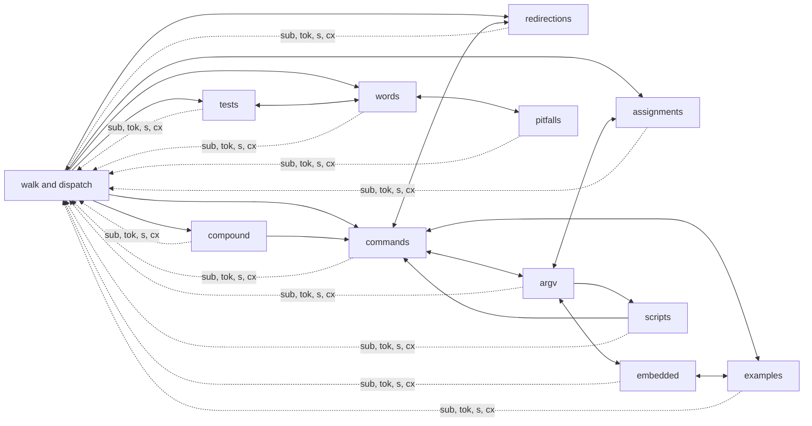
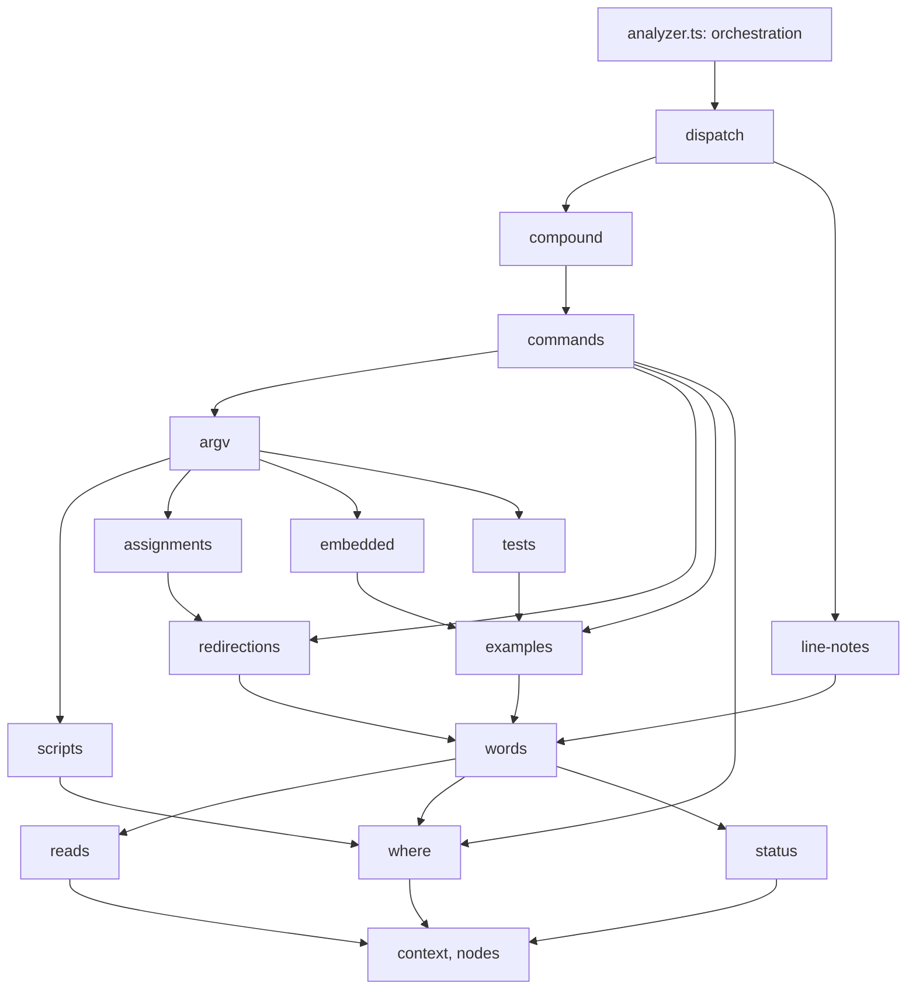

# A thin analyzer

src/analyzer.ts is 4,202 lines (at d265509). One class, `Analyzer`, holds about 200 members. The facts are no longer decided there: [semantics.md](semantics.md) and [refactor.md](refactor.md) moved them into the specs (src/argv/), the semantic model (src/semantics/) and the example sources (src/examples/source.ts). What is left is mostly the assembly of an explanation: tokens, notes, pitfalls and examples.

An outside review noted the size, and the pace (683 commits in 9 days). For one maintainer over the long term, a thin core matters more than a wider scope. The maintainer agreed: the next big work is to thin analyzer.ts, not to add features. This page plans it. Each step is a PR. The [traceability table](#traceability) records the findings and the steps.

Status: step 0 (the guards and the snapshot) is done (#275), step 1 (the facts the models own) is done (#308), and step 2 (the context) is done (#324). Steps 3 to 9 are not started: src/explain/ has the context and the node helpers only, and src/analyzer.ts is 3,905 lines.

The goal is not new behaviour. Every explanation stays byte-identical, except where a step fixes a contradiction with bash (and then says so).

## 1. What analyzer.ts holds (at d265509)

### 1.1 The parts

The file has three parts:

- **Imports and module helpers** (lines 1–170): about 60 lines of imports, the node-type sets (`BLOCKS`, `LAST_STAGES`, `BLOCK_OWNERS`, `WRAPPERS`), span and line helpers, `braceExpansion`, and the `LineContext` interface.
- **The class `Analyzer`** (lines 171–4042, 3,872 lines).
- **Module helpers after the class** (lines 4044–4202): `CommandHead`, `SHOPT_NAMES`, `sedPattern`, `jobSpec`, `dropLabelEcho`, `skeletal`, `summaryOf`, `sortTokens`, `lineStarts`, `posOf`, and the re-export of `lookupCommand`.

### 1.2 The class, by responsibility

The members fall into fourteen groups. Lines are those of the member bodies, without their doc comments. With the comments, add about 15%.

| Group | Members | Lines | Main members | Writes to the line's context |
|---|---:|---:|---|---|
| Walk and dispatch | 22 | 285 | `explainLine`, `explainNode`, `explain`, `sub`, `subs`, `full`, `flatten`, `ordered`, `anon`, `contextLabel`, `notes` (here-document and continuation notes), `say`, `s`, `t`, `tok`, `lineRef` | `line`, `context`, `facts` |
| Where code runs | 6 | 71 | `shoptAt`, `groupSubshell`, `subshellWhy`, `inSubshell`, `shellEffectNote`, `pidNote` | none |
| Compound commands | 13 | 224 | `forStatement`, `whileStatement`, `caseStatement`, `caseItem`, `casePattern`, `functionDef`, `coprocStatement`, `pipeline`, `list`, `block`, `missingKeyword`, `comment`, `shebangEnv` | notes, examples |
| Redirections | 13 | 194 | `redirected`, `redirectedWhole`, `redirectLayout`, `splitCommand`, `redirectInfo`, `fileRedirect`, `redirectTargetNote`, `wholeRedirect`, `fdExpansion`, `heredoc`, `herestring` | notes |
| Assignments and declarations | 9 | 209 | `assignment`, `assignments`, `assignmentList`, `markedAssignment`, `declaredOperand`, `unsetOperand`, `nameGlob`, `declarationOption`, `endOfOptions` | notes |
| Status notes | 4 | 44 | `postfixStatusNote`, `statusRangeNote`, `statusNotes`, `substitutionStatus` | notes |
| Commands | 17 | 356 | `command`, `commandParts`, `commandToken`, `commandTail`, `commandHead`, `commandHeadFor` (123 lines), `functionCall`, `missedNote`, `resolve`, `specFor`, `hostCommand`, `timed`, `tagExamples`, `anchorExamples` | notes, examples |
| Arguments by the spec (argv rendering) | 19 | 408 | `args`, `render` (100 lines), `optionToken`, `equalsToken`, `letterParts`, `valueToken`, `operandToken`, `splicedNote`, `wrapped`, `positional`, `testArgs` | `argCtx`, notes |
| Embedded languages | 12 | 206 | `embedded`, `embeddedText`, `embeddedTextInner`, `embeddedExample`, `fromEmbedded`, `findExpression`, `trContext`, `given`, `optionValues`, `regexFlavor` | examples |
| Examples | 27 | 424 | `titledExamples`, `wantsExample`, `jqExamples`, `yqExample`, `yqStreams`, `pipelineExample`, `pipelineStages`, `commandExampleFor`, `inputSource`, `stdinOf`, `unreadStdin`, `readExample`, `wordExample`, `regexExample`, the pattern and test examples | examples, notes |
| Pitfalls from the models | 7 | 147 | `pipeSubshellPitfalls`, `unmatchedGlobPitfalls`, `extglobPitfalls`, `globOptionNote`, `starStarNote`, `globNotes`, `extglobNote` | notes |
| Scripts run by commands | 8 | 187 | `scriptTokens` (a nested `Analyzer` per string), `withScript`, `joinedScript`, `fromScript`, `scriptSpan`, `trapNote`, `slotNotes` (80 lines), `unpassedVariables` | notes, facts, examples |
| Tests and arithmetic | 10 | 207 | `test`, `testTokens`, `unary`, `binary`, `regexNode`, `numericTestNote`, `quotedPatternNote`, `inArithmetic`, `isAssoc` | notes, examples |
| Words and expansions | 37 | 362 | `word`, `string`, `variable`, `simpleExpansion`, `expansion`, `subscript`, `tilde`, `braceWord`, `splitNote`, `variableNote`, `valueNote`, `wordAt`, `globOff`, the arithmetic literals, `commandSubstitution`, `processSubstitution` | none (reads `argCtx`) |

Two areas named in the brief need little work here:

- **Host files.** Their remapping is already outside, in src/hosts/remap.ts. The analyzer only reads `opts.host` (for yq) and `hostCommand` (bats functions).
- **The `reading` origin** is not on main yet. PR #269 (tree view) adds `Token.origin`, set by `render`, `testArgs`, the embedded explainers and `scriptTokens` (+47 −13 lines in analyzer.ts). Its marks follow the groups above: argv rendering is `argv`, embedded languages are `embedded`, scripts are `script`, the rest is `shell`. In the target, the module that makes a token sets its origin.

There are 393 inline `this.s(ja, en)` texts. They move with their functions, unchanged.

### 1.3 Shared mutable state

Every group reaches the per-line state through `this.cx` (a `LineContext`, made new by each `explainLine`):

- `extraNotes`: pushed in 40 places, from ten groups. Any function can add a note to the line.
- `examples`: pushed or sliced in 27 places. `tagExamples` and `anchorExamples` mark, after the fact, which command the new ones belong to.
- `facts`: written by `say` and by `scriptTokens`.
- `line`: the line filter. `full` sets it to null and restores it, so it must stay one shared object.
- `argCtx`: the command whose words are explained. `render` sets it; embedded languages, examples and words read it. It is an implicit parameter.
- `state`, `status`, `shell`, `opts`, `source`, `rootNode`, `slotEnvs`: read only.

Two adapters already copy parts of the class for other modules: `ExpansionHost` (src/expansion-tokens.ts, 12 members) and `EmbeddedContext` (src/embedded/registry.ts).

### 1.4 Dependencies between groups

Every group calls the walk (`sub`, `subs`, `full`, `tok`, `s`), and the walk dispatches to every group. Beyond that, the calls between groups form cycles:



Most cycles come from a few shared readers, not from real recursion:

- `resolve`, `specFor` (called from argv, examples, scripts, embedded, compound);
- `shoptAt`, `wordAt`, `globOff`, `unquotedWord` (from pitfalls, examples, redirections, assignments);
- `isAssoc`, `inArithmetic` (from words and assignments into tests);
- `given`, `optionValues` (from examples into embedded);
- `tagExamples`, `anchorExamples` (from tests, embedded, compound into commands);
- `globNotes`, `extglobNote` (word notes, grouped with the pitfalls).

Three are real recursion:

- the dispatch: a part's explanation explains its children;
- `splitCommand` (a command with redirections before its words) calls `commandToken`;
- `scriptTokens` explains a string with a new `Analyzer`; `findExpression` (find's `-exec`) calls `render`.

### 1.5 Decisions that belong to the models

CLAUDE.md "Design" says the analyzer does not check names, and does not decide what the models own. A few such places are left:

- **Name checks.** `commandTail` picks the yq flavour when the name is `yq` (1356). It says `local` fails outside a function by looking for a `function_definition` ancestor (1364). `regexFlavor` tests `cmd === 'sed'` (3157). The pipeline example labels the `xargs` stage by name (2741).
- **Where code runs, from node types.** `groupSubshell` climbs a hand-written list of parent types (377). `inSubshell` tests the reason with a regex (`/substitution/`, 417). `pipeSubshellPitfalls` decides the last stage and the scope of a variable with `LAST_STAGES` and `BLOCK_OWNERS` (2964, 2982).
- **Options per shell.** `shoptAt` says that `globstar` is on in zsh and is `set -o globstar` in ksh (361–362).
- **Words read by text.** `unpassedVariables` finds the variables a string reads with a regex over expansion texts (3185), beside the string's own model. `slotNotes` decides which words are risky with `hasExpansionNode` (3239).

These are small. They are fixed first (step 1), so that the split moves code that only renders.

## 2. The target

### 2.1 Principles

1. **analyzer.ts orchestrates.** It builds the line's context, explains the items of the line, gathers the notes and the examples, and returns the `LineExplanation`. Nothing else.
2. **One module per part of the explanation.** Each part of bash the reader learns (words, commands, redirections, compound commands, tests) has its module, in src/explain/.
3. **Functions, not a class.** A module exports functions `(cx: Explainer, n: SyntaxNode, …) => Token`. The context is the only state.
4. **The context is small and explicit.** What a line collects goes through three sinks (`note`, `say`, `example`). The current command is a scoped value (`withCommand`), not a field anyone may set.
5. **Facts come from the models.** A module renders what a model says. It does not compare command names, and it does not decide semantics from node types (see 2.4).
6. **No cycles.** Modules import only modules below them (2.3). The few real recursions go through the context.
7. **No change of behaviour.** A move keeps every explanation byte-identical (section 5).

### 2.2 The context

One object per line, made by analyzer.ts. It replaces `LineContext`, `ExpansionHost` and the analyzer's half of `EmbeddedContext`.

```ts
// src/explain/context.ts (sketch)
export interface Explainer {
  readonly lang: Lang;
  s(ja: string, en: string): string;
  t(text: Text): string;
  tok(n: SyntaxNode, kind: Kind, explanation: string, children?: Token[], label?: string): Token;

  /** The models of the script, read only. */
  readonly state: StateModel;
  readonly status: StatusModel;
  readonly shell: Shell | undefined;
  readonly opts: ExplainOptions;
  readonly source: string;
  readonly nested: NestedScript['kind'] | undefined;

  /** The walk: the line filter and the dispatch (src/explain/dispatch.ts). */
  explain(n: SyntaxNode): Token;
  sub(n: SyntaxNode | null | undefined): Token[];
  subs(nodes: readonly (SyntaxNode | null | undefined)[]): Token[];
  full(n: SyntaxNode): Token;
  onLine(n: SyntaxNode): boolean;

  /** What the line collects; nothing else writes it. */
  note(text: string): void;
  say(f: Fact): string[];
  example(e: Example): void;
  /** The examples added inside `f`, tagged with the command they belong to (today `tagExamples`). */
  examplesOf<T>(n: SyntaxNode, f: () => T, words?: Layout): T;

  /** The command whose words are explained (today `argCtx`), set only for the time of `f`. */
  readonly command: CommandContext | undefined;
  withCommand<T>(c: CommandContext, f: () => T): T;

  /** Re-entry points, for the real recursions (1.4). */
  commandToken(n: SyntaxNode, redirsOut?: boolean): Token;
  nestedLine(tree: SyntaxTree, line: number, shell: Shell | undefined): LineExplanation;
}
```

The line filter (`line`) and the collected lists are private to the implementation. `full` saves and restores the filter on the one object. A module never copies the context (`{ ...cx }` would break `full`).

### 2.3 The modules

Sizes are estimates, with doc comments.

| Module | From the groups | Lines | Reads (models) |
|---|---|---:|---|
| src/explain/context.ts | `LineContext`, `say`, `s`, `t`, `tok`, `lineRef`, example tagging; replaces `ExpansionHost` | 200 | the message catalog (`said`) |
| src/explain/nodes.ts | span and line helpers, `shorten`, `sortTokens`, `skeletal`, `dropLabelEcho`, `lineStarts`, `posOf`, `fromEmbedded` | 150 | the syntax tree |
| src/explain/reads.ts | `resolve`, `specFor`, `hostCommand`, `shoptAt`, `wordAt`, `globOff`, `globState`, `unquotedWord`, `isAssoc`, `inArithmetic`, `given`, `optionValues`, `regexFlavor`, `trContext` | 250 | names, state, words, argv query |
| src/explain/where.ts | where code runs: `groupSubshell`, `subshellWhy`, `inSubshell`, `shellEffectNote`, `pidNote` | 90 | env |
| src/explain/status.ts | `postfixStatusNote`, `statusRangeNote`, `substitutionStatus` | 60 | status, statusfacts |
| src/explain/words.ts | words and expansions, with `globNotes`, `extglobNote`, `globToken`, `globChildren` | 450 | words, state |
| src/explain/examples.ts | example builders that read the line (jq, yq, pipeline, regex, read, glob, case, test); may split off examples-jq.ts | 500 | spec (`example`, `io`, `eachFile`), examples/source.ts |
| src/explain/embedded.ts | `embedded`, `embeddedText`, `embeddedTextInner`, `embeddedExample`, `ansiCChildren` | 200 | embedded registry, argv query |
| src/explain/tests.ts | `test`, `testTokens`, `unary`, `binary`, `regexNode`, `numericTestNote`, `quotedPatternNote` | 230 | testexpr, `testSpecOf` |
| src/explain/redirections.ts | redirections, without `splitCommand` and `redirectLayout` | 190 | idioms (`simulateRedirects`), state |
| src/explain/scripts.ts | `scriptTokens`, `withScript`, `joinedScript`, `fromScript`, `scriptSpan`, `trapNote`, `slotNotes`, `unpassedVariables` | 220 | `state.script`, env |
| src/explain/assignments.ts | `assignment`, `assignments`, `assignmentList` | 150 | state, vars |
| src/explain/argv.ts | `args`, `render`, options, values, operands (with `declaredOperand`, `unsetOperand`, `markedAssignment`, `nameGlob`, `findExpression`), `wrapped`, `positional`, `testArgs`; may split into options.ts and operands.ts | 600 | ArgvParse, argv query, effects |
| src/explain/commands.ts | `command`, `commandParts`, `commandTail`, `commandHead`, `commandHeadFor`, `functionCall`, `missedNote`, `timed`, `splitCommand`, `redirectLayout` | 450 | names (`resolveName`, `assignmentsOf`), spec |
| src/explain/compound.ts | loops, `if`, `case`, functions, coproc, pipelines and lists, groups, comments and the shebang | 270 | env, state |
| src/explain/line-notes.ts | notes on the line as a whole: here-document and continuation notes, `statusNotes`, the pitfalls from the models (`pipeSubshellPitfalls`, `unmatchedGlobPitfalls`, `extglobPitfalls`), `globOptionNote`, `starStarNote` | 320 | state, env, status |
| src/explain/dispatch.ts | `explainNode`, `explain`, `sub`, `flatten`, `ordered`, `anon`, `contextLabel` | 260 | the syntax tree, refs |
| src/analyzer.ts | `Analyzer` (constructor, `explainLine`), `isBlockLike`, the re-exports | 150 | — |

The public API does not change. Tests and products keep `new Analyzer(lang).explainLine(tree, line, shell, opts)`, `isBlockLike`, `lookupCommand` and the type re-exports. 62 test files import them.

**Pitfalls.** There are three kinds, and each keeps one place:

- *Style checks on the text*, with no model: src/pitfalls.ts, src/dialect.ts, src/idioms.ts, as today (CLAUDE.md: "Style checks stay in src/pitfalls.ts").
- *Notes on the line that follow from the models* (a variable lost after a pipeline, a glob that matches nothing, status and errexit): src/explain/line-notes.ts. Each is a catalog entry, said through `cx.say(fact(…))`.
- *Notes on one token* (`splitNote`, `variableNote`): in the module of the token.

The `notes.pitfalls` setting stays applied in one place, `said` (src/messages.ts). No module tests it.

### 2.4 Facts only from the models

Each module renders what a model says. The rule per kind of fact:

| Fact | Source | Not |
|---|---|---|
| What a name runs | `resolveName` (through `reads.resolve`) | `name === 'local'` |
| What a command's words are | the `ArgvParse` and src/argv/query.ts | regexes over words |
| What a command does with input, its example | the spec (`CommandSpec.example`, `io`, `eachFile`) | `cmd === 'sed'` |
| Where code runs | `processOf`, `ownSubshells`, `whereOf`, `reachOf` (env) | climbing parent types |
| What a word does | `wordMeaning`, `partMeaning`, `wordFields` | `n.parent.type !== 'string'` |
| Options and variables in effect | `shellState(…).at(n)` | per-shell tables in the analyzer |
| Status and errexit | `statusModel`, src/statusfacts.ts | node types |
| A string read as a script | `state.script(words, env)` | regexes over its text |

Switching on node types to *render* them is fine: the syntax tree is the model of the syntax. Deciding *semantics* from node types is not. Step 1 removes the places listed in 1.5. A guard keeps new ones out (3.3).

### 2.5 Layers

Imports point down only:



The real recursions go up through the context: `cx.explain` and `cx.sub` (the dispatch), `cx.commandToken` (a command with redirections first, from commands.ts back into itself through redirections), and `cx.nestedLine` (a string read as a script; analyzer.ts provides it). `findExpression` moves beside `render`, so embedded.ts does not call argv.ts.

## 3. Guards

### 3.1 File length

test/file-length.test.ts: no file in src/ is over 1,000 lines, except those listed in test/fixtures/file-length.json, each with a ceiling.

- The test fails when a listed file is over its ceiling, or when it now fits under 1,000 lines (a stale entry, as in bash-ast-known.json).
- A step that shrinks a listed file lowers its ceiling to the new count. The test prints it.
- The list starts with today's files over 1,000 lines:

| File | Lines |
|---|---:|
| src/analyzer.ts | 4,202 |
| src/dict/commands.ts | 2,102 |
| src/examples/jq.ts | 1,847 |
| src/semantics/walk/walker.ts | 1,511 |
| src/syntax/adapters/unbash.ts | 1,421 |
| src/examples/awk.ts | 1,388 |
| src/semantics/words.ts | 1,165 |

The others are outside this plan. They stay listed, and may only shrink. src/dict/commands.ts is a table; it may later be split by kind of command, like src/dict/*.ts already is.

### 3.2 No import cycles in src/explain

test/explain-imports.test.ts reads the imports of src/explain/*.ts (as test/syntax-boundary.test.ts reads them) and fails on a cycle. It also checks that no file in src/explain/ imports src/analyzer.ts.

### 3.3 No command names in src/explain

The same test looks for comparisons with a command name of the dictionary (`commands`, `builtins`): `=== 'sed'`, `.includes('declare')`. A comparison on `.type` is left out (node types such as `command` are also builtin names). The known ones are listed with a reason and may only shrink. After step 1 the list should be empty.

## 4. Steps

Each step is a PR. Each keeps every test passing and coverage at 100% (Node.js 24, `npm run coverage`, `npm run coverage:check`). Sizes are in changed lines with tests, as in refactor.md: S under 300, M 300–1,000, L over 1,000. A move counts twice (removed and added).

**How a move is done.** A move is mechanical: `private f(a)` becomes `export function f(cx: Explainer, a)`, `this.cx.x` becomes `cx.x`, `this.g(…)` becomes `g(cx, …)`. It is done by a script (with the TypeScript compiler API), kept with the PR. After a conflict, the move is redone on the new main by running the script again, instead of merging by hand. While a step is in progress, the class keeps one-line delegates for moved functions that unmoved code still calls; the step that moves the last caller removes them.

**Avoiding long conflicts.** The maintainer chose thinning over features, so feature PRs that touch src/analyzer.ts wait while a move PR is open. Each move PR is short-lived: opened, checked and merged in one sitting. PR #269 (tree view, `Token.origin`) should be merged, or rebased, before step 2: it touches `render`, `testArgs`, `scriptTokens` and the embedded explainers, and step 2 changes how tokens are made.

### Step 0: the guards and the snapshot (S). Done (#275)

- test/file-length.test.ts and test/fixtures/file-length.json (3.1).
- test/explain-imports.test.ts (3.2, 3.3). It passes at once: src/explain/ does not exist yet. A unit test of its cycle finder covers it.
- test/snapshot.ts, a debug helper like test/dump.ts: the full `LineExplanation` of every line of the corpus (test/support/corpus.ts: the fixtures, the host fixtures and snippets.json), in Japanese and English, as JSON lines. It fixes the clock first, so the `git log` samples do not change from run to run. Every later step diffs its output against main's. Run it on main and on the branch, then compare: `npx tsx test/snapshot.ts /tmp/main.jsonl` (about 6 s, 7.5 MB, 4,054 lines), and `git diff --no-index --stat /tmp/main.jsonl /tmp/branch.jsonl` (empty for a pure move).

### Step 1: the facts the models own (S). Done (#308)

These fix the places of 1.5 before anything moves. Each is small and independent. A behaviour change is a fix: it gets a test against bash or the tool, and a CHANGELOG line.

- **1.1 Names.** The yq flavour from the spec or the resolution, not the name (1356). `local` outside a function from the env model: whether the command runs in a function (a `call` link), not whether a `function_definition` is around it (1364). The regex flavour of sed from its spec (a spec field for the flavour each option selects) (3157). The `xargs` stage's label from the spec of a command that runs commands (`CommandRole`) (2741).
- **1.2 Where code runs.** `groupSubshell` and `inSubshell` ask src/semantics/env.ts (a query for "the subshell link of this group, through the lists that hold it", and the link's kind instead of a regex on `why`). `pipeSubshellPitfalls` asks the model which variables a pipeline's last stage sets in its own shell and which of them are read after it, in place of `LAST_STAGES`, `BLOCK_OWNERS` and the walk over `everyNode`.
- **1.3 Options per shell.** `shoptAt`'s `globstar` of zsh and ksh comes from the state model, which knows the shell.
- **1.4 Words of a string.** `unpassedVariables` reads the variables from the string's own model (`script.model`), not from a regex over expansion texts. `slotNotes` asks `wordMeaning` whether a word is expanded.

**As done (#308).** The four parts were small enough for one PR. The snapshot of the corpus is byte-identical before and after. What moved where:

- 1.1. yq is not in the dictionary: three tools share the name, and an entry would change what its name badge says (`isProgram`). So the dictionary answers for the name, as `lookupCommand` does for the others: `yqSpecsOf(name)` (src/dict/yq.ts) gives the three specs, and the analyzer no longer compares the name. `local` outside a function is `inFunction(env)` (src/semantics/env.ts): a call link, with no slot after it that starts another shell or a program; a `${ …; }` of bash 5.3 still counts as a function, by its syntax (`scopeOf`). sed's `-E` (`-r`) selects the mode `ere` of its spec, as grep's options already did, and `regexFlavor` reads the modes the given options select, and those of the words its name implies (`egrep`). The pipeline example labels the step of a stage whose spec has a command among its operands (xargs), not the stage named `xargs`.
- 1.2. `groupSubshellLink(env, n)` (src/semantics/env.ts) climbs the statements that hold a `{ }` group. `inSubshell` compares the link's reason with `command-substitution` and `process-substitution`. `lostVariable(model, p)` (the new src/semantics/pipeline.ts) says which variable the last stage of a pipeline sets in its subshell and the script reads after it, with `LAST_STAGES`, `BLOCK_OWNERS` and the walk over the nodes moved there; `readsVariable` moved from src/pitfalls.ts to src/syntax/tree.ts, so that the semantics do not import the pitfalls.
- 1.3. `shoptIn(st, name, shell)` (src/semantics/shellstate.ts, exported by src/semantics/state.ts) gives a shopt option in the model's shell (`StateModel.shell`): zsh's `**`, ksh's `set -o globstar`.
- 1.4. `plainReads(script)` (src/semantics/nested.ts) lists the plain `$v` and `${v}` of a string read as a script, from the expansion's parse (`parseExpansion`). `slotNotes` takes a word as expanded here when `wordMeaning` has a tilde, parameter, command, arithmetic, process or glob step that applies.

Two of them change what is said outside the corpus, as bash does (tests against bash in test/audit-shell.test.ts and test/env.test.ts; details in docs/changes/unreleased.md, under a kind of fix the changelog already lists): `f() { eval 'local x'; }` no longer gets the `local` pitfall, and the ssh pitfall now names `'a'*`, `a=~/x` and `<(…)`, which bash expands here, and not a `*` after `set -f`. The other parts gave the same output on a set of edge cases (groups in pipelines, `&` and coprocs, lastpipe, zsh and ksh globstar, yq, grep and sed flavours, `egrep -F`, xargs stages, variables a `bash -c` string reads).

The analyzer still compares command names elsewhere (`head.name === 'local'` to find `local` at all, `return`, and others). They are not in 1.5's list; the guard of 3.3 checks them when their code moves to src/explain/.

### Step 2: the context (M)

- src/explain/context.ts with `Explainer` (2.2), and src/explain/nodes.ts with the module helpers.
- The class makes one `Explainer` per line and keeps its methods; they call `cx.note`, `cx.say`, `cx.example`, `cx.examplesOf`, `cx.withCommand` instead of pushing to `this.cx` lists. That is about 70 call sites.
- `ExpansionHost` becomes the `Explainer` (src/expansion-tokens.ts takes it as it is). `EmbeddedContext` is built from it.
- Moves about 200 lines. Risk: low (one file, mechanical), but the line filter must stay shared (`full`).

**As done (#324).** The snapshot of the corpus is byte-identical before and after (and so is a snapshot of the corpus with options: the reading tree, pitfalls and idioms off, examples disabled, a Markdown host with bash 5.3). src/analyzer.ts went from 4,092 to 3,905 lines; src/explain/context.ts is 306 lines and src/explain/nodes.ts 90. What moved where:

- src/explain/nodes.ts: the module helpers on nodes, tokens and positions (`isBlockLike` and the block sets, `intersects`, `effEndRow`, `same`, `onLine`, `sibling`, `has`, `skeletal`, `summaryOf`, `sortTokens`, `ancestorOf`, `lineStarts`, `posOf`, `sameSpan`). analyzer.ts re-exports `isBlockLike` and `summaryOf`. The helpers of one group stay in the class's file and move with it (`braceExpansion`, `CommandHead`, `SHOPT_NAMES`, `jobSpec`, `Layout`, `stageText`, `redirectParts`…).
- src/explain/context.ts: the `Explainer` interface, and `LineExplainer`, which implements it with what analyzer.ts reads back (`LineOutput`: the notes, facts, anchors, examples and context entries, `anchored`, `end`). `LineContext` is gone. `say`, `s`, `t`, `tok`, `lineRef`, `sub`, `subs` and `full` are the context's; the class keeps one-line delegates for them. The dispatch stays in the class and is handed to the context as a `Walk` (`explain`, `flatten`), which `sub` and `full` call back.
- The writes: the 38 places that added a note call `cx.note`, the 9 that added an example `cx.example`; the example marks (`before = examples.length`, then `tagExamples` or `anchorExamples`) are `cx.examplesOf` and `cx.examplesAt`, scoped around the code that adds them; `argCtx` is `cx.command`, set by `render` with `cx.withCommand`. No `this.cx.extraNotes`, `examples`, `facts`, `anchors` or `context` is left in the class.
- `ExpansionHost` and `SubstitutionHost` are gone: src/substitution-tokens.ts and src/expansion-tokens.ts take the `Explainer` as it is. `EmbeddedContext` takes its language from the context.

Where the sketch of 2.2 did not fit main, it was adapted, and 2.2 is read with these changes:

- `say(f, at)` takes the node the fact is about (notes carry ranges since #323), and `note(what, at)` takes a fact or a text and the node or nodes it is about; `anchored` (for the dialect, idiom and pitfall findings) is the orchestration's, on `LineOutput`.
- Besides `examplesOf`, `examplesAt` attaches the examples to a node without naming a command (the old `anchorExamples`), and `examplesReplaced` lets one example replace those of the stages (a pipeline's).
- `enclosing(entry)` records a construct around the line (`LineExplanation.context`, pushed by `flatten`), and `adopt(ex, span)` joins the notes, facts and examples of a line of a string read as a script (`scriptTokens`), until `nestedLine` replaces the nested `Analyzer` (step 7).
- `line` is readable (two places compare it: the header of a redirected block, and whether a `case` branch's patterns are on the line); only `full` and `end` change it. `onLine(n)` replaces the `line === null || intersects(n, line)` tests.
- `slotEnvs` is on the context (`args` fills it, the slots read it). The stages of pipelines are a memo of the line (`cx.memo(key)`, the key made by the code that reads it), so the context does not know the types of the examples.
- `explain`, `commandToken` and `nestedLine` are not on the `Explainer` yet: nothing outside the class calls them, and an unused member would be uncovered. They come with the steps that move their callers.
- What `${…}` asks of the analyzer's words (`varDesc`, `variableNote`, `orderNote`, `isAssoc`, `globChildren`) stays a small interface of src/expansion-tokens.ts (`ExpansionWords`), passed beside the context, until step 4 moves the words.

### Step 3: the readers (M)

src/explain/reads.ts, where.ts and status.ts (2.3). These are the leaves that most groups call. Moves about 400 lines.

### Step 4: words and expansions (M)

src/explain/words.ts. Moves about 450 lines.

### Step 5: tests, redirections (two M PRs)

src/explain/tests.ts (about 230 lines), then src/explain/redirections.ts (about 190). `splitCommand` and `redirectLayout` stay in the class until step 8.

### Step 6: examples, embedded languages (two M PRs)

src/explain/examples.ts (about 500 lines; split off examples-jq.ts if it is near 600), then src/explain/embedded.ts (about 200).

### Step 7: arguments, assignments, scripts (L, in three PRs)

src/explain/scripts.ts (about 220 lines; `nestedLine` from the context replaces the nested `Analyzer`), src/explain/assignments.ts (about 150), then src/explain/argv.ts (about 600, or options.ts and operands.ts). argv rendering is where new commands and options most often land: do this PR in a quiet window.

### Step 8: commands, compound commands, line notes (two M PRs)

src/explain/commands.ts (about 450 lines, with `splitCommand` and `redirectLayout`), then src/explain/compound.ts (about 270) and src/explain/line-notes.ts (about 320).

### Step 9: the dispatch, and analyzer.ts as orchestration (M)

src/explain/dispatch.ts (about 260 lines). analyzer.ts keeps `Analyzer`, `explainLine` and the re-exports, about 150 lines. Its entry leaves test/fixtures/file-length.json. CLAUDE.md "Design" gets a line on src/explain/ (one module per part, the context, the layers).

### Summary

| Step | What | Size | PRs | Depends on |
|---|---|---|---:|---|
| 0 | Guards, snapshot | S | 1 | — |
| 1 | Facts the models own | S | 1 (#308) | 0 |
| 2 | The context | M | 1 (#324) | 0; #269 merged |
| 3 | Readers, where, status | M | 1 | 2 |
| 4 | Words | M | 1 | 3 |
| 5 | Tests, redirections | M each | 2 | 4 |
| 6 | Examples, embedded | M each | 2 | 4 |
| 7 | Scripts, assignments, argv | M–L | 3 | 5, 6 |
| 8 | Commands, compound, line notes | M each | 2 | 7 |
| 9 | Dispatch, orchestration | M | 1 | 8 |

About 18 PRs; about 3,900 lines move. Steps 1.1–1.4 run in parallel with each other. They merge before step 3, which moves the functions they change (`groupSubshell`, `inSubshell`, `shoptAt`). Steps 5 and 6 are independent of each other.

## 5. Checks and risks

### 5.1 Every step

1. `npm test`, then `npm run coverage` and `npm run coverage:check` on Node.js 24.
2. The snapshot (step 0) of main and of the branch, in both languages, with an empty diff. A step of step 1 may differ only on the lines it fixes, each with a test against bash or the tool.
3. `npx tsx test/dump.ts test/fixtures/sample.sh en` unchanged (CLAUDE.md asks for it after edits to sample.sh; here it is a quick first look).
4. The guards: file length (ceiling lowered), imports (no cycle), names (list shrinking).
5. The PR lists the finding IDs it addresses, and updates the table below in the same PR.

### 5.2 Risks

- **Behaviour drift.** A moved function that reads `this` in a closure, or a getter (`ExpansionHost.shell` is one), can read a stale value. The snapshot covers every line of the corpus in both languages, with every field of `LineExplanation`. It is the main defence.
- **The line filter.** `full` sets and restores `line` on the shared context. A copy of the context, or a module that caches `line`, would explain the wrong parts. The context hides `line` behind `onLine` and `full`.
- **Example tagging.** `tagExamples` tags the examples added since a mark, innermost command first. `examplesOf` must keep that order. The snapshot includes `target` and `anchor`.
- **Nested scripts.** `scriptTokens` makes a new `Analyzer` with `nested` set, and the same options. `nestedLine` must do the same, and keep the notes, facts and examples it brings back.
- **Coverage.** A move keeps the code and its tests. The seven `c8 ignore` comments move with their code; a delegate left behind must be called, or removed in the same step.
- **Conflicts.** Each move touches lines feature PRs also touch. The move script and the wait on analyzer feature PRs (section 4) keep this short.
- **Performance.** One context per line, and plain function calls, cost no more than the class. The status-fact cache (`statusFactCache`) stays at module level.
- **The fuzz test** is seeded from the corpus. These steps do not change the corpus, unless a step-1 fix adds a snippet; then a latent adapter bug may show, and it is fixed, not reseeded (CLAUDE.md).

### 5.3 Not planned here

- **The inline texts.** 393 `s(ja, en)` texts move with their code. Many state facts of the models and could be catalog entries (src/messages.ts). That is a change of each note's identity (`LineExplanation.facts`), so it is a plan of its own, after this one.
- **The other long files** (3.1). They are listed and may only shrink.

## Traceability

Findings at d265509. Status: `planned`, `PR #N`, `done`, `won't do` or `not a problem`.

| ID | Finding (short) | Step | Status | Verified by |
|---|---|---|---|---|
| T1 | analyzer.ts is 4,202 lines, one class of about 200 members | 3–9 | planned | file-length test: analyzer.ts under 1,000 lines, then about 150 |
| T2 | Per-line state written from anywhere: notes pushed in 40 places, examples in 27, `argCtx` an implicit parameter | 2 | done (PR #324) | the snapshot unchanged; no `cx.extraNotes.push` left: notes, examples and the command go through the context's sinks and `withCommand` |
| T3 | Three overlapping hosts: `LineContext`, `ExpansionHost`, the analyzer's half of `EmbeddedContext` | 2 | done (PR #324) | one `Explainer` (the five reads of the words stay `ExpansionWords` until step 4); the snapshot unchanged |
| T4 | Name checks: yq (1356), `local` (1364), sed (3157), xargs label (2741) | 1.1 | done (PR #308) | names guard list empty; tests against the tools |
| T5 | Where code runs, decided from node types: `groupSubshell` (377), `inSubshell` (417), `pipeSubshellPitfalls` (2964, 2982) | 1.2 | done (PR #308) | env probes; test/facts-from-model.test.ts rows |
| T6 | `shoptAt` decides `globstar` per shell (361–362) | 1.3 | done (PR #308) | state probes |
| T7 | A string's variables read by a regex (3185); risky words by node types (3239) | 1.4 | done (PR #308) | rows against bash (`bash -c`, `sudo`, `env -i`) |
| T8 | Cycles between the groups (1.4) | 3–9 | planned | test/explain-imports.test.ts |
| T9 | No guard on file length, import cycles or name checks | 0 | done (PR #275) | the guards themselves |
| T10 | No before/after check of the whole explanation | 0 | done (PR #275) | test/snapshot.ts |

| Step | Status |
|---|---|
| 0 | done (PR #275) |
| 1.1–1.4 | done (PR #308) |
| 2 | done (PR #324) |
| 3 | planned |
| 4 | planned |
| 5 | planned |
| 6 | planned |
| 7 | planned |
| 8 | planned |
| 9 | planned |
