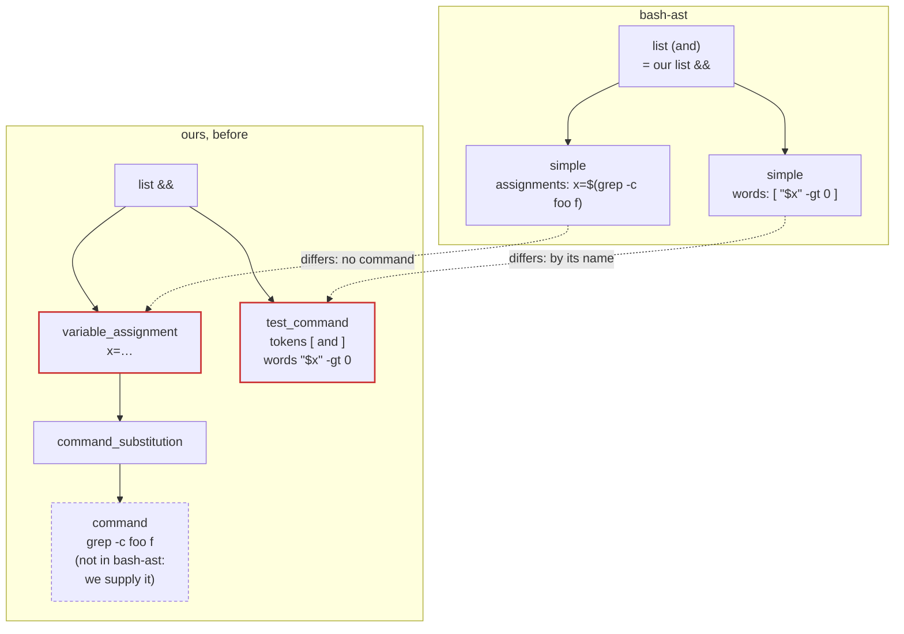
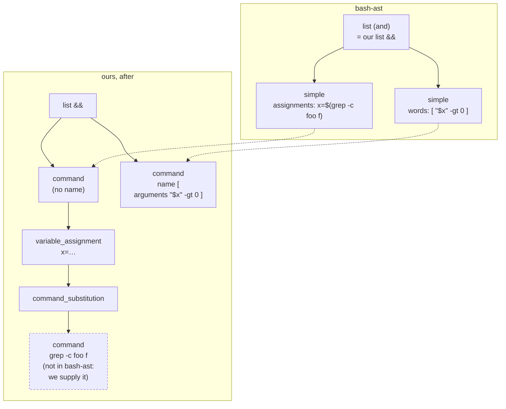
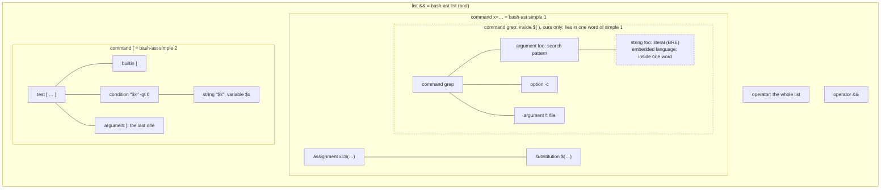

# The syntax tree, and the parsers behind it

Bash Explainer reads scripts through a syntax tree of its own: [src/syntax/tree.ts](../../src/syntax/tree.ts). A parser library is wrapped by an *adapter*, which turns that library's output into this tree. Nothing else in the code knows which library parsed the script, so the library can be replaced by writing one new adapter.

This page describes the model, its rules, and the move from tree-sitter-bash to [unbash](https://github.com/webpro-nl/unbash), which is done: tree-sitter is no longer in the repository. Mentions of it below are history.

## Why

The extension was built on tree-sitter-bash, read through web-tree-sitter. That coupling has costs:

- **Upstream is nearly inactive.** The last commit was in December 2025, and 24 PRs are open. We patch the grammar and build the wasm ourselves (`patches/tree-sitter-bash/`).
- **Some misparses need more than a grammar patch.** Example: a line with `&&` after a pipeline ([tree-sitter-bash#347](https://github.com/tree-sitter/tree-sitter-bash/issues/347)).
- **tree-sitter's names and quirks were all over the code.** About 8 files and 1,000 member accesses depended on them:
  - 53 node types and about 90 token strings;
  - `(( ))` parsed as a `compound_statement`, and `select` as a `for_statement`;
  - wasm memory (`tree.delete()`) and node identity (`node.id`) leaked into the code.

unbash parses more scripts correctly (451 of 451 in a sweep of system scripts, against 426), and recovers better from errors. It is young, though: six major versions in eight months, each changing its AST, with a single maintainer. The adapter keeps such changes, and any later switch, in one place.

## The model

`SyntaxTree` holds the text, the root node, and `errors` (each with a `kind`, a message and a range). The `kind` is `missing` (a token the grammar expects is not there; the open construct is `incomplete`, and the error is a place of no width) or `unreadable` (text the parser could not read; there is an `error` node over it). An adapter lists a place once. `BashParser.parse(text)` is synchronous.

A `SyntaxNode` has:

| property | meaning |
|---|---|
| `type` | the kind of node, a `NodeType`; for a token, its text (`if`, `&&`, `[[`, `>>`) |
| `named` | `false` for tokens (keywords and operators), `true` otherwise |
| `text` | the source text, always from the original text |
| `startIndex`, `endIndex` | offsets in UTF-16 code units, end exclusive |
| `startPosition`, `endPosition` | `{ row, column }`, zero-based, column in UTF-16 code units (as in VS Code and the browser) |
| `parent`, `children`, `namedChildren` | `children` holds tokens and named nodes in source order |
| `field` | the part this node plays in its parent (`name`, `argument`, `left`, `operator`, `body`…), or `null` |
| `incomplete` | the construct is not closed: the user is still typing (`if x; then` with no `fi`) |

Helpers in the same module (`field`, `fields`, `token`, `ancestor`, `descendants`, `hasError`) are the only ways to walk a tree besides these properties.

### Rules every adapter keeps

1. **Every keyword and operator is a token child**, with its own range. The explanation highlights them, and fixes replace them (`==` → `=`). A library that gives no position for them (unbash gives none for `then`, `fi`, `&&`, `[[`…) gets them from the token scanner. The scanner reads the text between the known children, skipping comments, quotes and line continuations.
2. **Every comment is a `comment` node.** Directives live in comments.
3. **Types follow bash, not the library.** The vocabulary is `NodeType`. An unknown name is a type error, so a library's names cannot leak in by accident. The table shows where tree-sitter-bash, the parser used before, differed from bash:

   | bash construct | tree-sitter-bash gave | model |
   |---|---|---|
   | `(( … ))` | `compound_statement` starting with `((` | `arithmetic_command` |
   | `[ … ]` | `test_command` starting with `[`, holding binary, unary and parenthesized expressions | `test_command`: the tokens `[` and `]`, and between them a flat list of words (`word`, `string`, `raw_string`, `expansion`, `concatenation`…); operators and parentheses (`-f`, `=`, `-a`, `(`) are `word`s too |
   | `[[ … ]]` | `test_command` starting with `[[` | `extended_test` |
   | `select x in …` | `for_statement` starting with `select` | `select_statement` |
   | `time [-p] pipeline` | a command named `time` | `time_statement` (token `time`, `option`, `body`) |
   | `coproc [NAME] command` | a command named `coproc` | `coproc_statement`: the token `coproc`, the `name` (a `word`, if there is one) and the `body` (a command, or a compound command such as `{ …; }`) |
   | `rm !(*.txt)` | a word and a subshell (masked and parsed again) | one `word` |
   | text it cannot read | `ERROR`, or a MISSING token | `error` node, or `incomplete` on the open construct, plus an entry in `errors` |

4. **Text is the original text.** If an adapter masks parts of the text before parsing (as the unbash adapter does for CRs), node texts still come from the original.
5. **Nodes are plain objects.** Nothing needs to be freed, and the same node is the same object, so `===` tells nodes apart.
6. **Errors do not throw.** `parse` always returns a tree. The parts it read are in the tree; the rest is an `error` node, or `incomplete` on the open construct.

### Not in the model

- **Incremental parsing.** The extension never used it: it re-parses a document when its version changes. unbash parses bash_completion (2,291 lines) in about 2 ms.
- **The grouping of `[ … ]` arguments.** `[ ]` and `test` take words at run time, so a `test_command` has no binary, unary or parenthesized expression: the adapter keeps them flat. src/testexpr.ts groups the words as bash's `test` does, and the analyzer and pitfalls read only that. (`[[ … ]]` keeps its expressions.)
- **What `time` binds.** A `time_statement` has a `body`, which is a command or the whole pipeline after `time`, as in bash. The commands in it are explained, and checked for dialect and pitfalls, like any other.

## Where libraries may be imported

Only `src/syntax/adapters/unbash.ts` may import `unbash`; `cli/` and `web/` make their parser with the adapter's export. A test checks this, so the boundary does not erode.

## The move to unbash

The move was made in steps, each a PR with the test suite as the safety net. Most of the tests check the explanations, not the tree: 37 of 46 test files never look at a node.

1. **The model and this page.** This PR.
2. **A tree-sitter adapter** (removed in step 6). It turns web-tree-sitter's tree into the model, applying the normalizations above. It also takes over the extended glob masking from src/parser.ts.
3. **The consumers read the model.** These are dialect, fixes, pitfalls, hosts and document, then the analyzer, each in its own step where possible. Explanations do not change, and the tests stay as they are, except about 35 assertions that read nodes directly. The import boundary test is added at the end of this step.
4. **An unbash adapter**, with the token scanner and the comment recovery. Pin unbash to an exact version.
5. **A differential run** (the oracle, removed in step 6). Both adapters explain the same scripts: sample.sh, the test fixtures, and a sweep of real scripts. Every difference is either a fix (tree-sitter misread it) or an adapter bug, and gets fixed or recorded.
6. **The switch. Done.** Part 1: the extension, the language server, the command-line tool and the web page use the unbash adapter, and no bundle loads wasm. Part 2: the tree-sitter adapter, web-tree-sitter, tree-sitter-bash, `patches/`, `grammar/`, `scripts/build-grammar.mjs`, their CI step and the oracle are removed. The explicit trees of the inputs tree-sitter read wrongly, and the invariants and fuzz tests, stay as tests of the unbash adapter.

### Known gaps to cover in the unbash adapter

These come from a survey of unbash 6.0.0 (6.0.1 only changed ANSI-C byte escapes). The adapter fills them; most are small.

- **No positions for comments, keywords and operators.** The token scanner recovers them (estimated at 400–700 lines with tests).
- **`[ ]` and `test` are plain commands.** The adapter makes `[ … ]` a `test_command` with its words as a flat list; testexpr does the grouping.
- **Array elements `[k]=v`, tilde words and `=~` right sides are plain words.** The adapter splits them where the explanations need it.
- **Unclosed compound commands come out with zero width.** For `if x; then`, `{ echo` and `case x in a)`, the adapter extends them to what follows and marks them `incomplete`.
- **`echo a |` drops the whole pipeline**, and a heredoc with no closing line raises no error. These are errors the adapter reports itself.
- **Escaped backquotes inside backquotes** get positions in the decoded text. The adapter maps them back.

### The unbash adapter

`src/syntax/adapters/unbash.ts` builds the model from unbash's AST, and `src/syntax/adapters/tokens.ts` finds what unbash does not position (comments, keywords, operators) in the text between the nodes it does. unbash is a dependency of every bundle since the switch (step 6, part 1). How it is checked:

- **Expected trees** (test/syntax-adapter-unbash.test.ts): for the inputs tree-sitter read wrongly (#347, `for i do`, `coproc`, `<<-` with tabs, a here string after `}`, unfinished input…), the test holds the tree unbash must give; the rest of the file checks the shape of each construct. Until step 6 the same inputs were also compared node for node with tree-sitter's (the oracle).
- **Soundness** (`invariants` in test/support/corpus.ts): the trees of the shell code of the fixtures and of the snippets the tests pass to the parser or the analyzer (test/fixtures/snippets.json, made by scripts/extract-snippets.ts), also of text that is not bash, have children inside their parent and in order, and texts and positions that fit the source.

What the adapter does beyond a change of names:

- **Positions of tokens.** A node's gaps (the stretches between its children) are scanned for tokens and comments. A heredoc body is skipped. For a `` `…` `` with escapes in it, unbash parses the text without the escapes; the adapter parses that with a converter of its own and maps the positions back.
- **Statements as bash reads them, not as tree-sitter's grammar nests them.** The redirections after the last command of a pipeline or list belong to that command (`echo A && echo B > f` redirects only `echo B`); `!` negates the whole pipeline (`negated_command` over the `pipeline`); `time` is a keyword only at the start of a pipeline (`a | time b` runs the program). A redirection after a compound command belongs to it (`{ …; } > f`). What follows `<<EOF` on its line is parsed as usual: more redirections and arguments belong to the command, and `| cmd`, `&& cmd`, `; cmd` go on as stages and statements.
- **A `heredoc_redirect` ends with its body**, which comes after the rest of its line, so the nodes of that line lie inside its range without being its children. It is the only overlap the model allows: the leaves outside bodies are in text order, and no leaf but a body's lies in a body (test/support/corpus.ts, `invariants`). An `else`, an `elif` or a `case` item still ends with the newline of its last statement, and a string is cut into lines.
- **Errors.** Every error of unbash reaches `errors`: text it dropped (`a | | b`, a stray `)`) is an `error` node and an `unreadable` entry; what it found missing (`a >` has no target, `{ }` no command, `if a; fi` no `then`) is a `missing` entry with the construct `incomplete`. A test fuzzes the adapter with prefixes, cuts and words removed from the fixtures (test/support/fuzz.ts): no throw, sound trees, no text left out, and linear time.
- **Unfinished input.** An open construct gets `incomplete` and an error of kind `missing`, and ends where its content ends. For `echo a |` and `echo a &&` the adapter puts the operator back, in a `pipeline` or `list` with `incomplete` and no right side, since unbash drops it. A heredoc with no closing line is `incomplete`, an array with no `)` too. A token unbash drops (`unexpected token ')'`) becomes an `error` node and an error of kind `unreadable`.
- **`[k]=v` in an array, `~/x`, and `$"…"`** are a `word` and a `translated_string` (a `$` and a `string`): the explanations do not need more.

Where the model differs from what tree-sitter gave, because its shape was an accident of its scanner, and the consumers cope with both:

- **`extglob_pattern` or `word`** for a plain pattern after `=`/`==` in a test and in a `case` item: tree-sitter's external scanner decides (`y` is a pattern, `ab` a word, `*.txt` a word, `a*` a pattern). The adapter copies its rule as far as it could work it out, so most agree, but not all. The consumers read both types as a pattern.
- **A word cut at `{ } [ ]`**: tree-sitter makes `{src,test}`, `*.[ch]` and `{}` (of `find -exec`) concatenations of single-character words; the adapter keeps one `word`.
- **`{1..10..3}`**: a `brace_expression` with the step (tree-sitter does not read it).
- **A space before an expansion in a string**, **`>&-` as one operator**, **a redirection alone in a substitution**, and **`time` before a pipe with a redirection** (`time a >f | b`).

What unbash does not give, which the adapter does not repair: `echo (` is accepted without an error, and `x=(a b` reports an "unterminated extended glob".

### Risks

- **unbash's AST changes with each major version.** Pin the version. An upgrade touches only the adapter, and the differential run and the tests check it.

### To do at the switch (done in part 1)

Found in the review of the unbash adapter; they needed the analyzer or the build, not the adapter, and waited for step 6. What was done:

- **`echo ${x@Z}`** is explained as a bad substitution, as bash reports it (the letter is an `error` token). `${#a-b}` too, which unbash reads as `$#` with an operator.
- **web/tsconfig.json** no longer overrides `moduleResolution`, so `tsc -p web` finds unbash.
- **CRLF.** The adapter masks each CR before a LF as a space of the same length (`SyntaxTree.carriageReturns` holds where), so a CRLF script is explained as an LF one, and `documentIssues` warns once (`crlf`): bash reads the CR as part of the last word of the line (`fi\r`). A here-document in such a script has no closing line, as in bash.
- **`coproc_statement`** is a feature of dialect.ts.
- **`declare a[1]` and `declare a[@]`** are `subscript` nodes in the adapter, so "Element `[1]` of array `a`" stays.
- **`[ ( a = b ) -o c = d ]`** (a syntax error in bash) is no longer a test; the tests use `\( \)`, which the analyzer groups (and compares with bash).
- **`cat <<EOF; cmd`** is covered in test/analyzer.test.ts as well as in the adapter test.

## Command nodes at bash's granularity

A plan, not built yet. The goal: at the command level, our tree has the nodes bash's parser has. If bash makes something a simple command, so do we. Word-level parts (`string`, `expansion`, `concatenation`…) stay finer than bash's words: the explanations need them.

Why: some command nodes are left over from tree-sitter-bash, and the adapter makes them by looking at the command name. `[ … ]` becomes a `test_command` when the name is `[`. What a name runs is a question for the model (`resolveName`), not for the parser: a function named `[`, `enable -n [` or a quoted `"["` change it, and the adapter cannot see them all.

### What bash's parser makes

From bash 5.2's `command.h`, and checked with bash-ast v0.3.3 on the inputs below. bash's commands are: simple, connection (`;`, `&`, `&&`, `||`, newline), pipeline (bash-ast gives it its own node), `if`, `case`, `for`, arithmetic `for`, `select`, `while`, `until`, group `{ }`, subshell `( )`, arithmetic `(( ))`, conditional `[[ ]]`, function definition, and `coproc`.

- `[ -f x ] > o`, `test -f x`, `unset a b`, `\[ -f x ]`, `"[" -f x ]`, `command [ -f x ]`: each is one simple command, with its words as written. `[ -f x` is a simple command too: bash fails only at run time (`[: missing ']'`, status 2).
- `a=1 b=2`, `a=1`, `a=1 >o`, `>o`: a simple command with no words.
- `echo a >o` and `>o echo a 2>e`: one simple command; its redirections are part of it.
- `{ a; } >o`, `while …; done >o`, `( a ) 2>&1`: the redirections belong to the compound command (its own `redirects`).
- `! a | b`: a pipeline with a negated flag. `time -p a | b`: a pipeline with a timing flag (bash-ast drops it). For `! a` alone, bash's source puts the flag on the simple command; bash-ast prints a pipeline of one stage with `negated: true`, and shape.ts builds the same. For `! { a; }`, bash-ast drops the negation. A bare `time` is an empty simple command.
- `coproc N { a; }`: a `coproc` node, with the name and the body.
- `declare a=(1 2) b`, `export X=1`, `local -r y=$z`: simple commands. bash-ast lists `a=(1 2)` under `assignments`, and `declare` and `b` under `words`.

The last one has a real special case in bash's parser, at the word level. Take the first word of a simple command as written (not quoted, not escaped; after any prefix assignments and redirections; after alias expansion). When it names a builtin marked `ASSIGNMENT_BUILTIN` (`alias`, `declare`, `export`, `local`, `readonly`, `typeset`), the parser accepts `name=(…)` in the arguments. When the command runs, such arguments are expanded like assignments: no word splitting and no globbing. After `eval` and `let`, only the parse changes: `a=(…)` is accepted as a word, but the words are expanded as usual. Checked with bash 5.2:

| input | bash |
|---|---|
| `declare a=(1 2)`, `x=1 declare a=(1 2)`, `>o declare a=(1 2)`, `time declare a=(1 2)`, `! declare a=(1 2)`, `eval a=(1 2)`, `let a=(1+2)`, `alias a=(1 2)` | parsed. (`alias a=(1 2)` even makes the array `a`, then fails with `alias: a: not found`) |
| `echo a=(1 2)`, `\declare a=(1 2)`, `command declare a=(1 2)`, `builtin declare a=(1 2)` | syntax error near `(` |
| `v="1 2"` and then `declare a=$v`, `x=1 declare a=$v`, `local a=$v`, or (alias `d=declare`) `d a=$v` | `a` is `1 2` |
| `\declare a=$v`, `"declare" a=$v`, `command declare a=$v`, `builtin declare a=$v`, `c=declare; $c a=$v` | split: `` `2': not a valid identifier `` |
| a function `declare`, then `declare a=$v` | the function gets one argument, `a=1 2` |
| `eval a=$v` | split: `eval` runs `a=1 2`, so `2: command not found`, and `a` stays unset |
| `let a=$v` | split: `a` is `1` |

So bash decides it from the text of the name, not from what the name runs. It is a fact of the syntax, and the adapter may keep it. But it marks words; it does not make a kind of command.

### Audit of our command nodes

The manual groups commands by section, not by node: one section can hold several kinds ([3.2.5.2](https://www.gnu.org/software/bash/manual/html_node/Conditional-Constructs.html) holds `if`, `case`, `select`, `(( ))` and `[[ ]]`), and `!` and `time` are part of a pipeline ([3.2.3](https://www.gnu.org/software/bash/manual/html_node/Pipelines.html)). bash-ast's command types follow bash's parser (`command.h`), so the column gives the section that describes each one.

| our node | bash | manual | verdict |
|---|---|---|---|
| `command` | simple | [3.2.2](https://www.gnu.org/software/bash/manual/html_node/Simple-Commands.html) | matches, except that redirections after the last word go to a `redirected_statement` around it |
| `test_command` | simple (`[` is a builtin, `]` its last argument) | [3.2.2](https://www.gnu.org/software/bash/manual/html_node/Simple-Commands.html); `[`: [4.1](https://www.gnu.org/software/bash/manual/html_node/Bourne-Shell-Builtins.html) | differs: becomes a `command` |
| `declaration_command` | simple; its assignment arguments are parsed specially (above) | [3.2.2](https://www.gnu.org/software/bash/manual/html_node/Simple-Commands.html); `export`, `readonly`: [4.1](https://www.gnu.org/software/bash/manual/html_node/Bourne-Shell-Builtins.html); `declare`, `local`, `typeset`: [4.2](https://www.gnu.org/software/bash/manual/html_node/Bash-Builtins.html) | differs: becomes a `command`; the special words stay `variable_assignment` |
| `unset_command` | simple | [3.2.2](https://www.gnu.org/software/bash/manual/html_node/Simple-Commands.html); [4.1](https://www.gnu.org/software/bash/manual/html_node/Bourne-Shell-Builtins.html) | differs: becomes a `command` |
| `variable_assignment` as a statement | simple with no words | [3.2.2](https://www.gnu.org/software/bash/manual/html_node/Simple-Commands.html); [3.4](https://www.gnu.org/software/bash/manual/html_node/Shell-Parameters.html) | differs: becomes a `command` with no name. As a part of a command it matches bash's assignment word, and stays |
| `variable_assignments` | simple with no words | [3.2.2](https://www.gnu.org/software/bash/manual/html_node/Simple-Commands.html); [3.4](https://www.gnu.org/software/bash/manual/html_node/Shell-Parameters.html) | differs: becomes a `command` with no name |
| `redirected_statement` around a simple command | part of the simple command | [3.2.2](https://www.gnu.org/software/bash/manual/html_node/Simple-Commands.html); [3.6](https://www.gnu.org/software/bash/manual/html_node/Redirections.html) | differs: the redirections become children of the `command`, as those before the name already are |
| `redirected_statement` around a compound command | the compound command's `redirects` | [3.2.5](https://www.gnu.org/software/bash/manual/html_node/Compound-Commands.html); [3.6](https://www.gnu.org/software/bash/manual/html_node/Redirections.html) | matches (a wrapper instead of a field); keep |
| `negated_command` | a flag on the pipeline (or the command) | [3.2.3](https://www.gnu.org/software/bash/manual/html_node/Pipelines.html) | matches: the wrapper holds the `!` token; keep |
| `time_statement` | a flag on the pipeline | [3.2.3](https://www.gnu.org/software/bash/manual/html_node/Pipelines.html) | matches: the wrapper holds `time` and `-p`; keep |
| `coproc_statement` | `coproc` | [3.2.6](https://www.gnu.org/software/bash/manual/html_node/Coprocesses.html) | matches |
| `pipeline` | pipeline | [3.2.3](https://www.gnu.org/software/bash/manual/html_node/Pipelines.html) | matches |
| `list` | connection with `&&`, `\|\|` | [3.2.4](https://www.gnu.org/software/bash/manual/html_node/Lists.html) | matches; `;`, `&` and newlines separate the statements of the parent |
| `compound_statement`, `subshell` | group, subshell | [3.2.5.3](https://www.gnu.org/software/bash/manual/html_node/Command-Grouping.html) | matches |
| `if_statement` (`elif_clause`, `else_clause`) | `if`, with an `elif` as a nested `if` | [3.2.5.2](https://www.gnu.org/software/bash/manual/html_node/Conditional-Constructs.html) | matches; the clauses only group the parts |
| `for_statement`, `select_statement`, `c_style_for_statement` | `for`, `select`, arithmetic `for` | [3.2.5.1](https://www.gnu.org/software/bash/manual/html_node/Looping-Constructs.html); `select`: [3.2.5.2](https://www.gnu.org/software/bash/manual/html_node/Conditional-Constructs.html) | matches |
| `while_statement` | `while`, `until` | [3.2.5.1](https://www.gnu.org/software/bash/manual/html_node/Looping-Constructs.html) | matches (one type, told apart by its first token) |
| `case_statement`, `case_item` | `case` and its clauses | [3.2.5.2](https://www.gnu.org/software/bash/manual/html_node/Conditional-Constructs.html) | matches |
| `function_definition` | function definition | [3.3](https://www.gnu.org/software/bash/manual/html_node/Shell-Functions.html) | matches |
| `arithmetic_command`, `extended_test` | arithmetic, conditional | [3.2.5.2](https://www.gnu.org/software/bash/manual/html_node/Conditional-Constructs.html) | matches |
| `do_group` | none (the body of a loop) | [3.2.5.1](https://www.gnu.org/software/bash/manual/html_node/Looping-Constructs.html) | a part, not a command; keep |

An example: `x=$(grep -c foo f) && [ "$x" -gt 0 ]`. bash-ast gives a connection and two simple commands; `$(grep -c foo f)` is only text in an assignment word. Before the change, two of our nodes differ (red). The `grep` command in `$( )` has no node in bash-ast: we supply it (dashed).

After the change, each command of bash-ast has one `command` of ours:

### `[` today

Checked with bash 5.2 and `npx tsx test/dump.ts`:

| input | bash runs | our tree and explanation today |
|---|---|---|
| `[ -f x ]` | the builtin `[` | `test_command`; right |
| `\[ -f x ]`, `"[" -f x ]`, `x=1 [ -f x ]` | the builtin `[` | a `command`: "Run the external command `[` (not in the dictionary)". Wrong |
| `command [ -f x ]`, `builtin [ -f x ]`, `env [ -f x ]` | the builtin `[` (with `env`, `/usr/bin/[`) | "runs `[`: Command `[`". The condition is not explained, and `-f` is "Option (not in the dictionary; see `man `)", with no name |
| a function `[`, then `[ -f x ]` | the function | explained as a test. Wrong |
| `enable -n [`, then `[ -f x ]` | `/usr/bin/[` | explained as a test, without saying it is the program. Acceptable |
| alias `[=echo`, with `expand_aliases` | `echo` | explained as a test. Rare |
| `[ -f x` | `[`, which fails at run time: `[: missing ']'`, status 2 | explained as an ordinary test, with no note. The tree has an error the adapter adds (`missing ']'`, src/syntax/adapters/unbash.ts, `testCommand`). Nothing shows it for bash (the dialect check reports parse errors only for zsh), and the main walk goes on; only `runScript` (`eval` and trap strings) stops at an error |
| `[ -d / && -d /tmp ]`, `[ -f x]` | `[ -d /`, then `-d /tmp ]`; a `[` with no `]` | the same added error. bash-ast-known.json lists 8 such inputs and says unbash reports the error; in fact the adapter does |

The pitfalls already explain the run-time `missing ']'` of `[ -f x]` and `[ a && b ]`.

### The plan

Each step is a PR. Each keeps every test passing, and the dump of sample.sh unchanged, except where an explanation was wrong. A fixed explanation gets a test against real bash (a row in an `examples-*` table, or a probe) and a CHANGELOG line under "Fixed".

0. **The guard**: the token test (below), before any node changes.
1. **`[` is a command.** The adapter drops `testCommand`: `[ … ]` is a `command` named `[`, and `]` is its last argument. A missing `]` is no longer a syntax error. The consumers ask `resolveName` what the name runs. When it is the builtin `[` or `test`, or a file `[`, testexpr groups the arguments (without a last `]`); a function or an alias is a plain call. Read today in src/analyzer.ts (`test`, the statements of a line, the `]` token, `bracketTest`), src/pitfalls.ts (its `test_command` case joins the checks of a command named `[`), src/semantics/walk/conditions.ts (the walk's conditions; it already checks for a function `[`), src/semantics/status.ts, src/semantics/walk/walker.ts (`ERREXIT_STOPS`, the conditions), src/semantics/env.ts (`STATEMENTS`), src/semantics/trust.ts, src/semantics/words.ts, src/highlight.ts, src/idioms.ts, src/label.ts, src/dialect.ts, src/refs.ts (sections from the name, through `SAME_AS`), src/wordfacts.ts; in the tests, syntax-adapter-unbash, shape.ts, testexpr, idioms and status. src/semantics/conditions.ts (what `test` gives for known words) reads words, not nodes, and stays. Fixes: `\[`, `"["`, `x=1 [`, `command [`, `builtin [` and `env [` are explained as a test; after a function `[`, as a call; `[ -f x` gets a note that `[` fails at run time (`missing ']'`, status 2), as the pitfalls already say for `[ -f x]` and `[ a && b ]`. The 8 `[` entries leave bash-ast-known.json.

   **Highlighting.** src/highlight.ts and src/label.ts import no model today, and the web editor highlights on every edit. Asking `resolveName` there would need the shell state for each highlight. So highlight.ts keeps colouring `[` (and the last `]`) as a builtin by its spelling, as it does now: an unquoted `[` in command position. Only the explanation resolves the name. A function `[` is rare, and a colour is not a claim about what runs; the explanation is. Reusing the state the explanation computes would tie highlighting to the cursor line, and would make it slower in the editor.

   **Cases to cover** (with bash): `[` alone (`missing ']'`, status 2) and `[ ]` (status 1); `time [ … ]`, `! [ … ]` and `[ ] | cat` (the wrappers and the pipeline around a command named `[`); `[ a = a ] <<EOF` (the here-document's body and its terminator line belong to the command, which ends where its line ends).
2. **`unset` is a command.** What its arguments are (variables, functions with `-f`, `a[0]` subject to globbing) comes from its spec in `src/argv/`. Read today in src/semantics/walk/walker.ts (the definitions it unsets), src/semantics/trust.ts, src/semantics/status.ts, src/semantics/words.ts, src/label.ts, src/highlight.ts (a builtin by its spelling, as for `[`), src/refs.ts and src/analyzer.ts. Check whether the walk unsets variables when a function named `unset` runs instead.
3. **Declarations are commands.** The adapter keeps bash's rule above: after a first word written `declare`, `typeset`, `export`, `readonly`, `local` or `alias`, an argument that is an assignment is a `variable_assignment` with field `argument`. The first word may follow prefix assignments and redirections (`x=1 declare`, `>o declare`); `time` and `!` are outside the command in our tree, so they need nothing. After `eval` and `let`, `a=(…)` is one word, expanded as usual. Which builtin runs, and what its options do, come from `resolveName` and the spec. Read today in src/analyzer.ts, src/label.ts, src/highlight.ts, src/dialect.ts (`typeset`), src/refs.ts, src/statusfacts.ts, src/semantics/status.ts, src/semantics/walk/walker.ts, src/semantics/trust.ts and src/semantics/words.ts (`declaration-argument`). Fix: `x=1 declare g=(1 2)` and `>o declare g=(1 2)` explain the array (today it is a plain argument). Gap: an alias that expands to `declare` (`alias d=declare`, then `d a=(1 2)`); the adapter cannot know aliases, so this stays a limit, listed in the README.

   **The comparison.** bash-ast lists prefix assignments and assignment arguments together, in source order and with no positions: for `x=1 declare a=(1 2)` it gives `assignments: ["x=1", "a=(1 2)"]` and `words: ["declare"]`. shape.ts does the same with ours (every `variable_assignment`, and every word that looks like one, goes to `assignments`), so it checks their text and order but cannot tell the two kinds apart. The kind is checked against bash in test/word-probes.test.ts: whether a word is split (`declare a=$v`, `x=1 declare a=$v`, `>o declare a=$v`, `\declare a=$v`), and whether `a=(…)` parses.
4. **Assignments alone are commands.** `a=1` and `a=1 b=2` are a `command` with no `command_name`, with `variable_assignment` children, as prefix assignments already are. The explanation stays ("Several variable assignments"). Read today in src/analyzer.ts, src/semantics/status.ts, src/semantics/walk/walker.ts, src/semantics/walk/conditions.ts, src/semantics/trust.ts, src/semantics/env.ts, src/refs.ts and src/semantics/words.ts.
5. **The redirections of a simple command are its children.** No `redirected_statement` around a `command`: `>o echo a 2>e` gives one `command` with both. `redirected_statement` stays around compound commands, and for `time >o`. This is the largest step: src/analyzer.ts (8 places), src/idioms.ts, src/semantics/status.ts, src/semantics/walk/walker.ts (the redirections of a body), src/statusfacts.ts, src/bats.ts, src/label.ts, src/wordfacts.ts, src/semantics/walk/conditions.ts, and 34 assertions in syntax-adapter-unbash.test.ts. The line end of a here-document moves with it. A case to cover: `[ -f x 2>/dev/null ]`, a redirection between the arguments. bash-ast gives the words `[ -f x ]` and the redirection apart; ours is a `redirect` child among the arguments, which testexpr must skip.
6. **Close.** Remove the old names from `NodeType`, from rule 3's table, and from the kind mapping in semantics.md (5.2). `SyntaxNode.type` is `NodeType | string`, so a leftover `=== 'test_command'` is no type error: a test fails if a removed name appears in `src/`. shape.ts makes a bash-ast `simple` only from a `command`, and fails on any other node.

### How it is checked

**bash-ast's shapes.** test/bash-ast.test.ts already compares the commands, their words and their redirections (test/support/shape.ts). Today shape.ts makes a `simple` from five node types, and from a `redirected_statement` around them. After step 6 only a `command` makes one, so a node of another kind where bash has a simple command fails the test. An entry of bash-ast-known.json that a step fixes fails as stale, so each step removes its entries. The declaration rule is not visible in bash-ast (it lists every word that looks like an assignment under `assignments`); test/word-probes.test.ts checks it with bash (`declare a=$v`, `\declare a=$v`, `x=1 declare a=$v`).

**Tokens refine commands.** Every explanation token has exactly one innermost enclosing command, and that command is one of bash's: tokens refine commands, and the relation from tokens to commands is many to one. A new test checks this with bash-ast, over the corpus of the shape test (the fixtures and snippets.json):

- **Our commands** are the nodes that shape.ts turns into a shape node: simple commands, pipelines, and-or lists, sequences, compound commands, function definitions and coprocs. shape.ts records, for each path in the shape, the nodes it came from. Where the shapes agree, each path is also a command of bash-ast. The wrappers follow what shape.ts builds:
  - `redirected_statement`, and `time_statement` with a body, get the same path as their body.
  - `negated_command` over a simple command (`! a`) gets the path of the pipeline of one stage that shape.ts makes, as bash-ast prints it; the command is that pipeline's stage. Over a pipeline, it gets the pipeline's path.
  - `negated_command` over a compound command (`! { a; }`) gets the path of the compound command: bash-ast drops the negation, so the `!` token belongs to that command.
  - A bare `time` (a `time_statement` with no body) is an empty simple command, with a path of its own.
- **The input** is the text the shape test gives bash-ast. A host fixture (Dockerfile, Makefile, YAML…) is extracted text: the test explains that text with `explainLine`, not `explainHostedLine`, and gives bash-ast the same text. A CRLF input is read through the masked text (`tree.text`), for both.
- **The tokens** are those of `analyzer.explainLine`: all items and their children (not `context`, not the examples). Their spans are rows and columns; turn them into offsets with the line starts of the text. A statement over several lines that is not a block is explained whole on each of its lines. To stay fast, the test explains such a statement once, on its first line, and skips its other lines (the rows come from the tree, as in `sub` in src/analyzer.ts); it keeps each token once, by span and label. Like the shape test, it prints its run time, and has the same timeout.
- **For each token**, find the innermost of our commands whose range holds its span. It must exist, and no other command may overlap the span without holding it: a token must not cross the boundary between two commands. The path of that command must exist in bash-ast's shape.
- **Exceptions.** Inside a `command_substitution` or a `process_substitution` (backquotes too), the innermost command is ours: bash-ast keeps the text as a word. The test still requires one innermost command, and that the substitution lies inside one word of a command of bash-ast. A token of an embedded language (jq, awk, sed…) must lie inside one word of one command. A `comment` belongs to no command, and is skipped. A token in a `heredoc_body` belongs to the command of its redirection: the body lies outside that command's range, so the test looks it up from the `heredoc_redirect`.
- Inputs bash-ast rejects are skipped, and so are known differences at the path in question, as in the shape test.

The tokens of the example, after the change, each in the box of its innermost command. The two exceptions are dashed: the `grep` command in `$( )`, and the token of the regex (an embedded language).

The test comes first (step 0), as a guard. Today's tree should mostly pass it: the wrappers map as above, and the shape test already agrees. What fails today is a finding. It goes in a list with a reason, as in bash-ast-known.json, and the steps above shrink that list. Each step then shows that no token lost its command.

### Risks

- **Many consumers.** About 25 files read these types. Each step changes one type, so a regression shows in the dumps and the tests of that step.
- **Coverage.** Removed branches drop out; new ones (`resolveName` on `[`) need tests. Coverage stays at 100%.
- **Fixes look like changes.** A dump that changes is either a fix (with a bash test and a CHANGELOG line) or a bug of the step.
- **snippets.json** is generated from the tests; when the PRs are stacked, it is regenerated at each level.

### Size

About 2,000 to 2,500 changed lines in 7 PRs. Step 5 (redirections, about 700 lines) and step 1 (`[`, about 500) are the largest. Steps 2 to 4 are 150 to 300 each, and the guard about 250.
