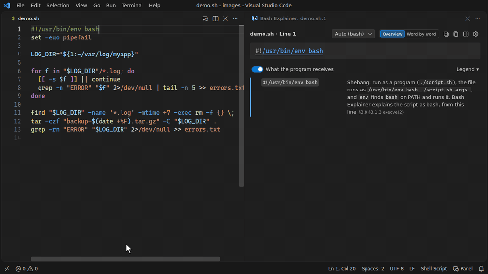
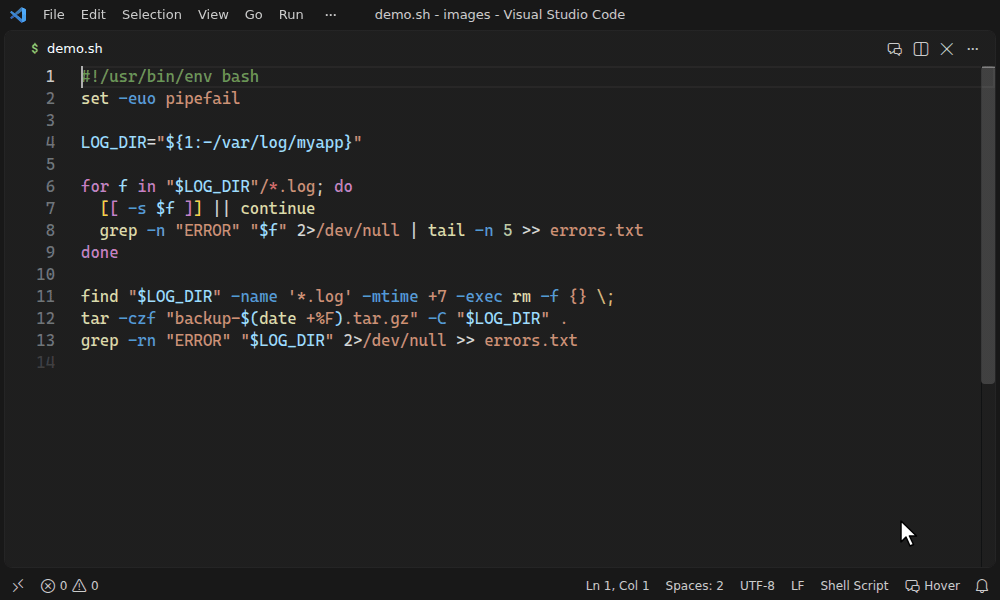
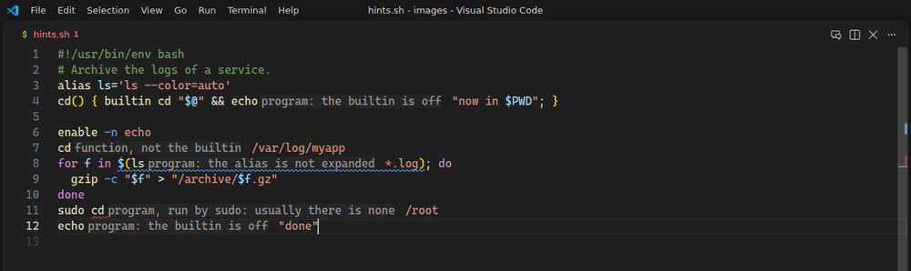

# VS Code で使う

[ユーザーガイド](README.md) · [English](../vscode.md) · 日本語

このページでは、VS Code の拡張機能のインストール方法、解説の3つの表示方法、パネル、コマンドを説明します。すぐに始めるには、README の [クイックスタート](../../../README.ja.md#クイックスタート) を参照してください。

## インストール

- **Marketplace:** [shun-fujioka.bash-explainer](https://marketplace.visualstudio.com/items?itemName=shun-fujioka.bash-explainer)
- **VS Code の中から:** 拡張機能ビュー（`Ctrl+Shift+X` / `Cmd+Shift+X`）で *Bash Explainer* を検索します。またはクイックオープン（`Ctrl+P` / `Cmd+P`）で `ext install shun-fujioka.bash-explainer` を実行します。
- **コマンドライン:** `code --install-extension shun-fujioka.bash-explainer`
- **VSCodium など Open VSX を使うエディタ:** [open-vsx.org/extension/shun-fujioka/bash-explainer](https://open-vsx.org/extension/shun-fujioka/bash-explainer)
- **VS Code for the Web:** [vscode.dev](https://vscode.dev) や [github.dev](https://github.dev)（GitHub のリポジトリで `.` を押す）でも動きます。

VS Code 1.85 以降が必要です。ネイティブの依存はなく（構文解析は JavaScript だけで動きます）、VS Code が動く環境ならどこでも動きます。

## 表示方法

| | 使い方 | 既定 |
| --- | --- | --- |
| **パネル** | カーソルに追従するサイドペイン。regex101 のように色分けし、具体例の入力を書き換えて結果を確かめられる | エディタのタイトルバーやホバーから開く |
| **ホバー** | 単語にマウスを乗せると、その部分の解説。カーソル行で `Ctrl+K Ctrl+E` を押すと行全体 | オン |
| **コマンド名のヒント** | 名前どおりのものを実行しないコマンド名（関数になっている `cd`、`sudo cd`）の後ろにヒントを表示 | オン |

ホバーとパネルは、ステータスバーの **Bash Explainer** をクリックするとオン/オフできます。コマンド名のヒントは `bashExplainer.hints.names` で切り替えます。

### パネル

パネルはカーソル行に追従します。ツリーの項目を指すと、エディタ側の該当箇所がハイライトされます。

### ホバー

単語・オプション・演算子にマウスを乗せると、それが何かをその場で解説します。意味、コマンド名の種類（予約語・ビルトイン・特殊ビルトイン・関数・エイリアス・プログラムのバッジ）と誰が実行するか、属するコマンドを表示します。隣の単語に移ると、その単語の解説に変わります。インデントの上では、行の構造を1行で表示します。

行全体の解説は、`Ctrl+K Ctrl+E`、右クリックメニューの **カーソル行の bash を解説**、またはホバーの **行全体** で開きます。コマンドごとに、引数とあわせて表示します。

Web 版のエディタでも同じカードを表示します（タッチ画面では表示しません）。Web 版では、`Ctrl+K Ctrl+E` と **行全体** で、行全体の解説をパネルに表示します。

### コマンド名のヒント

名前から想像するものを実行しないコマンド名の後ろに、薄い文字でヒントを表示します。ビルトインやプログラムを隠す関数やエイリアス、`enable -n` で無効にしたビルトイン、スクリプトの中で bash が展開しないエイリアス、`sudo cd`（`cd` というプログラムはない）、何も実行されない名前です。ヒントにマウスを乗せると、何が実行されるか、同じ名前でほかに何があるかを表示し、クリックするとその行をパネルで開きます。Web 版のエディタにも同じヒントが付きます。VS Code の `editor.inlayHints.enabled` で、インレイヒント全体をオン・オフ（または `Ctrl+Alt` を押している間だけ表示）できます。

カーソル行の行末に要約を表示するインライン表示は削除しました。`bashExplainer.inline.*` には効果がありません。

## パネル

パネルは regex101 と同じように使えます。

- **具体例を書き換える:** grep や `[[ =~ ]]` のテスト文字列、sed・awk・jq・perl・`sort`・`cut`・`xargs`・パイプライン全体の入力を書き換えると、出力がその場で更新されます。
- **一致した部分を見る:** 入力の中の一致部分を色付けし、キャプチャグループごとに、解説ツリーのグループと同じ色で示します。`\1`・`\2`… に入る文字列も一覧にします。
- **コマンド名が何かを見る:** どちらの深さでも、名前のあとのバッジが予約語・ビルトイン・特殊ビルトイン・関数・エイリアス・プログラムのどれかと、誰が実行するかを示します（`sudo echo` なら `sudo` が実行するプログラム）。同じ名前がほかのものでもあるときは、それが何で、どう書けば動くかを1行で示します（`time` はプログラム `/usr/bin/time` でもあり、`command time` で動く）。
- **どこまで読むかを選ぶ:** **深さ** か、パネルにフォーカスがあるときのキー **1**・**2** で選びます。選択はパネルが覚えています。**1 何をするか** は、行をひとことで言った文と行の問題（修正案をコピーできます）の下に、各コマンドが何をするかを示します。bash の手順で変わる単語には、その手順を1行で示します（`パラメータ展開 → 単語分割・グロブはしない（クォート内） → クォート除去`）。**2 bash がどう読むか** は、同じ行に同じ順序で、bash の予約語と演算子、単語とリダイレクトの部品を加えます。各行には、その部分が読み手ごとに何で、最後に誰が読むかを1行で示します（`引数 → -f の値 · tar が読む`）。その中の名前を押すかタップすると、その種類の説明とマニュアルの節が開きます。パイプは、何がどこへ渡るかを示します（`grep の標準出力 → sort の標準入力`）。展開される単語にはどれも bash の手順を順番どおりに示し、どの手順も働かない単語では1行に折りたたみます。`$( )` の中はサブシェルがもう一度解析し、`bash -c`・`eval`・trap に渡す文字列もスクリプトとしてもう一度読まれます。各コマンドは自分の引数を読み、単語の中の独自の言語（正規表現・sed スクリプトなど）も読みます。下に部品だけがある行は、折りたたんだ状態で始まります。
- **シェルや yq を切り替える:** ヘッダーで、そのファイルの対象シェルや yq の種類を切り替えると、解説と警告がすぐ変わります。
- **折りたたみ・コピー・早見表:** 解説ツリーを折りたたんだり、Markdown としてコピーしてレビューやドキュメントに貼ったりできます。展開・リダイレクト・条件式・変数・コマンドを検索できる早見表もあります。Web 版では、**折りたたむ**・**コピー**・タブの **早見表** が、解説の上の見出しで **深さ** と並びます。縦向きのスマートフォンでは、**コピー** はメニューにあり、**折りたたむ** は表示しません。タッチ画面では、早見表を開いても検索欄にフォーカスを移さないので、画面のキーボードは出ません。

## コマンド

| コマンド | ショートカット・呼び出し場所 |
| --- | --- |
| Bash Explainer: カーソル行の bash を解説 | `Ctrl+K Ctrl+E` / `Cmd+K Cmd+E` |
| Bash Explainer: bash の解説パネルを開く | エディタのタイトルバー、ホバー |
| Bash Explainer: ホバーとパネルの表示を切り替え | ステータスバー |
| Bash Explainer: 設定を開く | ホバー、パネル |
