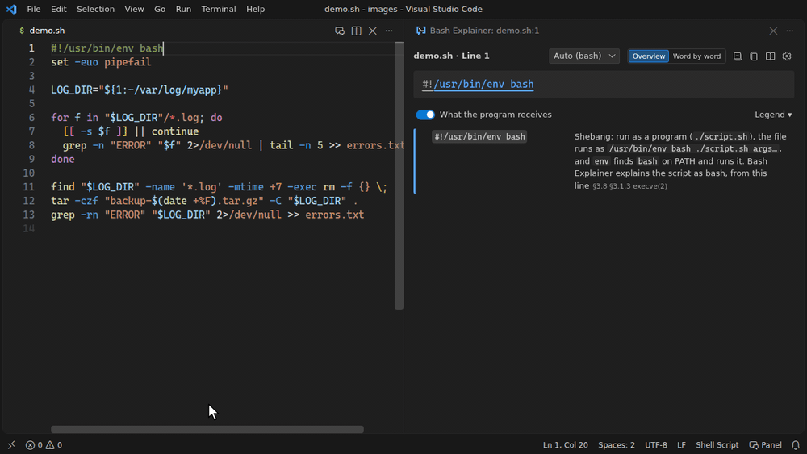
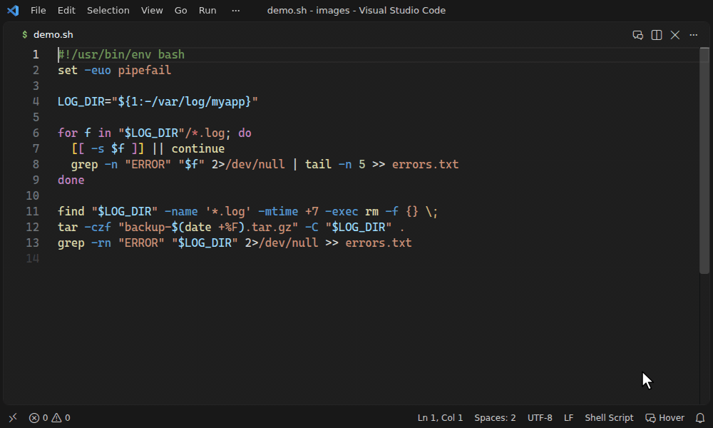
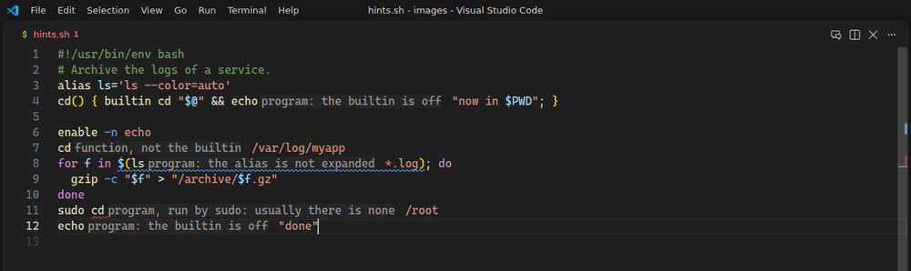

# In VS Code

[User guide](README.md) · English · [日本語](ja/vscode.md)

This page covers the extension in VS Code: the ways to install it, the three ways it shows explanations, the panel and the commands. To start at once, follow the [Quick start](../../README.md#quick-start) in the README.

## Installation

- **Marketplace:** [shun-fujioka.bash-explainer](https://marketplace.visualstudio.com/items?itemName=shun-fujioka.bash-explainer)
- **In VS Code:** open the Extensions view (`Ctrl+Shift+X` / `Cmd+Shift+X`) and search for *Bash Explainer*, or run `ext install shun-fujioka.bash-explainer` from Quick Open (`Ctrl+P` / `Cmd+P`).
- **Command line:** `code --install-extension shun-fujioka.bash-explainer`
- **VSCodium and other editors using Open VSX:** [open-vsx.org/extension/shun-fujioka/bash-explainer](https://open-vsx.org/extension/shun-fujioka/bash-explainer)
- **VS Code for the Web:** the extension also works on [vscode.dev](https://vscode.dev) and [github.dev](https://github.dev) (press `.` in a GitHub repository).

Requires VS Code 1.85 or later. There are no native dependencies (the parser is plain JavaScript), so it runs wherever VS Code runs.

## Ways to show explanations

| | How | Default |
| --- | --- | --- |
| **Panel** | A side pane that follows the cursor, colour-coded like regex101, where you can edit the example input and watch the result change | open it from the editor title bar or the hover |
| **Hover** | Hover a word for what it is; press `Ctrl+K Ctrl+E` for the whole cursor line | on |
| **Name hints** | A hint after a command name that does not run what it suggests (`cd` that is a function, `sudo cd`) | on |

Turn the hover and the panel on or off by clicking **Bash Explainer** in the status bar; the name hints with `bashExplainer.hints.names`.

### Panel

The panel follows the cursor line by line. Point at a part of the tree to highlight it in the editor.

### Hover

Hover a word, an option or an operator to see what it is, right where you are reading: its meaning, what kind of command a name is (a badge: keyword, builtin, special builtin, function, alias, program) and who runs it, and the command it belongs to. Moving to the next word explains that one. In the indentation, the hover shows the line's structure in one line.

For the whole line, press `Ctrl+K Ctrl+E`, choose **Explain Bash on Current Line** from the context menu, or click **Whole line** in the hover: one block per command, with its arguments.

The web page's editor shows the same cards (not on a touch screen); there, `Ctrl+K Ctrl+E` and **Whole line** explain the line in the panel.

### Name hints

A command name gets a faint hint after it where it does not run what a reader would guess: a function or an alias that hides a builtin or a program, a builtin turned off by `enable -n`, an alias that bash does not expand in a script, `sudo cd` (there is no `cd` program), a name that runs nothing. Hover the hint for what runs and what else the name is; click it to open the line in the panel. The web page shows the same hints in its editor. VS Code's `editor.inlayHints.enabled` turns all inlay hints on or off (or on while `Ctrl+Alt` is held).

The inline summary at the end of the cursor line was removed: `bashExplainer.inline.*` no longer has an effect.

## The panel

The panel works like regex101:

- **Edit the examples.** Change the input of a worked example — grep and `[[ =~ ]]` test strings, sed, awk, jq, perl, `sort`, `cut`, `xargs`, whole pipelines — and the output updates as you type.
- **See what matched.** Matches are highlighted in the input, each capture group in its own colour, the same colour as the group in the explanation; a table shows what `\1`, `\2`, … captured.
- **See what each command name is.** At both depths a badge after the name says keyword, builtin, special builtin, function, alias or program, and who runs it (`sudo echo`: the program, run by `sudo`). A name that is also something else gets a line saying what, and the code that runs it (`time` is also the program `/usr/bin/time`: `command time`).
- **Choose how deep to read** with **Depth**, or the keys **1** and **2** when the focus is in the panel; it remembers the depth. **1 What it does** says what each command does, under one sentence for the line and its problems, each with a fix to copy; a word that a step of bash changes shows the steps in one line (`parameter expansion → no word splitting or globbing (quoted) → quote removal`). **2 How bash reads it** adds, to the same rows and in the same order, bash's own reserved words and operators, and the parts of each word and redirection. Each row gets one line that says what the part is to each reader and who reads it (`argument → value of -f · tar reads it`); press or tap a name on it to read what that kind is, with its sections in the manual. A pipe says what goes where (`stdout of grep → stdin of sort`). Every word that expands shows bash's steps in bash's order; where no step acts, they fold to one line. A subshell parses the text of each `$( )` again, and the string of `bash -c`, `eval` or a trap is read as a script again; each command reads its own arguments, and some words hold a language of their own (a regex, a sed script). Rows with only such parts under them start folded.
- **See what each program receives** with the switch under the line box, or the key **W**: on by default, it shows under each command its words after bash's expansions, tints those received as written, and marks what bash handles itself. A quiet mark says what is not portable to sh; **Key** lists the marks on screen.
- **Switch the shell or yq** for the current file from the header, and see the explanation and warnings change.
- **Fold** the explanation tree, **copy** it as Markdown for a review or a document, and open the searchable **quick reference** of expansions, redirections, tests, variables and commands. On the web page, **Collapse**, **Copy** and the tab **Reference** are in the explanation's own header, beside **Depth**; on a phone held upright, **Copy** is in the menu and **Collapse** is left out. The quick reference does not move the focus to its search field on a touch screen, so the on-screen keyboard stays down.

## Commands

| Command | Shortcut / where |
| --- | --- |
| Bash Explainer: Explain Bash on Current Line | `Ctrl+K Ctrl+E` / `Cmd+K Cmd+E` |
| Bash Explainer: Open Bash Explanation Panel | the editor title bar, the hover |
| Bash Explainer: Turn Hover and Panel On or Off | the status bar item |
| Bash Explainer: Open Settings | the hover and the panel |
